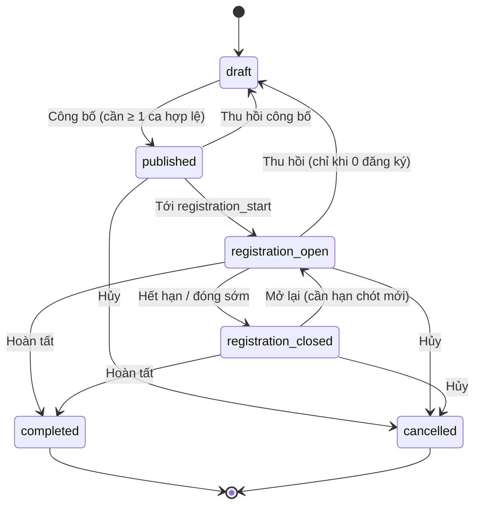
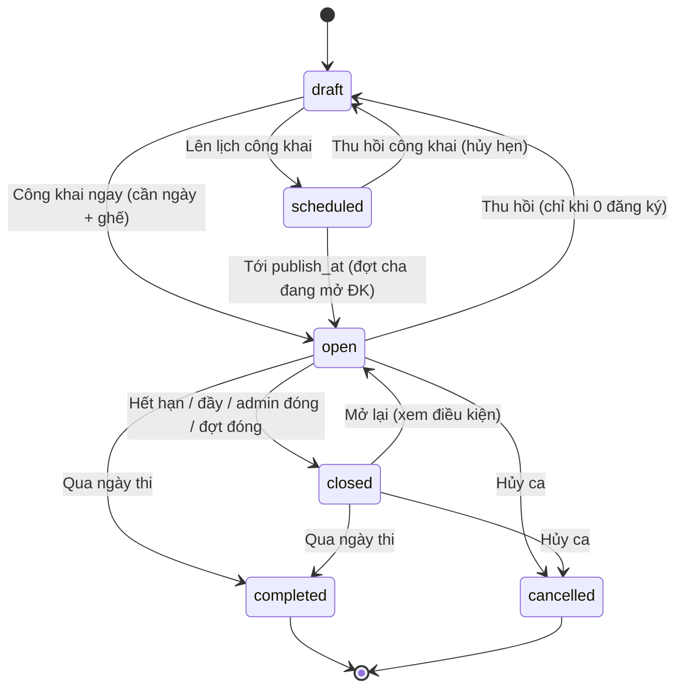
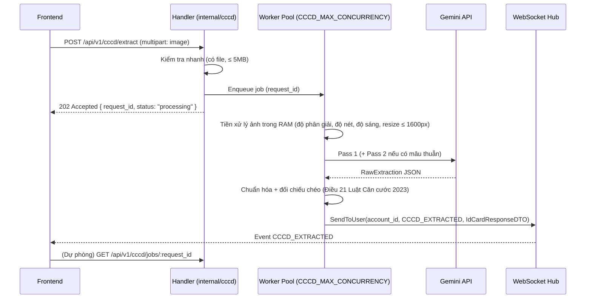

# 📘 API Documentation — HSK Vinh University Registration System

> **Base URL:** `http://<host>:<port>/api/v1`
> **Content-Type:** `application/json`
> **Ngôn ngữ lỗi:** Tiếng Việt (tất cả thông báo lỗi trả về bằng Tiếng Việt)
> **Phiên bản:** v1.2.8
> **Cập nhật lần cuối:** 2026-11-08

## Changelog

### v1.2.8 (2026-11-08)
- 🪪 **Hỗ trợ đồng thời CMND 9 số (cũ) & CCCD 12 số (mới) + Pipeline OCR Auto-Fill Thời gian thực**:
  - **Chuẩn hóa định dạng Mã định danh (`^(\d{9}|\d{12})$`)**: Toàn bộ các luồng Đăng ký (`POST /api/v1/auth/register`), Đăng nhập (`POST /api/v1/auth/login`), Tạo tài khoản nhân sự (`POST /api/v1/admin/staff-accounts`) và Hồ sơ giấy tờ tùy thân đều chấp nhận **đúng 9 chữ số (CMND cũ)** hoặc **12 chữ số (CCCD gắn chip)** thông qua custom validator tag `cccd_or_cmnd`. Từ chối sớm (HTTP 400) mọi chuỗi số có độ dài 10, 11 hoặc khác 9/12 chữ số.
  - **Fast-Path Ingestion (`POST /api/v1/cccd/upload` → `202 Accepted` trong < 50ms)**: Kiểm tra nhanh định dạng ảnh (`.jpg`, `.jpeg`, `.png`, ≤ 5MB), lưu file tạm và đẩy tác vụ vào `worker.WorkerPool` kèm `task_id` (UUID v4).
  - **Real-Time WebSocket Delivery (`ocr_progress`, `ocr_completed`, `ocr_failed`)**: Worker nền phát tiến trình qua kênh Redis Pub/Sub `cccd:ocr_events` (`QUEUED` → `PROCESSING` → `COMPLETED`/`FAILED`), chuẩn hóa `id_number` (9 hoặc 12 số), `full_name` (in hoa), `dob` (`DD/MM/YYYY`), `address` và tự động dọn dẹp file ảnh tạm sau khi xử lý xong. Tuyệt đối **không sử dụng sinh trắc học/nhận diện khuôn mặt** trong luồng OCR thẻ.

### v1.2.7 (2026-11-07)
- 🪪 **Module CCCD OCR (`internal/cccd`) — Trích xuất & Đối chiếu chéo Giấy tờ tùy thân bằng AI**:
  - **Hỗ trợ 7 loại/mặt giấy tờ Việt Nam**: CMND 9 số (trước/sau), CMND 12 số (trước/sau), CCCD gắn chip 2014 (trước/sau) và Thẻ Căn cước mới 2024 theo Luật Căn cước 2023 (trước/sau).
  - **Cơ chế xử lý bất đồng bộ (`POST /api/v1/cccd/extract` → `202 Accepted`)**: Trả ngay `request_id` để tránh vướng `WriteTimeout: 15s`, chạy qua Worker Pool (`CCCD_MAX_CONCURRENCY`), đẩy kết quả tức thì qua WebSocket event `CCCD_EXTRACTED` và hỗ trợ polling dự phòng tại `GET /api/v1/cccd/jobs/:id` (TTL 10 phút).
  - **Pipeline 2-Pass & Kiểm tra chéo (Điều 21 Luật Căn cước 2023)**: Tiền xử lý ảnh trong RAM (độ phân giải, độ nét, độ sáng, resize ≤ 1600px), chuẩn hóa văn bản/số nhầm lẫn OCR (`O→0`, `I→1`, `S→5`…), đối chiếu mã tỉnh (63 tỉnh/thành), chữ số thứ 4 (giới tính + thế kỷ sinh), 2 chữ số năm sinh, mốc hết hạn 14/25/40/60 tuổi; tự động chạy Pass 2 với `hints` khi phát hiện mâu thuẫn chéo.
  - **Kiến trúc chuẩn `CLAUDE.md`**: Tách bạch đầy đủ `handler.go`, `service.go`, `mapper.go`, `route.go`, `dto/request/`, `dto/response/`, `entities/`, `enum/` và bổ sung helper `utils.Accepted`.

### v1.2.6 (2026-11-05)
- 🔔 **Hệ thống Thông báo Thời gian thực (Real-Time Notification) & Bảo mật/Chịu tải WebSocket Hub**:
  - **Handshake an toàn không lộ JWT trên URL (`POST /api/v1/ws/ticket`)**: Cấp vé dùng 1 lần (One-Time Ticket, TTL 30 giây) để mở kết nối `ws://<host>/ws?ticket=<ticket>` (hoặc xác thực qua frame đầu tiên `{"type":"auth","token":"<jwt>"}` trong 5 giây). Chặn hoàn toàn việc truyền `?token=<jwt>` trên URL với `HTTP 401 Unauthorized` nhằm ngăn chặn rò rỉ JWT trong log proxy/reverse-proxy.
  - **Định tuyến mục tiêu & Giới hạn đa tab (`map[account_id][]*Client`)**: Hỗ trợ tối đa **5 kết nối đồng thời/user**; khi mở tab thứ 6, kết nối cũ nhất bị đóng tự động với mã `4002`. Các sự kiện cá nhân (`NOTIFICATION_PAYLOAD`, `notification_read`, `account_updated`) chỉ gửi đích danh tới các kết nối của `account_id` tương ứng.
  - **Mã đóng kết nối tùy chỉnh (Custom Close Codes `4001`, `4002`, `4003`)**: Tự động đóng kết nối với mã `4001` khi JWT hết hạn (để Frontend thực hiện silent refresh + xin vé mới + reconnect); ngắt tức thì toàn bộ kết nối của `account_id` với mã `4003` khi người dùng đăng xuất hoặc bị Admin vô hiệu hóa tài khoản.
  - **Chống tràn bộ đệm & Bão Broadcast**: Giới hạn kênh gửi `256` tin nhắn/client (tự động ngắt client chậm) và gộp/debounce các sự kiện tần suất cao (`seat_updated`) trong cửa sổ `250ms`.
  - **Đồng bộ tin nhắn bị lỡ & Đồng bộ trạng thái đọc đa tab**: Bổ sung `GET /api/v1/notifications?after_id=<max_local_id>` khi kết nối lại và phát sự kiện `notification_read` qua WebSocket khi gọi `PATCH /api/v1/notifications/:id/read`.

### v1.2.5 (2026-11-03)
- ⚡ **Giải quyết Deadlock State Machine & Top-Down Transactional Cascade**:
  - Triệt tiêu hoàn toàn vòng lặp bế tắc (circular deadlock) giữa Đợt thi cha (`exam_periods`) và Ca thi con (`exam_sessions`):
    - Sửa định nghĩa `valid_session_count` trong `periodMetrics`: tính các ca thi con đang ở trạng thái `draft` nhưng đã hoàn thiện cấu hình (`date`, `capacity > 0`, `registration_deadline`) là ca thi hợp lệ để công bố đợt thi cha.
    - Triển khai **Top-Down Transactional Cascade (ACID)** trong `POST /api/v1/admin/exam-periods/:id/publish`: Trong duy nhất một transaction, khi công bố đợt thi cha, tự động cascade cập nhật toàn bộ các ca thi con hợp lệ thuộc đợt từ `draft` sang `open` (hoặc `scheduled` nếu có hẹn giờ `publish_at` trong tương lai), xóa cache Redis đồng bộ.

### v1.2.4 (2026-10-28)
- 🔄 **Viết lại toàn bộ State Machine của module Exam** theo chuẩn nghiệp vụ mới:
  - **Đợt thi:** `draft → published → registration_open → registration_closed → completed`, nhánh `cancelled`. Loại bỏ trạng thái `rescheduled` — dời lịch **không** đổi trạng thái mà chỉ ghi `original_date`, tăng `reschedule_count` và cascade ngày của ca con.
  - **Ca thi:** `draft → scheduled → open → closed → completed`, nhánh `cancelled`. Thêm trường `closed_reason` (`manual`, `full`, `deadline`, `period_closed`) để phân biệt "Đã đóng" và "Đã hết hạn" trên cùng một trạng thái `closed`.
  - **Gộp trạng thái:** `exam_session_publication_status` bị loại bỏ hoàn toàn; các giá trị `draft`/`scheduled`/`published` được hợp nhất vào `exam_session_status` (`published` → `open`). Response trả thêm `stored_status` bên cạnh `status`.
  - **Trạng thái hiệu lực (effective status):** backend luôn tính lại trạng thái từ `now()`, hạn đăng ký, ngày thi, `publish_at` và trạng thái hiệu lực của đợt cha — không tin cột đã lưu. Worker nền chỉ đồng bộ cột đã lưu để hiển thị (`SyncStoredStatuses`).
  - **Guard dùng chung:** mọi endpoint thay đổi trạng thái trả **HTTP 409** kèm `code: "INVALID_STATE_TRANSITION"` và lý do tiếng Việt khi hành động không hợp lệ. Mọi response đợt thi / ca thi kèm `available_actions` để FE ẩn/hiện nút.
  - **Cascade trong một transaction:** đóng đăng ký đợt → ca `open` thành `closed` + `period_closed`, ca `scheduled` bị hủy hẹn về `draft`; mở lại đợt → chỉ ca `period_closed` quay về `open`; hủy đợt → mọi ca `cancelled` + mỗi đăng ký chọn `refund` hoặc `transfer`; dời lịch đợt → không đổi trạng thái.
  - **Đặt chỗ an toàn:** `fn_book_exam_seat` và `fn_transfer_registration` cùng gọi `fn_assert_session_accepts_registration`, hàm này khóa dòng ca thi bằng `SELECT ... FOR SHARE` và kiểm tra trạng thái hiệu lực, hạn chót, sĩ số, trùng lặp — đóng đăng ký ghi vào cùng dòng nên tuần tự hóa với thao tác đặt chỗ.
  - **API mới:** `publish`, `schedule-publish`, `unpublish`, `reopen-registration`, `capacity`, `DELETE /:id/draft`, `complete`, `cancel` cho đợt thi và ca thi (xem mục [4](#4-module-exam-kỳ-thi)). Endpoint `PATCH /admin/exam-sessions/:id/publication-status` đã bị xóa.

### v1.2.3 (2026-10-24)
- 🚀 **Quản lý Đợt thi (Exam Period) & Nhân bản Kỳ thi định kỳ (Duplicate Exam Period)**:
  - Triển khai mô hình phân cấp quản lý 2 tầng: **Đợt thi (`exam_periods`)** chứa nhiều **Ca thi (`exam_sessions`)**.
  - **Nhân bản đợt thi (`POST /api/v1/admin/exam-periods/:id/duplicate`)**: Nhân bản toàn bộ cấu hình kỳ thi (phòng thi, lệ phí, loại chứng chỉ HSK, ca sáng/chiều, sức chứa...) từ đợt thi trước đó trong **duy nhất 1 database transaction (ACID)**. Đợt thi mới và toàn bộ ca thi con được khởi tạo ở trạng thái `draft`, đặt ngày thi và hạn đăng ký về `NULL` (buộc quản trị viên phải nhập ngày thi mới, triệt tiêu nguy cơ phát hành nhầm ca thi với ngày cũ), tuyệt đối **KHÔNG sao chép hồ sơ đăng ký hoặc thí sinh** (0 registrations/candidates copied).
  - **Ràng buộc chỉnh sửa đợt thi (`PUT /api/v1/admin/exam-periods/:id`)**: Chỉ cho phép chỉnh sửa tự do không giới hạn khi đợt thi ở trạng thái `draft`. Khi đợt thi đã chuyển sang `published` hoặc `registration_open`: chỉ cho phép chỉnh sửa các trường an toàn (`name`, `description`, `instructions`). Mọi hành vi cố tình sửa ngày thi (`start_date`, `end_date`, `registration_deadline`) bị chặn ngay với HTTP 409 Conflict và bắt buộc chuyển sang quy trình Dời lịch thi (`Reschedule`).
  - **Dời lịch thi cấp đợt thi (`POST /api/v1/admin/exam-periods/:id/reschedule`)**: Hỗ trợ xử lý bất khả kháng (thiên tai, dịch bệnh). Cập nhật cascade đồng bộ ngày thi và hạn nộp cho toàn bộ ca thi con thuộc đợt thi; **giữ nguyên toàn bộ hồ sơ đăng ký của thí sinh**; tự động gửi thông báo hàng loạt (bulk notifications) cho tất cả thí sinh đã đăng ký; bắt buộc ghi nhận lý do dời lịch vào hệ thống nhật ký kiểm toán (Audit Log).
  - **Đóng đăng ký sớm (`close-registration`)**: Cho phép quản trị viên chủ động đóng đăng ký thủ công trước hạn chót khi các địa điểm thi đã kín chỗ, áp dụng linh hoạt ở cả cấp Đợt thi (`POST /api/v1/admin/exam-periods/:id/close-registration`) và cấp Ca thi đơn lẻ (`POST /api/v1/admin/exam-sessions/:id/close-registration`).

### v1.2.2 (2026-10-17)
- 🚀 **Tối ưu hóa Docker Image & Chuẩn đóng gói Container (< 100MB)**:
  - Tối ưu kích thước Docker Image API từ mức phình to >200MB xuống còn **~22.3MB content transfer** và **51MB disk usage** (kích thước binary Go sau nén chỉ còn **18.1MB**).
  - Tích hợp công cụ nén binary thực thi `upx --best --lzma` trong Dockerfile multi-stage build.
  - Tối ưu hóa `.dockerignore`: Loại bỏ triệt để file rác, binary cục bộ (`bin/api`), `secrets/`, `migrations/`, `.git/` để thu nhỏ build context từ hàng chục MB xuống còn vài chục KB.
  - Hỗ trợ biên dịch Multi-Architecture (`linux/amd64` và `linux/arm64` cho macOS Apple Silicon) qua biến build `TARGETARCH`.
  - Bổ sung cấu hình giới hạn dung lượng log (`json-file`, `max-size: 10m`, `max-file: 3`) cho toàn bộ dịch vụ trong `docker-compose.yml` chống phình ổ đĩa.
- ⚡ **Tích hợp Dịch vụ Bộ nhớ đệm Redis với Cơ chế Phòng thủ (Defensive Redis Cache Architecture)**:
  - Triển khai mô hình **Cache-Aside** cho các module cốt lõi: Ca thi (`exam`), Hồ sơ thí sinh (`candidate`), Địa điểm (`location`), và Kết quả thi (`result`).
  - **Chống Cache Breakdown (Stampede)**: Sử dụng kỹ thuật `singleflight.Group` triệt tiêu trùng lặp tính toán đồng thời trên cùng một tiến trình Go.
  - **Khởi động nguội đa phiên bản (Multi-Instance Cold Start)**: Triển khai khóa phân tán Redis Distributed Lock (`SET NX PX` kết hợp giải phóng an toàn bằng mã Lua atomics).
  - **Chống Cache Avalanche**: Bổ sung độ trễ ngẫu nhiên Dynamic TTL Jitter (±10% mặc định, ±35% cho ca thi được phát hành đồng loạt).
  - **Chống Cache Penetration**: Caching bản ghi rỗng Sentinel (`__HSK_NOT_FOUND__`) TTL 1 phút cho các truy vấn tra cứu công khai không tồn tại ID.
  - **Graceful Fallback Mode**: Thiết lập timeout ngắn (`DialTimeout: 1s`, `Read/WriteTimeout: 200ms`). Khi Redis gián đoạn, hệ thống tự động fallback trực tiếp xuống cơ sở dữ liệu PostgreSQL mà không gây lỗi HTTP 500 cho ứng dụng.
  - **Bộ API Xóa & Làm mới Cache linh hoạt**: Cung cấp các endpoint chuyên biệt cho Admin và Thí sinh để xóa cache tức thì theo từng phân hệ hoặc xóa toàn bộ hệ thống (`hsk:*`).

### v1.2.0 (2026-10-14)
- ✨ Thêm tự động kiểm tra ảnh chân dung bằng Google Cloud Vision API khi upload giấy tờ tùy thân
- 📝 Validation ảnh chân dung bao gồm: URL hợp lệ, khuôn mặt, chất lượng ảnh, góc chụp, nền trắng, nội dung an toàn
- 🎯 Ảnh hợp lệ tự động được `verified`, ảnh không hợp lệ tự động bị `rejected` với lý do cụ thể
- 🔄 Graceful degradation: nếu Vision API không khả dụng, giấy tờ giữ `pending` để admin kiểm tra thủ công
- 🐛 **v1.2.1 (2026-10-14)**: 
  - Chặn ngay lập tức hành động upload khi ảnh chân dung không đạt yêu cầu: trả về lỗi **HTTP 400 Bad Request** thay vì lưu hồ sơ rồi trả 201 Created. Giúp Front-end không còn hiển thị nhầm thông báo "Upload thành công".
  - Phân tích màu nền thực tế (pixel border analysis) kiểm tra nền trắng chuẩn xác.
  - Tích hợp kiểm tra kính qua Object Localization và Label Detection (`eyewear`, `glasses`, `sunglasses`) kết hợp Headwear Likelihood.
  - Quét toàn bộ lỗi và trả về danh sách chi tiết lý do vi phạm bằng tiếng Việt.

---

## Mục Lục

- [1. Quy ước chung](#1-quy-ước-chung)
- [2. Module Auth (Xác thực)](#2-module-auth-xác-thực)
- [3. Module Candidate (Hồ sơ thí sinh)](#3-module-candidate-hồ-sơ-thí-sinh)
- [4. Module Exam (Kỳ thi)](#4-module-exam-kỳ-thi)
- [5. Module Registration (Đăng ký thi)](#5-module-registration-đăng-ký-thi)
- [6. Module Payment (Thanh toán)](#6-module-payment-thanh-toán)
- [7. Module Result (Kết quả thi)](#7-module-result-kết-quả-thi)
- [8. Module Certificate (Chứng chỉ)](#8-module-certificate-chứng-chỉ)
- [9. Module Notification (Thông báo)](#9-module-notification-thông-báo)
- [10. Module Location (Địa điểm)](#10-module-location-địa-điểm)
- [11. Module Audit (Nhật ký hệ thống)](#11-module-audit-nhật-ký-hệ-thống)
- [12. Bảng Enum tham chiếu](#12-bảng-enum-tham-chiếu)
- [13. State Machines (Luồng trạng thái)](#13-state-machines-luồng-trạng-thái)
- [14. WebSocket Real-time Events](#14-websocket-real-time-events)
- [15. Module Dashboard (Bảng điều khiển quản trị)](#15-module-dashboard-bảng-điều-khiển-quản-trị)
- [16. Chuẩn đóng gói Container & Tối ưu hóa Dung lượng Docker](#16-chuẩn-đóng-gói-container--tối-ưu-hóa-dung-lượng-docker)
- [17. Kiến trúc Bộ nhớ đệm Redis & Cơ chế Phòng thủ (Redis Defensive Caching)](#17-kiến-trúc-bộ-nhớ-đệm-redis--cơ-chế-phòng-thủ-redis-defensive-caching)
- [18. Real-Time Session Invalidation, WebSocket Event Payloads & Registration State Machine](#18-real-time-session-invalidation-websocket-event-payloads--registration-state-machine)
- [19. Module CCCD OCR (Trích xuất & Xác thực CCCD/CMND bằng AI)](#19-module-cccd-ocr-trích-xuất--xác-thực-cccdcmnd-bằng-ai)

---

## 1. Quy ước chung

### 1.1. Response Envelope (Bao bọc phản hồi)

**Tất cả** các endpoint đều tuân theo cùng một cấu trúc response.

#### ✅ Thành công (HTTP 2xx)

```json
{
  "success": true,
  "data": <payload>,
  "error": null,
  "meta": null
}
```

Với **phân trang** (pagination):

```json
{
  "success": true,
  "data": [ ... ],
  "error": null,
  "meta": {
    "page": 1,
    "per_page": 20,
    "total_items": 150,
    "total_pages": 8
  }
}
```

#### ❌ Lỗi (HTTP 4xx, 5xx)

```json
{
  "statusCode": 400,
  "timestamp": "2026-09-07T10:30:00+07:00",
  "path": "/api/v1/auth/register",
  "msg": "Dữ liệu yêu cầu không hợp lệ"
}
```

| Field | Kiểu | Mô tả |
|---|---|---|
| `statusCode` | `integer` | HTTP status code |
| `timestamp` | `string` | Thời điểm lỗi, format ISO 8601 (`YYYY-MM-DDTHH:mm:ss+07:00`) |
| `path` | `string` | Đường dẫn API đã gọi |
| `code` | `string` | Mã lỗi máy đọc được (tùy chọn). Hiện dùng `INVALID_STATE_TRANSITION` cho module Exam |
| `msg` | `string` | Thông báo lỗi (bằng Tiếng Việt) |

> `code` chỉ xuất hiện với các lỗi có mã nghiệp vụ. Module Exam trả
> `409` + `code: "INVALID_STATE_TRANSITION"` khi hành động không hợp lệ với trạng
> thái hiệu lực hiện tại của đợt thi / ca thi (xem [4.5](#45-trạng-thái--hành-động-state-machine)).

### 1.2. Xác thực (Authentication)

- **Cơ chế:** JWT (JSON Web Token), HMAC-SHA256
- **Access Token TTL:** 24 giờ
- **Refresh Token TTL:** 168 giờ (7 ngày)
- **Header:** `Authorization: Bearer <access_token>`

**Token Claims:**

| Claim | Kiểu | Mô tả |
|---|---|---|
| `sub` | `int64` | Account ID |
| `user_id` | `int64` | Account ID |
| `user_role` | `string` | Role code (`admin`, `candidate`) |
| `exp` | `int64` | Thời điểm hết hạn (Unix timestamp) |
| `iat` | `int64` | Thời điểm phát hành (Unix timestamp) |

### 1.3. Các loại xác thực route

| Ký hiệu | Mô tả | Header cần gửi |
|---|---|---|
| 🔓 Public | Không cần token | Không |
| 🔐 JWT | Cần Access Token | `Authorization: Bearer <token>` |
| 🔐 JWT + Admin | Cần Access Token + role = `admin` | `Authorization: Bearer <token>` |

### 1.4. Quy ước chung về dữ liệu

| Quy ước | Mô tả | Ví dụ |
|---|---|---|
| **Tên field JSON** | `snake_case`, viết **thường** toàn bộ | `full_name`, `exam_session_id`, `created_at` |
| **ID** | Kiểu `integer` (int64) | `1`, `42`, `1001` |
| **Ngày (date only)** | Format `YYYY-MM-DD` | `"2026-12-25"` |
| **Ngày giờ (datetime)** | ISO 8601 / RFC 3339 | `"2026-09-07T10:30:00+07:00"` |
| **Boolean** | `true` / `false` | `true` |
| **Nullable fields** | Trả về `null` khi không có giá trị, hoặc không xuất hiện trong JSON (khi dùng `omitempty`) | `"phone": null` hoặc thiếu field `phone` |
| **Path param** | Luôn là `integer`, parse bằng `:id` hoặc `:registration_id` | `/me/registrations/42/cancel` |

### 1.5. Quy tắc mật khẩu (Password Policy)

Khi tạo hoặc thay đổi mật khẩu, **bắt buộc** tuân theo:

| Quy tắc | Mô tả |
|---|---|
| Tối thiểu 8 ký tự | `min=8` |
| Tối đa 72 ký tự | `max=72` (giới hạn bcrypt) |
| Chứa cả chữ và số | Phải có ít nhất 1 chữ cái + 1 số |
| Ít nhất 1 chữ hoa | `A-Z` |
| Ít nhất 1 ký tự đặc biệt | `!`, `@`, `#`, `$`, `%`, `^`, `&`, `*`, v.v. |

**Ví dụ hợp lệ:** `Abc@1234`, `MyPass!99`
**Ví dụ KHÔNG hợp lệ:** `12345678` (thiếu chữ), `abcdefgh` (thiếu số), `Abcdefg1` (thiếu ký tự đặc biệt)

### 1.6. Rate Limiting

- **Giới hạn:** 10 requests/giây, burst tối đa 20 (per IP)
- **Khi vượt quá:** HTTP `429 Too Many Requests`

```json
{
  "statusCode": 429,
  "timestamp": "2026-09-07T10:30:00+07:00",
  "path": "/api/v1/...",
  "msg": "Quá nhiều yêu cầu, vui lòng thử lại sau"
}
```

### 1.7. Mã HTTP phổ biến

| Code | Ý nghĩa | Khi nào xảy ra |
|---|---|---|
| `200` | OK | Request thành công |
| `201` | Created | Tạo mới tài nguyên thành công |
| `400` | Bad Request | Dữ liệu gửi lên không hợp lệ / thiếu trường bắt buộc |
| `401` | Unauthorized | Thiếu token / token hết hạn / sai thông tin đăng nhập |
| `403` | Forbidden | Không có quyền (ví dụ: candidate truy cập admin route) |
| `404` | Not Found | Không tìm thấy tài nguyên |
| `409` | Conflict | Xung đột dữ liệu (tài khoản đã tồn tại, ghế đã có người giữ, v.v.) |
| `429` | Too Many Requests | Vượt quá giới hạn rate limit |
| `500` | Internal Server Error | Lỗi hệ thống nội bộ |

---

## 2. Module Auth (Xác thực)

### 2.1. Đăng ký tài khoản

| | |
|---|---|
| **Endpoint** | `POST /api/v1/auth/register` |
| **Auth** | 🔓 Public |
| **Use-case** | Thí sinh tạo tài khoản mới để sử dụng hệ thống |

**Request Body:**

```json
{
  "cccd": "012345678901",
  "phone": "0901234567",
  "full_name": "Nguyễn Văn A",
  "email": "nguyenvana@email.com",
  "password": "Abc@1234"
}
```

| Field | Kiểu | Bắt buộc | Validate | Mô tả |
|---|---|---|---|---|
| `cccd` | `string` | ✅ | Đúng 9 chữ số (CMND cũ) hoặc 12 chữ số (CCCD mới), regex `^(\d{9}\|\d{12})$` | Số CMND / CCCD |
| `phone` | `string` | ✅ | Tối đa 20 ký tự | Số điện thoại |
| `full_name` | `string` | ✅ | Tối đa 150 ký tự | Họ và tên đầy đủ |
| `email` | `string` | ✅ | Email hợp lệ, tối đa 150 ký tự | Địa chỉ email |
| `password` | `string` | ✅ | Min 8, max 72, phải có chữ + số + chữ hoa + ký tự đặc biệt | Mật khẩu (xem [1.5](#15-quy-tắc-mật-khẩu-password-policy)) |

**Response (201 Created):**

```json
{
  "success": true,
  "data": {
    "account": {
      "id": 1,
      "username": "012345678901",
      "full_name": "Nguyễn Văn A",
      "email": "nguyenvana@email.com",
      "phone": "0901234567",
      "status": "active",
      "role_id": 2,
      "created_at": "2026-09-07T10:30:00+07:00",
      "updated_at": "2026-09-07T10:30:00+07:00"
    },
    "message": "Tài khoản đã được tạo thành công."
  },
  "error": null,
  "meta": null
}
```

**Lỗi có thể xảy ra:**

| Code | Thông báo | Nguyên nhân |
|---|---|---|
| `400` | `"Dữ liệu yêu cầu không hợp lệ"` | JSON body sai format |
| `400` | `"Số CMND/CCCD không hợp lệ (phải bao gồm đúng 9 hoặc 12 chữ số)"` | Số CMND/CCCD không khớp `^(\d{9}\|\d{12})$` |
| `409` | `"Số CMND/CCCD này đã được đăng ký tài khoản"` / `"tài khoản đã tồn tại"` | CMND/CCCD hoặc email đã được đăng ký |

---

### 2.2. Đăng nhập

| | |
|---|---|
| **Endpoint** | `POST /api/v1/auth/login` |
| **Auth** | 🔓 Public |
| **Use-case** | Xác thực người dùng, nhận Access + Refresh Token |

**Request Body:**

```json
{
  "identifier": "012345678901",
  "password": "Abc@1234"
}
```

| Field | Kiểu | Bắt buộc | Validate | Mô tả |
|---|---|---|---|---|
| `identifier` | `string` | ✅ | Không rỗng; nếu chỉ chứa chữ số thì phải khớp `^(\d{9}\|\d{12})$` | Số CMND (9 số), CCCD (12 số) hoặc Email |
| `password` | `string` | ✅ | Không rỗng | Mật khẩu |

> **Lưu ý:** Server tự phát hiện `identifier` là CMND (9 số) / CCCD (12 số) hay Email dựa trên format. Nếu `identifier` chỉ chứa chữ số nhưng không phải 9 hoặc 12 số, server trả ngay `400 Bad Request` (`"Số CMND/CCCD đăng nhập phải bao gồm đúng 9 hoặc 12 chữ số"`).

**Request Headers (tự động gửi):**

| Header | Mô tả |
|---|---|
| `User-Agent` | Thông tin thiết bị (được lưu lại cho quản lý phiên) |

**Response (200 OK):**

```json
{
  "success": true,
  "data": {
    "access_token": "eyJhbGciOiJIUzI1NiIs...",
    "refresh_token": "eyJhbGciOiJIUzI1NiIs...",
    "expires_in": 86400,
    "must_change_password": false
  },
  "error": null,
  "meta": null
}
```

| Field | Kiểu | Mô tả |
|---|---|---|
| `access_token` | `string` | JWT access token (24h). Payload chứa `user_id` và `user_role` |
| `refresh_token` | `string` | JWT refresh token (7 ngày) |
| `expires_in` | `integer` | Thời gian sống của access token (giây) |
| `must_change_password` | `boolean` | `true` nếu là nhân viên lần đầu đăng nhập cần đổi mật khẩu tạm |

> **⚠️ Khi `must_change_password = true`:** Front-end phải redirect sang trang đổi mật khẩu bắt buộc (gọi API [2.4](#24-đổi-mật-khẩu-bắt-buộc-nhân-viên)).
>
> **🧭 Xử lý phân quyền (RBAC) trên Frontend:**
> Token JWT `access_token` chứa trường `user_role` (`admin`, `candidate`, `proctor`, `reviewer`). Frontend có thể dùng thư viện `jwt-decode` để giải mã token ngay phía client để lấy role, từ đó **điều hướng (redirect) user về đúng giao diện tương ứng**:
> - `admin`: Chuyển sang layout Dashboard Quản trị (quản lý ca thi, thí sinh, tài chính...).
> - `candidate`: Chuyển sang layout Thí sinh (xem thông tin cá nhân, đăng ký thi...).
> - `proctor` / `reviewer`: Chuyển sang layout Giám thị / Giám khảo.

**Lỗi có thể xảy ra:**

| Code | Thông báo | Nguyên nhân |
|---|---|---|
| `400` | `"Dữ liệu yêu cầu không hợp lệ"` | JSON body sai format |
| `401` | `"thông tin đăng nhập không chính xác"` | Sai mật khẩu HOẶC tài khoản không tồn tại (không phân biệt 2 trường hợp — bảo mật) |

---

### 2.3. Làm mới Token

| | |
|---|---|
| **Endpoint** | `POST /api/v1/auth/refresh` |
| **Auth** | 🔓 Public |
| **Use-case** | Lấy access token mới khi token cũ hết hạn |

**Request Body:**

```json
{
  "refresh_token": "eyJhbGciOiJIUzI1NiIs..."
}
```

| Field | Kiểu | Bắt buộc | Validate | Mô tả |
|---|---|---|---|---|
| `refresh_token` | `string` | ✅ | Không rỗng | Refresh token nhận từ đăng nhập |

**Response (200 OK):**

```json
{
  "success": true,
  "data": {
    "access_token": "eyJhbGciOiJIUzI1NiIs...",
    "refresh_token": "eyJhbGciOiJIUzI1NiIs...",
    "expires_in": 86400
  },
  "error": null,
  "meta": null
}
```

**Lỗi có thể xảy ra:**

| Code | Thông báo | Nguyên nhân |
|---|---|---|
| `400` | `"Dữ liệu yêu cầu không hợp lệ"` | JSON body sai format |
| `401` | `"Token không hợp lệ hoặc đã hết hạn"` | Refresh token hết hạn hoặc bị thu hồi |

---

### 2.4. Đổi mật khẩu bắt buộc (Nhân viên)

| | |
|---|---|
| **Endpoint** | `POST /api/v1/auth/force-password-change` |
| **Auth** | 🔓 Public |
| **Use-case** | Nhân viên đổi mật khẩu tạm khi đăng nhập lần đầu |

**Request Body:**

```json
{
  "temp_token": "eyJhbGciOiJIUzI1NiIs...",
  "new_password": "NewPass@2026"
}
```

| Field | Kiểu | Bắt buộc | Validate | Mô tả |
|---|---|---|---|---|
| `temp_token` | `string` | ✅ | Không rỗng | Token tạm nhận từ lần đăng nhập đầu tiên |
| `new_password` | `string` | ✅ | Min 8, max 72 | Mật khẩu mới |

**Response (200 OK):**

```json
{
  "success": true,
  "data": {
    "message": "Đổi mật khẩu thành công, vui lòng đăng nhập lại"
  },
  "error": null,
  "meta": null
}
```

---

### 2.5. Đăng xuất (1 phiên)

| | |
|---|---|
| **Endpoint** | `POST /api/v1/auth/logout` |
| **Auth** | 🔐 JWT |
| **Use-case** | Đăng xuất khỏi thiết bị hiện tại |

**Request Body:**

```json
{
  "session_id": 15
}
```

| Field | Kiểu | Bắt buộc | Validate | Mô tả |
|---|---|---|---|---|
| `session_id` | `integer` | ✅ | Min 1 | ID phiên đăng nhập (lấy từ GET /me/sessions) |

**Response (200 OK):**

```json
{
  "success": true,
  "data": {
    "message": "Đăng xuất thành công"
  },
  "error": null,
  "meta": null
}
```

---

### 2.6. Đăng xuất tất cả thiết bị

| | |
|---|---|
| **Endpoint** | `POST /api/v1/auth/logout-all` |
| **Auth** | 🔐 JWT |
| **Use-case** | Đăng xuất khỏi tất cả thiết bị (xóa toàn bộ session) |

**Request Body:** Không cần (trống)

**Response (200 OK):**

```json
{
  "success": true,
  "data": {
    "message": "Đã đăng xuất khỏi tất cả thiết bị"
  },
  "error": null,
  "meta": null
}
```

---

### 2.7. Lấy thông tin tài khoản (Me)

| | |
|---|---|
| **Endpoint** | `GET /api/v1/me` |
| **Auth** | 🔐 JWT |
| **Use-case** | Lấy profile tài khoản đang đăng nhập |

**Request:** Không cần body/query.

**Response (200 OK):**

```json
{
  "success": true,
  "data": {
    "id": 1,
    "username": "012345678901",
    "full_name": "Nguyễn Văn A",
    "email": "nguyenvana@email.com",
    "phone": "0901234567",
    "status": "active",
    "role_id": 2,
    "created_at": "2026-09-07T10:30:00+07:00",
    "updated_at": "2026-09-07T10:30:00+07:00"
  },
  "error": null,
  "meta": null
}
```

**Response fields (AccountResponseDTO):**

| Field | Kiểu | Nullable | Mô tả |
|---|---|---|---|
| `id` | `integer` | ❌ | ID tài khoản |
| `username` | `string` | ❌ | Username (= CCCD) |
| `full_name` | `string` | ❌ | Họ tên |
| `email` | `string` | ❌ | Email |
| `phone` | `string` | ✅ | Số điện thoại (có thể `null` hoặc thiếu) |
| `status` | `string` | ❌ | Trạng thái: `active`, `locked`, `pending` |
| `role_id` | `integer` | ❌ | ID của role |
| `created_at` | `datetime` | ❌ | Ngày tạo |
| `updated_at` | `datetime` | ❌ | Ngày cập nhật |

---

### 2.8. Cập nhật thông tin tài khoản

| | |
|---|---|
| **Endpoint** | `PUT /api/v1/me` |
| **Auth** | 🔐 JWT |
| **Use-case** | Cập nhật họ tên, email, số điện thoại của tài khoản đang đăng nhập |

**Request Body (các trường đều tùy chọn, chỉ gửi các trường cần cập nhật):**

```json
{
  "full_name": "Nguyen Van A",
  "email": "newemail@example.com",
  "phone": "0987654321"
}
```

| Field | Kiểu | Bắt buộc | Validate | Mô tả |
|---|---|---|---|---|
| `full_name` | `string` | ❌ | Tối đa 100 ký tự | Họ tên mới |
| `email` | `string` | ❌ | Email hợp lệ, tối đa 150 ký tự | Email mới |
| `phone` | `string` | ❌ | Tối đa 20 ký tự | SĐT mới |

**Response (200 OK):** Trả về `AccountResponseDTO` (xem [2.7](#27-lấy-thông-tin-tài-khoản-me)).

---

### 2.9. Xóa tài khoản (Soft-delete)

| | |
|---|---|
| **Endpoint** | `DELETE /api/v1/me` |
| **Auth** | 🔐 JWT |
| **Use-case** | Người dùng tự vô hiệu hóa tài khoản |

**Request:** Không cần body.

**Response (200 OK):**

```json
{
  "success": true,
  "data": {
    "message": "Đã xóa tài khoản"
  },
  "error": null,
  "meta": null
}
```

---

### 2.10. Đổi mật khẩu

| | |
|---|---|
| **Endpoint** | `PATCH /api/v1/me/password` |
| **Auth** | 🔐 JWT |
| **Use-case** | Người dùng đang đăng nhập đổi mật khẩu |

**Request Body:**

```json
{
  "old_password": "Abc@1234",
  "new_password": "NewPass@2026"
}
```

| Field | Kiểu | Bắt buộc | Validate | Mô tả |
|---|---|---|---|---|
| `old_password` | `string` | ✅ | Không rỗng | Mật khẩu hiện tại |
| `new_password` | `string` | ✅ | Min 8, max 72 | Mật khẩu mới (xem [1.5](#15-quy-tắc-mật-khẩu-password-policy)) |

**Response (200 OK):**

```json
{
  "success": true,
  "data": {
    "message": "Đổi mật khẩu thành công"
  },
  "error": null,
  "meta": null
}
```

---

### 2.11. Danh sách phiên đăng nhập

| | |
|---|---|
| **Endpoint** | `GET /api/v1/me/sessions` |
| **Auth** | 🔐 JWT |
| **Use-case** | Xem danh sách các thiết bị đang đăng nhập |

**Response (200 OK):**

```json
{
  "success": true,
  "data": [
    {
      "id": 15,
      "device_info": "Mozilla/5.0 (Macintosh; Intel Mac OS X 10_15_7)",
      "ip_address": "192.168.1.100",
      "created_at": "2026-09-07T08:00:00+07:00",
      "expires_at": "2026-09-14T08:00:00+07:00"
    }
  ],
  "error": null,
  "meta": null
}
```

**Response fields (SessionResponseDTO):**

| Field | Kiểu | Nullable | Mô tả |
|---|---|---|---|
| `id` | `integer` | ❌ | ID phiên đăng nhập |
| `device_info` | `string` | ✅ | Thông tin thiết bị/trình duyệt |
| `ip_address` | `string` | ✅ | Địa chỉ IP |
| `created_at` | `datetime` | ❌ | Thời điểm đăng nhập |
| `expires_at` | `datetime` | ❌ | Thời điểm hết hạn phiên |

---

### 2.12. Xóa phiên đăng nhập cụ thể

| | |
|---|---|
| **Endpoint** | `DELETE /api/v1/me/sessions/:id` |
| **Auth** | 🔐 JWT |
| **Use-case** | Đăng xuất khỏi một thiết bị cụ thể |

**Path Params:**

| Param | Kiểu | Mô tả |
|---|---|---|
| `id` | `integer` | ID phiên đăng nhập |

**Response (200 OK):**

```json
{
  "success": true,
  "data": {
    "message": "Đã đăng xuất khỏi thiết bị"
  },
  "error": null,
  "meta": null
}
```

---

### 2.13. [Admin] Vô hiệu hóa / Xóa tài khoản & Khôi phục tài khoản

| | |
|---|---|
| **Endpoint** | `DELETE /api/v1/admin/delete-account/:id` (hoặc `POST /api/v1/admin/accounts/:id/deactivate`) |
| **Auth** | 🔐 JWT + Admin |
| **Use-case** | Admin vô hiệu hóa tài khoản thí sinh/người dùng kèm xác nhận danh tính, thu hồi toàn bộ phiên JWT tức thì và xử lý dây chuyền các đơn đăng ký thi |

**Path Params:**

| Param | Kiểu | Mô tả |
|---|---|---|
| `id` | `integer` | ID tài khoản cần vô hiệu hóa |

**Request Body:**

```json
{
  "confirm_account_id": 50,
  "confirm_identity": "040123456060",
  "reason": "Tài khoản trùng lặp theo yêu cầu xác minh",
  "paid_resolution": "block"
}
```

| Field | Kiểu | Bắt buộc | Validate | Mô tả |
|---|---|---|---|---|
| `confirm_account_id` | `integer` | ✅ | Khớp với `:id` | ID tài khoản xác nhận |
| `confirm_identity` | `string` | ✅ | Khớp với `full_name`, `doc_number` (số CCCD/Hộ chiếu), `username` hoặc `email` | Chuỗi xác nhận danh tính chống xóa nhầm |
| `reason` | `string` | ✅ | 5–500 ký tự | Lý do vô hiệu hóa (ghi vào `audit_logs`) |
| `paid_resolution` | `string` | ❌ | `block` (mặc định) hoặc `refund` | Cách xử lý nếu thí sinh có đơn đã thanh toán (`confirmed`) |

**Cơ chế xử lý dây chuyền (Registration & Session Cascade):**
1. **Phiên đăng nhập & JWT:** Thu hồi toàn bộ `auth_sessions` (`auth_session_revoked_at = NOW()`) và vô hiệu hóa ngay lập tức mọi JWT Access Token đang hoạt động của tài khoản qua bộ lọc `middleware.JWTAuth`.
2. **Đơn chưa thanh toán (`pending_payment`):** Tự động chuyển sang `cancelled` và giải phóng ghế `held -> available`.
3. **Đơn đã thanh toán (`confirmed`):**
   - Nếu `paid_resolution = "block"` (mặc định): Chặn thao tác với `HTTP 409 Conflict`.
   - Nếu `paid_resolution = "refund"`: Hủy đơn, giải phóng ghế `booked -> available` và chuyển trạng thái thanh toán sang `pending_refund`.

**Khôi phục tài khoản đã vô hiệu hóa (`POST /api/v1/admin/accounts/:id/reactivate`):**

```json
{
  "reason": "Khôi phục tài khoản sau khi xác minh bổ sung"
}
```

**Response (200 OK):**

```json
{
  "success": true,
  "data": {
    "message": "Đã vô hiệu hóa tài khoản và thu hồi toàn bộ phiên đăng nhập"
  },
  "error": null,
  "meta": null
}
```

---

### 2.14. [Admin] Tạo tài khoản nhân viên

| | |
|---|---|
| **Endpoint** | `POST /api/v1/admin/staff-accounts` |
| **Auth** | 🔐 JWT + Admin |
| **Use-case** | Admin tạo tài khoản cho nhân viên/cán bộ. Hệ thống trả về mật khẩu tạm |

**Request Body:**

```json
{
  "cccd": "034567890123",
  "full_name": "Trần Thị B",
  "email": "tranthib@dhv.edu.vn",
  "phone": "0912345678",
  "role_code": "admin"
}
```

| Field | Kiểu | Bắt buộc | Validate | Mô tả |
|---|---|---|---|---|
| `cccd` | `string` | ✅ | Đúng 12 ký tự, chỉ chứa số | Số CCCD |
| `full_name` | `string` | ✅ | Tối đa 150 ký tự | Họ và tên |
| `email` | `string` | ✅ | Email hợp lệ, tối đa 150 ký tự | Email |
| `phone` | `string` | ❌ | Tối đa 20 ký tự | Số điện thoại |
| `role_code` | `string` | ✅ | Không rỗng | Mã vai trò: `admin` hoặc `candidate` |

**Response (201 Created):**

```json
{
  "success": true,
  "data": {
    "account": { ... },
    "temp_password": "xK9#mP2q",
    "message": "Tài khoản nhân viên đã được tạo. Nhân viên phải đổi mật khẩu khi đăng nhập lần đầu."
  },
  "error": null,
  "meta": null
}
```

> **⚠️ Quan trọng:** `temp_password` chỉ xuất hiện **MỘT LẦN DUY NHẤT** trong response. Admin phải ghi lại và gửi cho nhân viên.

---

## 3. Module Candidate (Hồ sơ thí sinh)

> Tất cả endpoint hồ sơ, giấy tờ, upload, tra cứu và phê duyệt thí sinh đều thuộc cùng module/tag `Candidate`; không tách riêng nhóm admin hay upload thành module khác.

### 3.1. Tạo hồ sơ thí sinh

| | |
|---|---|
| **Endpoint** | `POST /api/v1/me/candidate-profile` |
| **Auth** | 🔐 JWT |
| **Use-case** | Thí sinh tạo hồ sơ cá nhân (sau khi đã đăng ký tài khoản) |

**Request Body:**

```json
{
  "full_name": "Nguyễn Văn A",
  "full_name_cn": "阮文A",
  "dob": "2000-05-15",
  "gender": "male",
  "ethnicity": "Kinh",
  "religion": "Không",
  "nationality": "Việt Nam",
  "chinese_study_years": 3
}
```

| Field | Kiểu | Bắt buộc | Validate | Mô tả |
|---|---|---|---|---|
| `full_name` | `string` | ✅ | Tối đa 150 ký tự | Họ tên đầy đủ |
| `full_name_cn` | `string` | ❌ | Tối đa 150 ký tự | Họ tên tiếng Trung |
| `dob` | `string` | ✅ | Format: `YYYY-MM-DD` | Ngày sinh |
| `gender` | `string` | ✅ | `male`, `female`, `other` | Giới tính |
| `ethnicity` | `string` | ❌ | Tối đa 50 ký tự | Dân tộc |
| `religion` | `string` | ❌ | Tối đa 50 ký tự | Tôn giáo |
| `nationality` | `string` | ❌ | Tối đa 50 ký tự | Quốc tịch |
| `chinese_study_years` | `integer` | ❌ | Min 0 | Số năm học tiếng Trung |

**Response (201 Created):**

```json
{
  "success": true,
  "data": {
    "id": 1,
    "account_id": 1,
    "full_name": "Nguyễn Văn A",
    "full_name_cn": "阮文A",
    "dob": "2000-05-15T00:00:00Z",
    "gender": "male",
    "ethnicity": "Kinh",
    "religion": "Không",
    "nationality": "Việt Nam",
    "chinese_study_years": 3
  },
  "error": null,
  "meta": null
}
```

**Response fields (CandidateResponseDTO):**

| Field | Kiểu | Nullable | Mô tả |
|---|---|---|---|
| `id` | `integer` | ❌ | ID hồ sơ thí sinh |
| `account_id` | `integer` | ❌ | ID tài khoản liên kết |
| `full_name` | `string` | ❌ | Họ tên |
| `full_name_cn` | `string` | ✅ | Họ tên tiếng Trung |
| `dob` | `datetime` | ❌ | Ngày sinh |
| `gender` | `string` | ❌ | Giới tính |
| `ethnicity` | `string` | ✅ | Dân tộc |
| `religion` | `string` | ✅ | Tôn giáo |
| `birthplace` | `string` | ✅ | Nơi sinh |
| `nationality` | `string` | ❌ | Quốc tịch |
| `mother_tongue` | `string` | ✅ | Tiếng mẹ đẻ |
| `chinese_study_years` | `integer` | ✅ | Số năm học tiếng Trung |

**Lỗi có thể xảy ra:**

| Code | Thông báo | Nguyên nhân |
|---|---|---|
| `409` | `"Hồ sơ thí sinh đã tồn tại"` | Tài khoản này đã có hồ sơ thí sinh |

---

### 3.2. Xem hồ sơ thí sinh (của tôi)

| | |
|---|---|
| **Endpoint** | `GET /api/v1/me/candidate-profile` |
| **Auth** | 🔐 JWT |
| **Use-case** | Thí sinh xem hồ sơ cá nhân |

**Response (200 OK):** Trả về `CandidateResponseDTO` (xem [3.1](#31-tạo-hồ-sơ-thí-sinh)).

---

### 3.3. Cập nhật hồ sơ thí sinh

| | |
|---|---|
| **Endpoint** | `PATCH /api/v1/me/candidate-profile` |
| **Auth** | 🔐 JWT |
| **Use-case** | Thí sinh cập nhật một phần hồ sơ (chỉ gửi các field cần sửa) |

**Request Body (partial update):**

```json
{
  "full_name": "Nguyễn Văn B",
  "full_name_cn": "阮文B",
  "chinese_study_years": 4
}
```

| Field | Kiểu | Bắt buộc | Validate | Mô tả |
|---|---|---|---|---|
| `full_name` | `string` | ❌ | Tối đa 150 ký tự | Họ tên |
| `full_name_cn` | `string` | ❌ | Tối đa 150 ký tự | Họ tên tiếng Trung |
| `ethnicity` | `string` | ❌ | Tối đa 50 ký tự | Dân tộc |
| `religion` | `string` | ❌ | Tối đa 50 ký tự | Tôn giáo |
| `nationality` | `string` | ❌ | Tối đa 50 ký tự | Quốc tịch |
| `chinese_study_years` | `integer` | ❌ | Min 0 | Số năm học tiếng Trung |

`full_name_cn` được lưu vào `candidates.candidate_full_name_cn` và trả lại trong
response dưới dạng `full_name_cn`. Tên field phải dùng đúng snake_case như trên.
Nếu không gửi field này trong PATCH thì giá trị cũ được giữ nguyên; nếu chưa có
dữ liệu, response trả về `null`.

Giá trị đúng cần gửi là chuỗi tên tiếng Trung, ví dụ `"full_name_cn": "潘文进"`.
Backend cũng tự loại bỏ một lớp dấu ngoặc kép dư thừa nếu client gửi nhầm
`"full_name_cn": "\"潘文进\""`, để dữ liệu lưu trong database vẫn là `潘文进`.

**Hướng dẫn tích hợp Front-end:** `full_name_cn` phải được gửi dưới dạng chuỗi
Unicode UTF-8 bình thường. Không gọi `JSON.stringify()` riêng cho giá trị này;
hãy truyền object trực tiếp cho `fetch`/Axios và để thư viện serialize request body.
Font `PingFang SC` chỉ là font hiển thị khi quản trị viên xem dữ liệu trong
DataGrip/macOS, không phải một phần của dữ liệu database và không cần cài đặt
font này ở Front-end.

> **⚠️ Lưu ý:** Không thể sửa hồ sơ khi đang có đăng ký thi `confirmed`. Sẽ trả lỗi `409`.

---

### 3.4. Upload giấy tờ tùy thân

| | |
|---|---|
| **Endpoint** | `POST /api/v1/me/candidate-profile/documents` |
| **Auth** | 🔐 JWT |
| **Use-case** | Thí sinh upload ảnh CCCD/Passport |

> **Luồng upload ảnh:** Front-end lấy chữ ký từ [3.5](#35-lấy-chữ-ký-upload), upload trực tiếp lên Cloudinary, rồi gửi URL ảnh về endpoint này.

**Request Body:**

```json
{
  "doc_type": "cccd",
  "doc_number": "012345678901",
  "issue_date": "2021-06-15",
  "issue_place": "Cục Cảnh sát QLHC về TTXH",
  "front_image_url": "https://res.cloudinary.com/.../front.jpg",
  "back_image_url": "https://res.cloudinary.com/.../back.jpg",
  "portrait_image_url": "https://res.cloudinary.com/.../portrait.jpg",
  "ward_id": 5,
  "address_detail": "123 Đường ABC, Phường XYZ"
}
```

| Field | Kiểu | Bắt buộc | Validate | Mô tả |
|---|---|---|---|---|
| `doc_type` | `string` | ✅ | `cccd` hoặc `passport` | Loại giấy tờ |
| `doc_number` | `string` | ✅ | Tối đa 30 ký tự | Số giấy tờ |
| `issue_date` | `string` | ✅ | Format: `YYYY-MM-DD` | Ngày cấp |
| `issue_place` | `string` | ✅ | Tối đa 150 ký tự | Nơi cấp |
| `front_image_url` | `string` | ✅ | URL hợp lệ | URL ảnh mặt trước |
| `back_image_url` | `string` | ❌ | URL hợp lệ | URL ảnh mặt sau |
| `portrait_image_url` | `string` | ✅ | URL hợp lệ | URL ảnh chân dung |
| `ward_id` | `integer` | ❌ | Min 1 | ID xã/phường |
| `address_detail` | `string` | ❌ | Tối đa 255 ký tự | Địa chỉ chi tiết |

**Response (201 Created):**

```json
{
  "success": true,
  "data": {
    "id": 1,
    "candidate_id": 1,
    "doc_type": "cccd",
    "doc_number": "012345678901",
    "issue_date": "2021-06-15T00:00:00Z",
    "issue_place": "Cục Cảnh sát QLHC về TTXH",
    "front_image_url": "https://res.cloudinary.com/.../front.jpg",
    "back_image_url": "https://res.cloudinary.com/.../back.jpg",
    "portrait_image_url": "https://res.cloudinary.com/.../portrait.jpg",
    "verification_status": "pending"
  },
  "error": null,
  "meta": null
}
```

**Response fields (DocumentResponseDTO):**

| Field | Kiểu | Nullable | Mô tả |
|---|---|---|---|
| `id` | `integer` | ❌ | ID giấy tờ |
| `candidate_id` | `integer` | ❌ | ID thí sinh |
| `doc_type` | `string` | ❌ | `cccd` hoặc `passport` |
| `doc_number` | `string` | ❌ | Số giấy tờ |
| `issue_date` | `datetime` | ❌ | Ngày cấp |
| `issue_place` | `string` | ❌ | Nơi cấp |
| `front_image_url` | `string` | ❌ | URL ảnh mặt trước |
| `back_image_url` | `string` | ✅ | URL ảnh mặt sau |
| `portrait_image_url` | `string` | ❌ | URL ảnh chân dung |
| `verification_status` | `string` | ❌ | `pending`, `verified`, `rejected` |
| `rejection_reason` | `string` | ✅ | Lý do từ chối (chỉ khi `rejected`) |
| `ward_id` | `integer` | ✅ | ID của Xã/Phường |
| `province_id` | `integer` | ✅ | ID của Tỉnh/Thành phố |
| `address_detail` | `string` | ✅ | Địa chỉ chi tiết |

> **🤖 Tự động kiểm tra ảnh chân dung:**
> 
> - Ảnh chân dung (`portrait_image_url`) sẽ được tự động kiểm tra bằng Google Cloud Vision API và bộ phân tích ảnh ngay khi upload.
> - **Nếu validation passes**: Lưu thông tin giấy tờ với `verification_status: "verified"` (HTTP 201 Created).
> - **Nếu validation fails**: **Chặn ngay lập tức** bằng lỗi **HTTP 400 Bad Request**, KHÔNG lưu bản ghi vào database. Response lỗi chuẩn:
>   ```json
>   {
>     "statusCode": 400,
>     "timestamp": "2026-10-14T14:30:00+07:00",
>     "path": "/api/v1/me/candidate-profile/documents",
>     "msg": "Ảnh chân dung không hợp lệ: <danh sách lý do vi phạm>"
>   }
>   ```
> - **Nếu Vision API không khả dụng hoặc lỗi hạ tầng**: Giữ nguyên cơ chế graceful degradation, lưu với trạng thái `pending` (HTTP 201 Created) để admin kiểm tra thủ công.
> 
> **Quy tắc validation ảnh chân dung:**
> 
> 1. **URL ảnh**: Bắt buộc là HTTPS từ Cloudinary (`res.cloudinary.com`), không để trống.
> 2. **Khuôn mặt**: Phải có chính xác 1 khuôn mặt, không được đeo kính (`glasses`, `eyewear`, `sunglasses`) hoặc trang phục che khuôn mặt.
> 3. **Chất lượng ảnh**: Không được mờ, độ sáng vùng khuôn mặt phải hợp lý (80–240 / 255).
> 4. **Góc chụp**: Đầu không được nghiêng quá nhiều (roll < 20°, pan < 25°, tilt < 20°).
> 5. **Nền ảnh**: Phải màu trắng (tỷ lệ điểm ảnh trắng ở vùng viền trên và 2 bên đạt ≥ 80%).
> 6. **Nội dung**: Không được chứa nội dung nhạy cảm (adult, violence, medical, racy).
> 
> **Lý do từ chối (msg) bằng tiếng Việt:**
> 
> - "URL ảnh không được để trống!"
> - "URL ảnh không hợp lệ!"
> - "phải có chính xác một khuôn mặt trong ảnh!"
> - "không được đeo kính hoặc trang phục che khuôn mặt!"
> - "ảnh bị mờ, không rõ nét!"
> - "ảnh quá tối, không đủ sáng!"
> - "ảnh quá sáng, bị cháy sáng!"
> - "góc chụp khuôn mặt không hợp lệ (đầu nghiêng quá nhiều)!"
> - "nền ảnh phải màu trắng!"
> - "không thể xác định màu nền ảnh!"
> - "ảnh chứa nội dung không phù hợp!"
> 
> **⚠️ Lưu ý cho Front-end:**
> 
> - Khi nhận **HTTP 201 Created**: Ảnh đã đạt chuẩn (hoặc đang chờ duyệt thủ công nếu Vision API offline). Hiển thị thông báo thành công và chuyển bước tiếp theo.
> - Khi nhận **HTTP 400 Bad Request**: Bắt lỗi trong khối `catch` (Axios/Fetch), hiển thị ngay Toast/Modal cảnh báo lỗi màu đỏ với nội dung từ `error.response.data.msg`, chặn người dùng tiến hành và yêu cầu chọn lại ảnh khác.

---

### 3.5. Lấy danh sách giấy tờ tùy thân

| | |
|---|---|
| **Endpoint** | `GET /api/v1/me/candidate-profile/documents` |
| **Auth** | 🔐 JWT |
| **Use-case** | Thí sinh xem toàn bộ giấy tờ tùy thân đã nộp |

**Response (200 OK):**

```json
{
  "success": true,
  "data": [
    {
      "id": 2,
      "candidate_id": 1,
      "doc_type": "cccd",
      "doc_number": "012345678901",
      "issue_date": "2021-06-15T00:00:00Z",
      "issue_place": "Cục Cảnh sát QLHC về TTXH",
      "front_image_url": "https://res.cloudinary.com/.../front.jpg",
      "back_image_url": "https://res.cloudinary.com/.../back.jpg",
      "portrait_image_url": "https://res.cloudinary.com/.../portrait.jpg",
      "verification_status": "verified",
      "ward_id": 123,
      "province_id": 4,
      "address_detail": "Số 123 Đường ABC"
    },
    {
      "id": 1,
      "candidate_id": 1,
      "doc_type": "passport",
      "doc_number": "B12345678",
      "issue_date": "2020-03-10T00:00:00Z",
      "issue_place": "Cục Xuất nhập cảnh",
      "front_image_url": "https://res.cloudinary.com/.../pp_front.jpg",
      "portrait_image_url": "https://res.cloudinary.com/.../pp_portrait.jpg",
      "verification_status": "pending",
      "ward_id": 456,
      "province_id": 5,
      "address_detail": "Thôn XYZ"
    }
  ],
  "error": null,
  "meta": null
}
```

> Trả về mảng `DocumentResponseDTO` (cùng cấu trúc đã mô tả ở [3.4](#34-upload-giấy-tờ-tùy-thân)). Sắp xếp theo thời gian tạo giảm dần (mới nhất trước).

---

### 3.6. Lấy chữ ký Upload (Cloudinary)

| | |
|---|---|
| **Endpoint** | `GET /api/v1/me/candidate-profile/upload-signature` |
| **Auth** | 🔐 JWT |
| **Use-case** | Lấy thông tin để upload ảnh trực tiếp lên Cloudinary |

**Response (200 OK):**

```json
{
  "success": true,
  "data": {
    "signature": "abc123...",
    "timestamp": 1694000000,
    "api_key": "1234567890",
    "cloud_name": "your_cloud",
    "folder": "candidates/documents"
  },
  "error": null,
  "meta": null
}
```

---

### 3.7. Kiểm tra tính hợp lệ của ảnh chân dung (Pre-validation)

| | |
|---|---|
| **Endpoint** | `POST /api/v1/me/candidate-profile/validate-portrait` |
| **Auth** | 🔐 JWT |
| **Use-case** | Front-end gọi ngay sau khi thí sinh chọn ảnh hoặc upload lên Cloudinary để kiểm tra tiêu chuẩn ảnh (nền trắng, không đeo kính, 1 khuôn mặt, đủ sáng) trước khi nhấn "Lưu giấy tờ" |

**Request Body:**

```json
{
  "portrait_image_url": "https://res.cloudinary.com/.../portrait.jpg"
}
```

| Field | Kiểu | Bắt buộc | Validate | Mô tả |
|---|---|---|---|---|
| `portrait_image_url` | `string` | ✅ | URL hợp lệ | URL ảnh chân dung cần phân tích |

**Response (200 OK):**

```json
{
  "success": true,
  "data": {
    "valid": false,
    "has_face": true,
    "has_glasses": true,
    "is_white_background": false,
    "is_blurred": false,
    "is_too_dark": false,
    "brightness": 184.2,
    "reasons": [
      "nền ảnh phải màu trắng!",
      "không được đeo kính hoặc trang phục che khuôn mặt!"
    ],
    "rejection_reason": "Ảnh chân dung không hợp lệ: nền ảnh phải màu trắng! không được đeo kính hoặc trang phục che khuôn mặt!"
  },
  "error": null,
  "meta": null
}
```

> **Hướng dẫn cho Front-end:**
> - Gọi API này ngay khi ảnh chân dung được tải lên Cloudinary.
> - Nếu `data.valid === false`:
>   - Hiển thị Toast/Cảnh báo lỗi màu đỏ với nội dung từ `data.rejection_reason` (hoặc liệt kê từng lỗi trong `data.reasons`).
>   - Reset/Xóa trường ảnh chân dung (`setValue("portrait_image_url", "")`) để người dùng không thể gửi ảnh sai.
> - Nếu `data.valid === true`:
>   - Hiển thị thông báo: "Ảnh chân dung đạt tiêu chuẩn 3×4 cm!" và lưu URL vào form.

---

### 3.8. [Admin] Danh sách thí sinh

| | |
|---|---|
| **Endpoint** | `GET /api/v1/admin/candidates` |
| **Auth** | 🔐 JWT + Admin |
| **Use-case** | Admin xem danh sách thí sinh, lọc theo trạng thái giấy tờ |

**Query Params:**

| Param | Kiểu | Bắt buộc | Validate | Mô tả |
|---|---|---|---|---|
| `status` | `string` | ❌ | `all`, `pending`, `verified`, `rejected` | Lọc theo trạng thái xác minh; bỏ trống hoặc `all` là tất cả |
| `level` | `string` | ❌ | Tối đa 100 ký tự | Lọc theo cấp độ HSK của kỳ thi đã đăng ký |
| `search` | `string` | ❌ | Tối đa 100 ký tự | Tìm theo họ tên hoặc số CCCD |
| `exam_date` | `date` | ❌ | `YYYY-MM-DD` | Lọc theo ngày thi |
| `page` | `integer` | ❌ | Min 1, mặc định 1 | Trang hiện tại |
| `limit` | `integer` | ❌ | Min 1, max 100, mặc định 20 | Số bản ghi/trang |

**Ví dụ:** `GET /api/v1/admin/candidates?status=pending&level=HSK%203&search=Nguyen&page=1&limit=20`

`exam_date` có thể dùng để chỉ lấy thí sinh thuộc một ngày thi cụ thể:
`GET /api/v1/admin/candidates?exam_date=2026-11-27&page=1&limit=20`

**Response (200 OK):** Mảng `AdminCandidateResponseDTO` + `meta` phân trang.
> **Bảo mật dữ liệu cá nhân (Nghị định 13/2023/NĐ-CP):** Trong API danh sách (`GET /api/v1/admin/candidates`), các trường PII nhạy cảm gồm `phone` và `latest_document.doc_number` luôn được che mặt nạ ở tầng DTO (ví dụ: `"090***567"`, `"040***060"`). Dữ liệu gốc không che chỉ được trả về tại API chi tiết `GET /api/v1/admin/candidates/:id` và mọi lượt truy cập đều được ghi nhận bắt buộc vào `audit_logs` (`action = "VIEW_PII"`).

```json
{
  "success": true,
  "data": [
    {
      "id": 1,
      "account_id": 1,
      "full_name": "Nguyễn Văn A",
      "full_name_cn": "阮文A",
      "dob": "2000-05-15T00:00:00Z",
      "gender": "male",
      "ethnicity": "Kinh",
      "religion": "Không",
      "nationality": "Việt Nam",
      "birthplace": null,
      "mother_tongue": null,
      "chinese_study_years": 3,
      "phone": "090***567",
      "email": "nguyenvana@email.com",
      "exam_level": "HSK 4",
      "target_exam_level": "HSK 4",
      "latest_document": {
        "id": 1,
        "candidate_id": 1,
        "doc_type": "cccd",
        "doc_number": "012***901",
        "issue_date": "2021-06-15T00:00:00Z",
        "issue_place": "Cục Cảnh sát QLHC về TTXH",
        "front_image_url": "...",
        "back_image_url": null,
        "portrait_image_url": "...",
        "verification_status": "pending",
        "rejection_reason": null,
        "ward_id": null,
        "province_id": null,
        "address_detail": "Số 123 Đường ABC"
      }
    }
  ],
  "error": null,
  "meta": {
    "page": 1,
    "per_page": 20,
    "total_items": 50,
    "total_pages": 3
  }
}
```

---

### 3.8. [Admin] Thống kê hồ sơ thí sinh

| | |
|---|---|
| **Endpoint** | `GET /api/v1/admin/candidates/metrics` |
| **Auth** | 🔐 JWT + Admin |
| **Use-case** | Lấy tổng số hồ sơ và số lượng theo trạng thái giấy tờ mới nhất |

```json
{
  "success": true,
  "data": {
    "total": 120,
    "pending": 45,
    "verified": 60,
    "rejected": 15
  },
  "error": null,
  "meta": null
}
```

### 3.9. [Admin] Xuất danh sách hồ sơ thí sinh

| | |
|---|---|
| **Endpoint** | `GET /api/v1/admin/candidates/export` |
| **Auth** | 🔐 JWT + Admin |
| **Use-case** | Tải danh sách hồ sơ đã lọc dưới dạng tệp PDF |

API bắt buộc nhận `exam_date=YYYY-MM-DD` để xác định đúng đợt thi; đồng thời nhận các query params `status`, `level` và `search` giống API danh sách. `status` nhận `all` (tất cả, mặc định khi bỏ trống), `pending` (chờ duyệt), `verified` (đã duyệt) hoặc `rejected` (từ chối). Response bắt buộc trả về `Content-Type: application/pdf` và `Content-Disposition` với tên file theo trạng thái và ngày thi.

PDF sử dụng font Noto Serif SC Unicode được nhúng trực tiếp vào file (kiểu serif tương tự Times New Roman, hỗ trợ cả tiếng Việt và chữ Hán), không phụ thuộc font hệ thống hoặc container. Toàn bộ nội dung được truyền dưới dạng UTF-8; các tên tiếng Trung như `潘文进` phải hiển thị đúng.

Tên file được tạo theo quy tắc: tất cả `ds_thi_sinh_{dd-mm-yyyy}.pdf`; chờ duyệt `ds_ho_so_thi_sinh_cho_duyet_{dd-mm-yyyy}.pdf`; đã duyệt `ds_ho_so_thi_sinh_da_duyet_{dd-mm-yyyy}.pdf`; từ chối `ds_ho_so_thi_sinh_tu_choi_{dd-mm-yyyy}.pdf`.

PDF gồm các cột: `STT`, `Họ và tên`, `Ngày sinh`, `Số CCCD`, `Cấp thi`, `Ngày đăng ký` (`dd/mm/yyyy hh:mm`) và `Ghi chú`. Cấp thi sử dụng nguyên tên kỳ thi theo dữ liệu gốc; các kỳ HSK 1–2 không được đưa vào danh sách export. Nội dung dài trong ô được rút gọn bằng dấu `...` để không chồng lấn cột. Với hồ sơ `rejected`, cột `Ghi chú` hiển thị `Từ chối: {candidate_document_rejection_reason}`; nếu không có lý do thì hiển thị `-`. Tiêu đề thể hiện ngày thi theo định dạng `dd/mm/yyyy`, cùng tên đơn vị và phần tiêu ngữ theo thể thức văn bản hành chính.

**Ví dụ tải file:**

```http
GET /api/v1/admin/candidates/export?exam_date=2026-11-27&status=verified
Authorization: Bearer <admin_jwt>
```

Các lựa chọn xuất theo trạng thái:

```http
# Tất cả hồ sơ (bỏ status hoặc dùng status=all)
GET /api/v1/admin/candidates/export?exam_date=2026-11-27
GET /api/v1/admin/candidates/export?exam_date=2026-11-27&status=all

# Hồ sơ chờ duyệt
GET /api/v1/admin/candidates/export?exam_date=2026-11-27&status=pending

# Hồ sơ đã duyệt
GET /api/v1/admin/candidates/export?exam_date=2026-11-27&status=verified

# Hồ sơ từ chối, kèm lý do từ chối trong cột Ghi chú
GET /api/v1/admin/candidates/export?exam_date=2026-11-27&status=rejected
```

Khi `status=rejected`, PDF chỉ gồm các hồ sơ có trạng thái giấy tờ mới nhất là
`rejected`. Cột `Ghi chú` có dạng `Từ chối: {rejection_reason}`; nếu không có
lý do từ chối thì hiển thị `-`. Khi bỏ qua `status` hoặc dùng `status=all`, PDF
bao gồm cả hồ sơ chưa có giấy tờ mới nhất và các hồ sơ có trạng thái
`pending`, `verified`, `rejected`.

**Lỗi thường gặp:**

- Thiếu `exam_date`: HTTP `400`.
- `exam_date` không đúng định dạng `YYYY-MM-DD`: HTTP `400`.
- Không có quyền admin: HTTP `401` hoặc `403`.

### 3.10. [Admin] Xem chi tiết thí sinh (Kèm Soft Lock 5 phút & Audit Log VIEW_PII)

| | |
|---|---|
| **Endpoint** | `GET /api/v1/admin/candidates/:id` |
| **Auth** | 🔐 JWT + Admin |
| **Use-case** | Admin mở xem chi tiết hồ sơ, kiểm tra ảnh giấy tờ gốc và dữ liệu PII đầy đủ trước khi phê duyệt |

**Path Params:** `id` — ID thí sinh (`integer`)

**Cơ chế Bảo mật & Đồng thời:**
1. **Audit Trail (Nghị định 13/2023):** Mỗi lần gọi API này, hệ thống tự động ghi 1 bản ghi `VIEW_PII` vào `audit_logs` với ID của Admin truy cập.
2. **Soft Lock (5 phút):** Tự động cấp khóa tạm thời 5 phút (`review_lock`) cho Admin đang mở hồ sơ. Nếu Admin khác mở cùng hồ sơ trong thời gian này, `review_lock.is_locked_by_other = true` sẽ được trả về và các thao tác duyệt/từ chối của Admin thứ 2 sẽ bị chặn với `HTTP 409 Conflict`. Khi đóng popup xét duyệt, FE có thể gọi `DELETE /api/v1/admin/candidates/:id/lock` để nhả khóa sớm.
3. **Approval Gatekeeping (Proof-of-View):** Admin bắt buộc phải gọi API xem chi tiết này trước thì mới được phép gọi `POST /api/v1/admin/candidates/:id/approve`.

---

### 3.10b. [Admin] Duyệt giấy tờ (Strict Gatekeeping + Duplicate Hard Blocker + Optimistic Lock)

| | |
|---|---|
| **Endpoint** | `POST /api/v1/admin/candidates/:id/approve` |
| **Auth** | 🔐 JWT + Admin |
| **Use-case** | Admin phê duyệt giấy tờ thí sinh (`pending -> verified`) |

**Path Params:** `id` — ID thí sinh (`integer`)

**Các chốt chặn bắt buộc (Hard Blockers — trả về `HTTP 409 Conflict` nếu vi phạm):**
1. **Chặn duyệt mù từ màn hình danh sách:** Phải mở `GET /api/v1/admin/candidates/:id` kiểm tra ảnh giấy tờ trước khi duyệt.
2. **Chặn duyệt trực tiếp hồ sơ đã bị từ chối (`rejected`):** Hồ sơ `rejected` không thể duyệt trực tiếp; thí sinh phải nộp lại hoặc Admin phải gọi `POST /api/v1/admin/candidates/:id/reopen-review` (Mở lại xét duyệt).
3. **Chặn cứng trùng số CCCD/Hộ chiếu (Step 3):** Nếu số giấy tờ trùng với bất kỳ hồ sơ thí sinh đang hoạt động nào khác, thao tác duyệt bị chặn cứng (`HTTP 409 Conflict`) cho đến khi xử lý gộp hồ sơ qua `POST /api/v1/admin/candidates/merge`.
4. **Optimistic Locking:** Chỉ cập nhật khi trạng thái hiện tại là `pending` (`WHERE id = $1 AND status = 'pending'`). Nếu Admin khác vừa duyệt/từ chối trước đó (`0 rows affected`), trả về `HTTP 409 Conflict`.

**Response (200 OK):**

```json
{
  "success": true,
  "data": { "message": "Hồ sơ đã được duyệt" },
  "error": null,
  "meta": null
}
```

---

### 3.10c. [Admin] Từ chối giấy tờ, Thu hồi phê duyệt & Mở lại xét duyệt (Strict State Machine)

| Endpoint | Chuyển trạng thái | Mô tả |
|---|---|---|
| `POST /api/v1/admin/candidates/:id/approve` | `pending -> verified` | **Duyệt hồ sơ:** Chỉ cho phép khi trạng thái hiện tại là `pending`. Không cho phép duyệt trực tiếp hồ sơ `rejected`. |
| `POST /api/v1/admin/candidates/:id/reject` | `pending -> rejected` | **Từ chối hồ sơ:** Chỉ cho phép khi trạng thái hiện tại là `pending` (bắt buộc `reason`). |
| `POST /api/v1/admin/candidates/:id/revoke-approval` | `verified -> rejected` | **Thu hồi phê duyệt:** Chỉ cho phép khi trạng thái hiện tại là `verified`. Bắt buộc `reason` (5–500 ký tự). Tự động hủy các đơn `pending_payment` và nhả ghế `held -> available`. Với đơn đã thanh toán (`confirmed`), mặc định chặn (`paid_resolution: "block"` -> `409 Conflict`) hoặc chuyển thanh toán sang `pending_refund` và nhả ghế khi truyền `"paid_resolution": "refund"`. |
| `POST /api/v1/admin/candidates/:id/reopen-review` | `rejected -> pending` | **Mở lại xét duyệt:** Chỉ cho phép khi trạng thái hiện tại là `rejected`. Bắt buộc `reason` (5–500 ký tự), đưa hồ sơ bị từ chối về lại `pending` và ghi `REOPEN_REVIEW` vào `audit_logs`. |

---

### 3.10d. [Admin] Lịch sử thao tác của thí sinh (Audit Logs theo thí sinh)

| | |
|---|---|
| **Endpoint** | `GET /api/v1/admin/candidates/:id/audit-logs` |
| **Auth** | 🔐 JWT + Admin |
| **Use-case** | Xem nhật ký các thao tác **do chính thí sinh thực hiện** (Actor = `candidate_account_id`), bao gồm nộp giấy tờ, thay đổi thông tin, v.v. có phân trang |

> [!NOTE]
> Hệ thống lọc theo `audit_log_actor_account_id = candidate_account_id` (hành động do chính thí sinh là tác nhân thực hiện). Các hành động can thiệp quản trị từ Admin lên hồ sơ thí sinh (như Admin duyệt, từ chối, khóa PII) được ghi nhận trong audit log quản trị chung của hệ thống.

**Query Params:**

| Param | Kiểu | Bắt buộc | Validate | Mô tả |
|---|---|---|---|---|
| `scope` | `string` | ❌ | `all`, `candidate_documents`, `registrations` | Phạm vi nhật ký (`candidate_documents`: thao tác giấy tờ tùy thân; `registrations`: thao tác ca thi & đăng ký; mặc định `all`) |
| `page` | `integer` | ❌ | Min 1, mặc định 1 | Trang hiện tại |
| `limit` | `integer` | ❌ | Min 1, max 100, mặc định 10 | Số bản ghi mỗi trang (5 hoặc 10 bản ghi/trang trên UI modal) |

**Response (200 OK):** Mảng `AuditLogResponseDTO` (luôn trả về `[]` khi rỗng, không trả `null`) kèm `meta` phân trang (`page`, `per_page`, `total_items`, `total_pages`).

---

### 3.11. [Admin] Danh sách hồ sơ trùng & Gộp hồ sơ (`fn_merge_candidate_profiles`)

| | |
|---|---|
| **Endpoint phát hiện** | `GET /api/v1/admin/candidates/duplicates` |
| **Endpoint gộp hồ sơ** | `POST /api/v1/admin/candidates/merge` |
| **Auth** | 🔐 JWT + Admin |
| **Use-case** | Phát hiện và gộp nguyên tử (atomic) hồ sơ thí sinh bị trùng số CCCD/Hộ chiếu thông qua `fn_merge_candidate_profiles` |

**Request Body (`POST /api/v1/admin/candidates/merge`):**

```json
{
  "primary_candidate_id": 10,
  "duplicate_candidate_id": 25,
  "reason": "Gộp 2 hồ sơ trùng số CCCD 038200001234"
}
```

**Response (`POST /api/v1/admin/candidates/merge` — 200 OK):**

```json
{
  "success": true,
  "data": {
    "primary_candidate_id": 10,
    "duplicate_candidate_id": 25,
    "duplicate_account_id": 250,
    "moved_registrations_count": 1,
    "cancelled_registrations_count": 1,
    "reason": "Gộp 2 hồ sơ trùng số CCCD 038200001234"
  },
  "error": null,
  "meta": null
}
```

---

### 3.12. [Admin] Danh sách điểm danh phòng thi

| | |
|---|---|
| **Endpoint** | `GET /api/v1/admin/exam-sessions/:id/roster` |
| **Auth** | 🔐 JWT + Admin |
| **Use-case** | Xuất danh sách thí sinh trong phòng thi |

**Path Params:** `id` — ID ca thi (`integer`)

**Response (200 OK):**

```json
{
  "success": true,
  "data": [
    {
      "seat_number": 1,
      "candidate_id": 42,
      "full_name": "Nguyễn Văn A",
      "dob": "2000-05-15T00:00:00Z",
      "gender": "male",
      "nationality": "Việt Nam",
      "doc_number": "012345678901",
      "doc_type": "cccd",
      "portrait_image_url": "https://..."
    }
  ],
  "error": null,
  "meta": null
}
```

---

### 3.13. [Admin] Xoá toàn bộ bộ nhớ đệm thí sinh (Clear Candidates Cache)

| | |
|---|---|
| **Endpoint** | `POST /api/v1/admin/candidates/clear-cache` |
| **Auth** | 🔐 JWT + Admin |
| **Use-case** | Xoá toàn bộ cache hồ sơ (`hsk:cand:profile:*`) và giấy tờ (`hsk:cand:docs:*`) của tất cả thí sinh trên Redis để phục vụ FE/Admin làm mới dữ liệu tức thì sau khi có can thiệp dữ liệu ngoài hệ thống |

**Request Body:** Không cần body.

**Response (200 OK):**

```json
{
  "success": true,
  "data": {
    "message": "Đã làm mới toàn bộ bộ nhớ đệm thí sinh"
  },
  "error": null,
  "meta": null
}
```

---

### 3.14. Xoá bộ nhớ đệm hồ sơ cá nhân (Clear My Profile Cache)

| | |
|---|---|
| **Endpoint** | `POST /api/v1/me/candidate-profile/clear-cache` |
| **Auth** | 🔐 JWT (Candidate / Authenticated User) |
| **Use-case** | Xoá cache hồ sơ và giấy tờ của chính thí sinh đang đăng nhập trên Redis để làm mới giao diện |

**Request Body:** Không cần body.

**Response (200 OK):**

```json
{
  "success": true,
  "data": {
    "message": "Đã làm mới bộ nhớ đệm hồ sơ cá nhân"
  },
  "error": null,
  "meta": null
}
```

---

## 4. Module Exam (Kỳ thi)

### 4.1. Danh sách loại kỳ thi

| | |
|---|---|
| **Endpoint** | `GET /api/v1/exam-types` |
| **Auth** | 🔓 Public |
| **Use-case** | Lấy danh sách các loại chứng chỉ/kỳ thi (HSK 1, HSK 2, ...) |

**Response (200 OK):**

```json
{
  "success": true,
  "data": [
    {
      "id": 1,
      "code": "HSK1",
      "name": "HSK Cấp 1",
      "description": "Chứng chỉ năng lực tiếng Trung cấp 1"
    }
  ],
  "error": null,
  "meta": null
}
```

**Response fields (ExamTypeResponseDTO):**

| Field | Kiểu | Nullable | Mô tả |
|---|---|---|---|
| `id` | `integer` | ❌ | ID loại thi |
| `code` | `string` | ❌ | Mã loại thi |
| `name` | `string` | ❌ | Tên loại thi |
| `description` | `string` | ✅ | Mô tả |

---

### 4.2. Danh sách ca thi

| | |
|---|---|
| **Endpoint** | `GET /api/v1/exam-sessions` |
| **Auth** | 🔓 Public |
| **Use-case** | Xem các ca thi đang mở đăng ký, có thể lọc |

**Query Params (tất cả tùy chọn):**

| Param | Kiểu | Validate | Mô tả |
|---|---|---|---|
| `province_id` | `integer` | — | Lọc theo tỉnh/thành phố |
| `exam_type_id` | `integer` | — | Lọc theo loại thi |
| `from` | `string` | Format: `YYYY-MM-DD` | Ngày bắt đầu |
| `to` | `string` | Format: `YYYY-MM-DD` | Ngày kết thúc |

**Ví dụ:** `GET /api/v1/exam-sessions?exam_type_id=1&from=2026-10-01&to=2026-12-31`

### 4.2.1. [Admin] Danh sách toàn bộ ca thi

| | |
|---|---|
| **Endpoint** | `GET /api/v1/admin/exam-sessions` |
| **Auth** | 🔐 JWT + Admin |
| **Use-case** | Admin xem toàn bộ ca thi ở mọi trạng thái (`draft`, `scheduled`, `open`, `closed`, `completed`, `cancelled`) |

Endpoint này chỉ dành cho tài khoản Admin. API public bên trên chỉ trả về ca đang
**hiệu lực `open`**; Admin API không áp dụng bộ lọc đó.

**Query Params (tất cả tùy chọn):** `exam_type_id`, `from`, `to`.

**Response (200 OK):** Mảng `ExamSessionResponseDTO` (xem bảng field bên dưới).

**Response (200 OK):**

```json
{
  "success": true,
  "data": [
    {
      "id": 1,
      "exam_type_id": 1,
      "date": "2026-10-15T00:00:00Z",
      "shift": "morning",
      "capacity": 40,
      "fee": 500000,
      "registration_deadline": "2026-10-10T23:59:59+07:00",
      "status": "open",
      "stored_status": "open",
      "closed_reason": null,
      "publish_at": null,
      "check_in_at": "2026-10-15T07:30:00+07:00",
      "available_actions": ["view", "copy_code", "edit", "close_registration", "increase_capacity", "cancel"]
    }
  ],
  "error": null,
  "meta": null
}
```

**Response fields (ExamSessionResponseDTO):**

| Field | Kiểu | Nullable | Mô tả |
|---|---|---|---|
| `id` | `integer` | ❌ | ID ca thi |
| `period_id` | `integer` | ✅ | ID đợt thi cha (bỏ trống với ca thi độc lập) |
| `exam_type_id` | `integer` | ❌ | ID loại thi |
| `name` | `string` | ✅ | Tên ca thi |
| `description` | `string` | ✅ | Mô tả / ghi chú |
| `date` | `datetime` | ✅ | Ngày thi |
| `shift` | `string` | ❌ | Ca thi: `morning`, `afternoon`, `evening` |
| `capacity` | `integer` | ✅ | Sức chứa tối đa |
| `fee` | `integer` | ❌ | Lệ phí thi (đơn vị: VNĐ) |
| `registration_deadline` | `datetime` | ✅ | Hạn đăng ký |
| `status` | `string` | ❌ | **Trạng thái hiệu lực**: `draft`, `scheduled`, `open`, `closed`, `completed`, `cancelled` |
| `stored_status` | `string` | ❌ | Giá trị đã lưu trong DB (chỉ để hiển thị; có thể trễ so với `status`) |
| `closed_reason` | `string` | ✅ | Chỉ có khi `status = "closed"`: `manual`, `full`, `deadline`, `period_closed` |
| `publish_at` | `datetime` | ✅ | Thời điểm hẹn công khai; bắt buộc ở trạng thái `scheduled` |
| `check_in_at` | `datetime` | ✅ | Giờ có mặt của thí sinh |
| `available_actions` | `string[]` | ❌ | Các hành động được phép ở trạng thái hiện tại |

> **Lưu ý:** `status` **không** phải giá trị trong DB. Backend luôn tính lại từ
> `now()`, hạn đăng ký, ngày thi, `publish_at` và trạng thái hiệu lực của đợt cha.
> `exam_session_publication_status` đã bị loại bỏ — dùng `status` / `stored_status`.

---

### 4.3. Chi tiết ca thi

| | |
|---|---|
| **Endpoint** | `GET /api/v1/exam-sessions/:id` |
| **Auth** | 🔓 Public |
| **Use-case** | Xem chi tiết một ca thi cụ thể |

**Path Params:** `id` — ID ca thi (`integer`)

**Response (200 OK):** Trả về `ExamSessionResponseDTO` (xem [4.2](#42-danh-sách-ca-thi)).

---

### 4.4. Sơ đồ ghế ngồi

| | |
|---|---|
| **Endpoint** | `GET /api/v1/exam-sessions/:id/seats` |
| **Auth** | 🔓 Public |
| **Use-case** | Xem danh sách ghế và trạng thái của một ca thi |

**Path Params:** `id` — ID ca thi (`integer`)

**Response (200 OK):**

```json
{
  "success": true,
  "data": [
    {
      "id": 1,
      "session_id": 1,
      "number": 1,
      "status": "available",
      "held_until": null
    },
    {
      "id": 2,
      "session_id": 1,
      "number": 2,
      "status": "held",
      "held_until": "2026-09-07T10:45:00+07:00"
    }
  ],
  "error": null,
  "meta": null
}
```

**Response fields (ExamSeatResponseDTO):**

| Field | Kiểu | Nullable | Mô tả |
|---|---|---|---|
| `id` | `integer` | ❌ | ID ghế |
| `session_id` | `integer` | ❌ | ID ca thi |
| `number` | `integer` | ❌ | Số ghế |
| `status` | `string` | ❌ | `available`, `held`, `booked` |
| `held_until` | `datetime` | ✅ | Thời điểm hết hạn giữ chỗ (chỉ có khi `held`) |

---

### 4.5. Trạng thái & hành động (State machine)

> Mọi endpoint trong module `exam` đều tuân theo bảng trạng thái dưới đây.
> `status` trong response **luôn là trạng thái hiệu lực** (tính từ `now()`), không
> phải giá trị đã lưu trong DB. Giá trị đã lưu nằm ở `stored_status` (chỉ để hiển thị).

#### Đợt thi (`exam_periods`)

```
draft → published → registration_open → registration_closed → completed
                    ↘ cancelled ↙
```

| Trạng thái | Ý nghĩa |
|---|---|
| `draft` | Nháp, chưa công khai |
| `published` | Đã công bố, chưa tới `registration_start` |
| `registration_open` | Đang mở đăng ký |
| `registration_closed` | Đã đóng đăng ký (hết hạn hoặc đóng sớm) |
| `completed` | Đã hoàn tất |
| `cancelled` | Đã hủy (terminal) |

#### Ca thi (`exam_sessions`)

```
draft → scheduled → open → closed → completed
              ↘  cancelled  ↙
```

| Trạng thái | Ý nghĩa |
|---|---|
| `draft` | Nháp / chưa công khai |
| `scheduled` | Đã hẹn giờ công khai (`publish_at`) |
| `open` | Đang mở đăng ký |
| `closed` | Đã đóng đăng ký — phân biệt bằng `closed_reason` |
| `completed` | Đã thi xong |
| `cancelled` | Đã hủy (terminal) |

`closed_reason` (chỉ có khi `status = "closed"`, ràng buộc DB
`ck_exam_session_closed_reason_required`):

| Giá trị | Nghĩa | Điều kiện mở lại |
|---|---|---|
| `manual` | Admin đóng tay | Luôn được (đợt cha phải đang mở đăng ký) |
| `full` | Đủ sĩ số | Phải nới sĩ số trước |
| `deadline` | Hết hạn đăng ký | Phải đặt hạn chót mới trong tương lai |
| `period_closed` | Đợt cha đóng đăng ký | Không mở riêng được, phải mở lại từ đợt |

> “Đã đóng” và “Đã hết hạn” là hai cách hiển thị của **cùng** trạng thái `closed`,
> chỉ khác `closed_reason`.

#### `available_actions`

Mọi response của đợt thi / ca thi đều kèm `available_actions` — danh sách hành động
được phép ở trạng thái hiệu lực hiện tại. FE nên dùng trường này để ẩn/hiện nút
thay vì tự suy luận từ `status`.

Ca thi: `view`, `copy_code`, `edit`, `edit_notes`, `publish`, `schedule_publish`,
`unpublish`, `close_registration`, `reopen_registration`, `increase_capacity`,
`decrease_capacity`, `participant_list`, `check_in`, `cancel`, `delete`.

> **Ràng buộc công khai ca thi theo đợt cha:**
> - Ca thi chỉ được công khai (`publish`) hoặc hẹn giờ công khai (`schedule_publish`) khi **đợt thi cha đã được công bố** (`published`, `registration_open`, hoặc `registration_closed`).
> - Khi đợt thi cha có trạng thái **`draft`** (hoặc `cancelled`, `completed`), backend tự động **loại bỏ** `publish` và `schedule_publish` khỏi mảng `available_actions` của ca thi con.
> - Nếu gửi request `POST /api/v1/admin/exam-sessions/:id/publish` hoặc `schedule-publish` khi đợt cha đang là `draft`, backend sẽ trả HTTP **409 Conflict** (`code: "INVALID_STATE_TRANSITION"`) với thông báo: *"Đợt thi đang ở trạng thái nháp; phải công bố đợt thi trước khi công khai ca thi"*.

> **Đã bỏ nhân bản ca thi.** `POST /api/v1/admin/exam-sessions/:id/duplicate` và
> trường `duplicated_from_id` không còn tồn tại (migration
> `000018_remove_exam_session_duplication` xóa cột `exam_session_duplicated_from_id`).
> `duplicate` **không bao giờ** xuất hiện trong `available_actions` của ca thi; muốn
> nhân bản, dùng `POST /api/v1/admin/exam-periods/:id/duplicate` — đợt mới sinh lại
> các ca con ở trạng thái `draft`.

Đợt thi: `view`, `copy_code`, `export_candidates`, `edit`, `edit_description`,
`publish`, `unpublish`, `close_registration`, `reopen_registration`, `reschedule`,
`duplicate`, `cancel`, `delete`.

#### Lỗi 409 `INVALID_STATE_TRANSITION`

Khi hành động không hợp lệ với trạng thái hiệu lực, backend trả **409 Conflict**
kèm mã lỗi `INVALID_STATE_TRANSITION` và lý do bằng tiếng Việt:

```json
{
  "statusCode": 409,
  "timestamp": "2026-09-07T10:00:00+07:00",
  "path": "/api/v1/admin/exam-sessions/12/reopen-registration",
  "code": "INVALID_STATE_TRANSITION",
  "msg": "Ca thi đóng do đầy sĩ số; phải nới sĩ số trước khi mở lại"
}
```

---

### 4.6. [Admin] Tạo ca thi hàng loạt

| | |
|---|---|
| **Endpoint** | `POST /api/v1/admin/exam-sessions/batch-create` |
| **Auth** | 🔐 JWT + Admin |
| **Use-case** | Admin tạo nhiều ca thi cùng lúc |

**Request Body:**

```json
{
  "sessions": [
    {
      "exam_type_id": 1,
      "date": "2026-10-15",
      "shift": "morning",
      "capacity": 40,
      "fee": 500000,
      "registration_deadline": "2026-10-10T23:59:59+07:00",
      "status": "scheduled",
      "publish_at": "2026-10-01T00:00:00+07:00",
      "check_in_at": "2026-10-15T07:30:00+07:00"
    }
  ]
}
```

| Field | Kiểu | Bắt buộc | Validate | Mô tả |
|---|---|---|---|---|
| `sessions` | `array` | ✅ | Min 1 phần tử | Mảng ca thi |
| `sessions[].exam_type_id` | `integer` | ✅ | Min 1 | ID loại thi |
| `sessions[].date` | `string` | ✅ | Format: `YYYY-MM-DD` | Ngày thi |
| `sessions[].shift` | `string` | ✅ | `morning`, `afternoon`, `evening` | Ca thi |
| `sessions[].capacity` | `integer` | ✅ | Min 1 | Sức chứa |
| `sessions[].fee` | `number` | ❌ | Min 0 | Lệ phí (VNĐ) |
| `sessions[].registration_deadline` | `string` | ✅ | RFC 3339 datetime | Hạn đăng ký |
| `sessions[].status` | `string` | ❌ | `open`, `draft`, `scheduled` | Mặc định `open` (công khai ngay) |
| `sessions[].publish_at` | `string` | ❌ | RFC 3339 datetime | Bắt buộc và phải ở tương lai khi `status = scheduled` |
| `sessions[].check_in_at` | `string` | ❌ | RFC 3339 datetime | Giờ có mặt |

**Response (201 Created):** Mảng `ExamSessionResponseDTO`.

---

### 4.7. [Admin] Sinh ghế cho ca thi

| | |
|---|---|
| **Endpoint** | `POST /api/v1/admin/exam-sessions/:id/seats/generate` |
| **Auth** | 🔐 JWT + Admin |
| **Use-case** | Tự động sinh danh sách ghế (từ 1 → capacity) cho ca thi |

**Path Params:** `id` — ID ca thi (`integer`)

**Request Body:** Không cần.

**Response (201 Created):**

```json
{
  "success": true,
  "data": {
    "session_id": 1,
    "created_seats": 40
  },
  "error": null,
  "meta": null
}
```

---

### 4.8. [Admin] Chỉnh sửa ca thi

| | |
|---|---|
| **Endpoint** | `PUT /api/v1/admin/exam-sessions/:id` |
| **Auth** | 🔐 JWT + Admin |
| **Use-case** | Admin cập nhật thông tin một ca thi (partial update — chỉ field gửi lên mới được áp dụng) |

**Path Params:** `id` — ID ca thi (`integer`)

**Request Body (mọi field tùy chọn):**

```json
{
  "name": "Ca sáng HSK 3",
  "description": "Có mặt trước 15 phút",
  "date": "2026-10-20",
  "shift": "afternoon",
  "capacity": 45,
  "fee": 550000,
  "registration_deadline": "2026-10-12T23:59:59+07:00",
  "check_in_at": "2026-10-20T13:00:00+07:00"
}
```

| Field | Kiểu | Validate | Mô tả |
|---|---|---|---|
| `name` | `string` | Max 255 | Tên ca thi |
| `description` | `string` | — | Mô tả / hướng dẫn |
| `date` | `string` | `YYYY-MM-DD` | Ngày thi |
| `shift` | `string` | `morning`, `afternoon`, `evening` | Ca thi |
| `capacity` | `integer` | Min 1 | Sức chứa (nên dùng [4.14](#414-admin-nới--giảm-sĩ-số)) |
| `fee` | `integer` | Min 0 | Lệ phí |
| `registration_deadline` | `string` | RFC 3339 | Hạn đăng ký |
| `check_in_at` | `string` | RFC 3339 | Giờ có mặt |

**Ràng buộc theo trạng thái:**

- `draft`, `scheduled`: sửa được mọi field.
- `open`: nếu **đã có đăng ký** thì `date`, `shift`, `fee`, `registration_deadline`
  bị khóa (400) — phải dùng nghiệp vụ dời giờ; `name`, `description`, `check_in_at`
  vẫn sửa được.
- `closed`: chỉ ghi chú (`name`, `description`) — mọi field khác trả 409.
- `completed`, `cancelled`: không sửa được (409).

**Response (200 OK):** `ExamSessionResponseDTO`.

---

### 4.9. [Admin] Công khai ca thi ngay

| | |
|---|---|
| **Endpoint** | `POST /api/v1/admin/exam-sessions/:id/publish` |
| **Auth** | 🔐 JWT + Admin |
| **Use-case** | Công khai ca thi ngay lập tức (`draft`/`scheduled` → `open`) |

**Request Body:** Không cần, hoặc `{}` (không truyền `publish_at`).

**Điều kiện:**
- Ca thi phải có `date`, `registration_deadline` và đã sinh ghế (`capacity` > 0).
- Trạng thái ca thi phải là `draft` hoặc `scheduled`; ngược lại trả 409 `INVALID_STATE_TRANSITION`.
- **Đợt thi cha phải được công bố trước:** Nếu đợt thi cha mang trạng thái `draft`, API trả 409 `INVALID_STATE_TRANSITION` (`"Đợt thi đang ở trạng thái nháp; phải công bố đợt thi trước khi công khai ca thi"`). Mảng `available_actions` của ca thi sẽ không cung cấp `publish` khi đợt cha ở trạng thái `draft`.

**Response (200 OK):**

```json
{
  "success": true,
  "data": {
    "message": "Đã công khai ca thi",
    "session": { "id": 1, "status": "open", "stored_status": "open", "closed_reason": null, "available_actions": ["view", "copy_code", "edit", "..."] }
  },
  "error": null,
  "meta": null
}
```

---

### 4.10. [Admin] Lên lịch công khai ca thi

| | |
|---|---|
| **Endpoint** | `POST /api/v1/admin/exam-sessions/:id/schedule-publish` |
| **Auth** | 🔐 JWT + Admin |
| **Use-case** | Hẹn giờ công khai (`draft`/`scheduled` → `scheduled`) |

**Request Body:**

```json
{ "publish_at": "2026-10-01T00:00:00+07:00" }
```

| Field | Kiểu | Bắt buộc | Validate | Mô tả |
|---|---|---|---|---|
| `publish_at` | `string` | ✅ | RFC 3339, **phải ở tương lai** | Thời điểm công khai |

**Điều kiện:** Tương tự như công khai ngay, đợt thi cha phải không ở trạng thái `draft`. Nếu đợt cha đang là `draft`, API trả 409 `INVALID_STATE_TRANSITION` và `available_actions` của ca thi sẽ không cung cấp `schedule_publish`.

Worker nền (`SyncStoredStatuses`) tự chuyển `scheduled` → `open` khi tới hạn **và**
đợt cha đang ở `registration_open`, đồng thời xóa `publish_at`.

**Response (200 OK):** `UpdateSessionStatusResponseDTO` với
`message = "Đã lên lịch công khai ca thi"`.

---

### 4.11. [Admin] Thu hồi công khai ca thi

| | |
|---|---|
| **Endpoint** | `POST /api/v1/admin/exam-sessions/:id/unpublish` |
| **Auth** | 🔐 JWT + Admin |
| **Use-case** | Ẩn ca thi (`scheduled`/`open` → `draft`), hủy hẹn công khai |

**Request Body:** Không cần.

**Điều kiện:** `scheduled` → luôn được (hủy hẹn). `open` → chỉ khi **0 đăng ký**.
Các trạng thái khác trả 409.

**Response (200 OK):**

```json
{
  "success": true,
  "data": {
    "message": "Đã thu hồi công khai ca thi",
    "session": { "id": 1, "status": "draft", "stored_status": "draft", "closed_reason": null }
  },
  "error": null,
  "meta": null
}
```

---

### 4.12. [Admin] Đóng đăng ký sớm cấp Ca thi

| | |
|---|---|
| **Endpoint** | `POST /api/v1/admin/exam-sessions/:id/close-registration` |
| **Auth** | 🔐 JWT + Admin |
| **Use-case** | Đóng đăng ký của một ca thi (`open` → `closed`) |

**Request Body (tùy chọn):**

```json
{ "reason": "Hết phòng thi", "closed_reason": "manual" }
```

| Field | Kiểu | Bắt buộc | Validate | Mô tả |
|---|---|---|---|---|
| `reason` | `string` | ❌ | Max 500 | Ghi chú, lưu vào audit log |
| `closed_reason` | `string` | ❌ | `manual`, `full`, `deadline`, `period_closed` | Lý do đóng; mặc định `manual` |

**Response (200 OK):** `ExamSessionResponseDTO` với `status = "closed"`.

---

### 4.13. [Admin] Mở lại đăng ký Ca thi

| | |
|---|---|
| **Endpoint** | `POST /api/v1/admin/exam-sessions/:id/reopen-registration` |
| **Auth** | 🔐 JWT + Admin |
| **Use-case** | Mở lại ca thi đã đóng (`closed` → `open`) |

**Request Body (tùy chọn):**

```json
{ "registration_deadline": "2026-10-20T23:59:59+07:00" }
```

| Field | Kiểu | Bắt buộc | Validate | Mô tả |
|---|---|---|---|---|
| `registration_deadline` | `string` | ❌ | RFC 3339, phải ở tương lai | Hạn đăng ký mới |

**Điều kiện mở lại:**

1. Đợt cha phải đang ở `registration_open`.
2. `closed_reason = "manual"` → mở lại luôn được.
3. `closed_reason = "full"` → 409, phải nới sĩ số trước ([4.14](#414-admin-nới--giảm-sĩ-số)).
4. `closed_reason = "deadline"` → bắt buộc gửi `registration_deadline` mới trong tương lai.
5. `closed_reason = "period_closed"` → 409, phải mở lại từ đợt ([4.27](#427-admin-mở-lại-đăng-ký-đợt-thi)).

**Response (200 OK):** `ExamSessionResponseDTO` với `status = "open"`.

---

### 4.14. [Admin] Nới / giảm sĩ số

| | |
|---|---|
| **Endpoint** | `POST /api/v1/admin/exam-sessions/:id/capacity` |
| **Auth** | 🔐 JWT + Admin |
| **Use-case** | Tăng hoặc giảm sĩ số ca thi |

**Request Body:**

```json
{ "capacity": 50 }
```

| Field | Kiểu | Bắt buộc | Validate | Mô tả |
|---|---|---|---|---|
| `capacity` | `integer` | ✅ | Min 1 | Sĩ số mới |

**Quy tắc:**

- `open`, `closed` → được phép. `draft`/`scheduled`/`completed`/`cancelled` → 409.
- Giảm xuống dưới số đã đăng ký → 400.
- Tăng sĩ số của ca đang `closed` với `closed_reason = "full"` → **tự động mở lại**
  thành `open` (nếu đợt cha đang mở đăng ký).

**Response (200 OK):** `ExamSessionResponseDTO`.

---

### 4.15. [Admin] Hủy ca thi

| | |
|---|---|
| **Endpoint** | `POST /api/v1/admin/exam-sessions/:id/cancel` |
| **Auth** | 🔐 JWT + Admin |
| **Use-case** | Hủy một ca thi (`open`/`closed` → `cancelled`) |

**Path Params:** `id` — ID ca thi (`integer`)

**Request Body:** Không cần.

**Điều kiện:** chỉ `open` hoặc `closed`. `draft`/`scheduled` phải dùng Xóa nháp
([4.16](#416-admin-xóa-ca-thi-nháp)); `completed`/`cancelled` trả 409.

**Response (200 OK):**

```json
{
  "success": true,
  "data": { "message": "Ca thi đã được hủy" },
  "error": null,
  "meta": null
}
```

---

### 4.16. [Admin] Xóa ca thi nháp

| | |
|---|---|
| **Endpoint** | `DELETE /api/v1/admin/exam-sessions/:id/draft` |
| **Auth** | 🔐 JWT + Admin |
| **Use-case** | Xóa mềm một ca thi chưa công khai |

**Path Params:** `id` — ID ca thi (`integer`)

**Điều kiện:** chỉ `draft` hoặc `scheduled`. Các trạng thái khác trả 409.

**Response (200 OK):**

```json
{
  "success": true,
  "data": { "message": "Đã xóa ca thi nháp" },
  "error": null,
  "meta": null
}
```

---

### 4.17. [Admin] Xoá bộ nhớ đệm Ca thi (Clear Exam Sessions Cache)

| | |
|---|---|
| **Endpoint** | `POST /api/v1/admin/exam-sessions/clear-cache` (Admin)<br>`POST /api/v1/exam-sessions/clear-cache` (Công khai / Development) |
| **Auth** | 🔐 JWT + Admin (với route admin) / 🔓 Public (route dev) |
| **Use-case** | Xoá cache danh sách loại thi, danh sách ca thi công khai và chi tiết từng ca thi. Giúp làm mới danh sách ca thi ngay lập tức sau khi Admin đổi trạng thái hoặc sĩ số |

**Request Body:** Không cần body.

**Response (200 OK):**

```json
{
  "success": true,
  "data": {
    "message": "Đã làm mới bộ nhớ đệm ca thi"
  },
  "error": null,
  "meta": null
}
```

---

### 4.18. [Admin] Danh sách Đợt thi (List Exam Periods)

| | |
|---|---|
| **Endpoint** | `GET /api/v1/admin/exam-periods` |
| **Auth** | 🔐 JWT + Admin |
| **Use-case** | Admin xem danh sách các đợt thi (kèm số lượng ca thi con), lọc theo trạng thái và khoảng thời gian |

**Query Params (tùy chọn):** `status` (`draft`, `published`, `registration_open`,
`registration_closed`, `completed`, `cancelled`), `from`, `to` (`YYYY-MM-DD`).

**Response (200 OK):** Mảng `ExamPeriodResponseDTO`.

---

### 4.19. [Admin] Chi tiết Đợt thi kèm danh sách Ca con

| | |
|---|---|
| **Endpoint** | `GET /api/v1/admin/exam-periods/:id` |
| **Auth** | 🔐 JWT + Admin |
| **Use-case** | Xem chi tiết một đợt thi và toàn bộ ca thi con |

**Response (200 OK):** `ExamPeriodResponseDTO` — `sessions` chứa đầy đủ
`ExamSessionResponseDTO` của từng ca con.

---

### 4.20. [Admin] Tạo mới Đợt thi

| | |
|---|---|
| **Endpoint** | `POST /api/v1/admin/exam-periods` |
| **Auth** | 🔐 JWT + Admin |
| **Use-case** | Tạo một đợt thi mới ở trạng thái `draft` |

**Request Body:**

```json
{
  "name": "Đợt thi HSK tháng 10/2026",
  "code": "HSK-2026-10",
  "description": "Đợt thi dành cho thí sinh tự do",
  "instructions": "Mang theo CCCD khi dự thi",
  "start_date": "2026-10-15",
  "end_date": "2026-10-17",
  "registration_start": "2026-09-01T08:00:00+07:00",
  "registration_deadline": "2026-10-05T23:59:59+07:00"
}
```

| Field | Kiểu | Bắt buộc | Validate | Mô tả |
|---|---|---|---|---|
| `name` | `string` | ✅ | 3–150 ký tự | Tên đợt thi |
| `code` | `string` | ✅ | 3–50 ký tự | Mã đợt thi |
| `description` | `string` | ❌ | — | Mô tả |
| `instructions` | `string` | ❌ | — | Hướng dẫn |
| `start_date` | `string` | ❌ | `YYYY-MM-DD` | Ngày bắt đầu |
| `end_date` | `string` | ❌ | `YYYY-MM-DD` | Ngày kết thúc |
| `registration_start` | `string` | ❌ | RFC 3339 | Mở đăng ký |
| `registration_deadline` | `string` | ❌ | RFC 3339 | Đóng đăng ký |

**Response (201 Created):** `ExamPeriodResponseDTO`.

---

### 4.21. [Admin] Chỉnh sửa Đợt thi

| | |
|---|---|
| **Endpoint** | `PUT /api/v1/admin/exam-periods/:id` |
| **Auth** | 🔐 JWT + Admin |
| **Use-case** | Cập nhật thông tin đợt thi (partial update) |

**Request Body (mọi field tùy chọn):** `name`, `description`, `instructions`,
`start_date`, `end_date`, `registration_start`, `registration_deadline`.

**Ràng buộc theo trạng thái:**

- `draft`, `published`: sửa đầy đủ.
- `registration_open`: **chỉ** `description`, `instructions`. Đổi ngày/giờ → 409
  (phải dùng Dời lịch để thí sinh được thông báo).
- `registration_closed`, `completed`, `cancelled`: 409.

**Response (200 OK):** `ExamPeriodResponseDTO`.

---

### 4.22. [Admin] Nhân bản Đợt thi

| | |
|---|---|
| **Endpoint** | `POST /api/v1/admin/exam-periods/:id/duplicate` |
| **Auth** | 🔐 JWT + Admin |
| **Use-case** | Tạo bản sao đợt thi (kèm các ca con), ở mọi trạng thái |

**Request Body:** xem `DuplicateExamPeriodRequestDTO` (tùy chọn đổi tên / mã / ngày).

**Response (201 Created):** `DuplicateExamPeriodResponseDTO`

```json
{
  "success": true,
  "data": {
    "new_period_id": 8,
    "duplicated_sessions": 6,
    "period": { "id": 8, "status": "draft", "...": "..." }
  },
  "error": null,
  "meta": null
}
```

---

### 4.23. [Admin] Dời lịch thi Đợt thi (Reschedule)

| | |
|---|---|
| **Endpoint** | `POST /api/v1/admin/exam-periods/:id/reschedule` |
| **Auth** | 🔐 JWT + Admin |
| **Use-case** | Dời ngày thi do bất khả kháng; dời toàn bộ ca con và thông báo thí sinh |

**Request Body:**

```json
{
  "new_start_date": "2026-11-15",
  "new_end_date": "2026-11-17",
  "new_registration_deadline": "2026-11-05T23:59:59+07:00",
  "days_offset": 31,
  "reason": "Bão lũ, phải dời lịch thi"
}
```

| Field | Kiểu | Bắt buộc | Validate | Mô tả |
|---|---|---|---|---|
| `new_start_date` | `string` | ✅ | `YYYY-MM-DD` | Ngày bắt đầu mới |
| `new_end_date` | `string` | ❌ | `YYYY-MM-DD` | Ngày kết thúc mới |
| `new_registration_deadline` | `string` | ❌ | RFC 3339 | Hạn đăng ký mới |
| `days_offset` | `integer` | ❌ | — | Số ngày dời (dùng khi không gửi ngày cụ thể) |
| `reason` | `string` | ✅ | 5–500 ký tự | Lý do dời lịch |

**Quy tắc:** **không đổi trạng thái**. Chỉ ghi `original_date`, tăng
`reschedule_count`, dời ngày các ca con và gửi thông báo. Cho phép ở
`published`, `registration_open`, `registration_closed`.

**Response (200 OK):** `RescheduleExamPeriodResponseDTO`

```json
{
  "success": true,
  "data": {
    "period_id": 3,
    "updated_sessions": 6,
    "candidates_alerted": 128,
    "reason": "Bão lũ, phải dời lịch thi",
    "period": { "id": 3, "original_date": "2026-10-15", "reschedule_count": 1, "...": "..." }
  },
  "error": null,
  "meta": null
}
```

---

### 4.24. [Admin] Công bố Đợt thi

| | |
|---|---|
| **Endpoint** | `POST /api/v1/admin/exam-periods/:id/publish` |
| **Auth** | 🔐 JWT + Admin |
| **Use-case** | Công bố đợt thi (`draft` → `published`) |

**Request Body:** Không cần.

**Điều kiện:** Cần **≥ 1 ca thi hợp lệ** trong đợt (đã cấu hình ngày thi `date`, sức chứa `capacity > 0`, hạn đăng ký `registration_deadline`); ngược lại trả HTTP 409 `INVALID_STATE_TRANSITION`.

**Transactional Cascade (ACID):**
- Trong **cùng một database transaction**, khi đợt thi cha chuyển sang `published`, hệ thống tự động cascade cập nhật toàn bộ các ca thi con hợp lệ thuộc đợt đang ở trạng thái `draft` sang `open` (hoặc `scheduled` nếu có thời điểm hẹn giờ `publish_at` trong tương lai).
- Triệt tiêu hoàn toàn vòng lặp bế tắc (circular deadlock) giữa thực thể cha và thực thể con.
- Tự động xóa bộ nhớ đệm (Redis Cache Invalidation) cho danh sách đợt thi và ca thi liên quan.

**Response (200 OK):** `ExamPeriodResponseDTO` với `status = "published"`.

---

### 4.25. [Admin] Thu hồi công bố Đợt thi

| | |
|---|---|
| **Endpoint** | `POST /api/v1/admin/exam-periods/:id/unpublish` |
| **Auth** | 🔐 JWT + Admin |
| **Use-case** | Thu hồi công bố (`published` → `draft`) |

**Request Body:** Không cần.

**Điều kiện:** `published` → luôn được. `registration_open` → chỉ khi **0 đăng ký**.
Các trạng thái khác trả 409.

**Response (200 OK):** `ExamPeriodResponseDTO` với `status = "draft"`.

---

### 4.26. [Admin] Đóng đăng ký sớm cấp Đợt thi (Cascade)

| | |
|---|---|
| **Endpoint** | `POST /api/v1/admin/exam-periods/:id/close-registration` |
| **Auth** | 🔐 JWT + Admin |
| **Use-case** | Đóng đăng ký của cả đợt thi và cascade xuống toàn bộ ca con trong **một transaction** |

**Request Body (tùy chọn):**

```json
{ "reason": "Đã đủ chỉ tiêu" }
```

**Cascade:**

- Ca con đang hiệu lực `open` → `closed` với `closed_reason = "period_closed"`.
- Ca con đã đóng vì lý do khác (`manual`, `full`, `deadline`) **giữ nguyên** lý do.
- Ca `scheduled` → `draft` và `publish_at = NULL` (hủy hẹn công khai).
- Ca `draft` không được công khai trong đợt đã đóng.

**Response (200 OK):** `ExamPeriodResponseDTO` — `sessions` phản ánh trạng thái sau cascade.

---

### 4.27. [Admin] Mở lại đăng ký Đợt thi

| | |
|---|---|
| **Endpoint** | `POST /api/v1/admin/exam-periods/:id/reopen-registration` |
| **Auth** | 🔐 JWT + Admin |
| **Use-case** | Mở lại đợt thi đã đóng (`registration_closed` → `registration_open`) |

**Request Body:**

```json
{ "registration_deadline": "2026-11-10T23:59:59+07:00" }
```

| Field | Kiểu | Bắt buộc | Validate | Mô tả |
|---|---|---|---|---|
| `registration_deadline` | `string` | ✅ | RFC 3339, phải ở **tương lai** | Hạn chót mới |

**Cascade:** chỉ các ca con có `closed_reason = "period_closed"` quay về `open`;
ca đóng vì `full` hoặc `manual`/`deadline` **giữ nguyên**.

**Điều kiện:** đợt đang `registration_closed` và còn trước ngày thi; ngược lại 409.

**Response (200 OK):** `ExamPeriodResponseDTO`.

---

### 4.28. [Admin] Hoàn tất Đợt thi

| | |
|---|---|
| **Endpoint** | `POST /api/v1/admin/exam-periods/:id/complete` |
| **Auth** | 🔐 JWT + Admin |
| **Use-case** | Đánh dấu đợt thi đã hoàn tất |

**Request Body:** Không cần.

**Điều kiện:** `registration_open` hoặc `registration_closed` (hoặc ngày thi đã qua);
ngược lại 409.

**Response (200 OK):** `ExamPeriodResponseDTO` với `status = "completed"`.

---

### 4.29. [Admin] Hủy Đợt thi (kèm hoàn tiền / chuyển ca)

| | |
|---|---|
| **Endpoint** | `POST /api/v1/admin/exam-periods/:id/cancel` |
| **Auth** | 🔐 JWT + Admin |
| **Use-case** | Hủy cả đợt thi; mọi ca con → `cancelled`, mỗi đăng ký phải chọn hoàn tiền hoặc chuyển ca |

**Request Body:**

```json
{
  "reason": "Không đủ số lượng thí sinh",
  "resolution": "refund",
  "target_session_id": 0
}
```

| Field | Kiểu | Bắt buộc | Validate | Mô tả |
|---|---|---|---|---|
| `reason` | `string` | ✅ | Max 500 | Lý do hủy |
| `resolution` | `string` | ✅ | `refund` hoặc `transfer` | Cách xử lý đăng ký |
| `target_session_id` | `integer` | ❌ | Min 1 | Ca thi đích; **bắt buộc** khi `resolution = transfer` |

**Điều kiện:** `published`, `registration_open`, `registration_closed`. Đợt đã
`completed`/`cancelled` hoặc còn `draft` → 409.

**Response (200 OK):** `ExamPeriodResponseDTO` với `status = "cancelled"`.

---

### 4.30. [Admin] Xóa Đợt thi nháp

| | |
|---|---|
| **Endpoint** | `DELETE /api/v1/admin/exam-periods/:id` |
| **Auth** | 🔐 JWT + Admin |
| **Use-case** | Xóa mềm một đợt thi còn ở trạng thái `draft` |

**Điều kiện:** chỉ `draft`; các trạng thái khác trả 409.

**Response (200 OK):**

```json
{
  "success": true,
  "data": { "message": "Đã xóa đợt thi nháp" },
  "error": null,
  "meta": null
}
```

---

## 5. Module Registration (Đăng ký thi)

### 5.1. Giữ chỗ / Đăng ký thi

| | |
|---|---|
| **Endpoint** | `POST /api/v1/me/registrations` |
| **Auth** | 🔐 JWT |
| **Headers** | `Idempotency-Key`: string (Tùy chọn — UUID duy nhất từ client để kích hoạt bộ nhớ đệm Idempotency) |
| **Use-case** | Thí sinh chọn ca thi → hệ thống tự động giữ ghế 15 phút → tạo đơn đăng ký `pending_payment` |

> **⚠️ Quan trọng:** Ghế được giữ tối đa **15 phút**. Nếu không thanh toán trong thời gian này, ghế tự động được trả lại.

**Cơ chế Idempotency & Race Condition (Double-click Safe):**
1. **Khóa Idempotency (Redis Cache)**: Khi client đính kèm header `Idempotency-Key`, phản hồi thành công đầu tiên được cache tại Redis (TTL 5 phút). Bất kỳ request nào gửi lại cùng `Idempotency-Key` sẽ trả về ngay kết quả đã lưu mà không ghi lại DB.
2. **Graceful Duplicate Resolution**: Khi xảy ra xung đột đăng ký trùng (`DUPLICATE_REGISTRATION`), nếu thí sinh đã có phiếu đăng ký ở trạng thái `pending_payment` cho ca thi đó, hệ thống sẽ tự động trả về phiếu đăng ký đó với HTTP 200/201 thay vì ném lỗi 409 Conflict.

**Request Body:**

```json
{
  "exam_session_id": 1
}
```

| Field | Kiểu | Bắt buộc | Validate | Mô tả |
|---|---|---|---|---|
| `exam_session_id` | `integer` | ✅ | Min 1 | ID ca thi muốn đăng ký |

**Response (201 Created / 200 OK):**

```json
{
  "success": true,
  "data": {
    "id": 1,
    "candidate_id": 42,
    "exam_session_id": 1,
    "exam_seat_id": 5,
    "status": "pending_payment",
    "registered_at": "2026-09-07T10:30:00+07:00"
  },
  "error": null,
  "meta": null
}
```

**Response fields (ExamRegistrationResponseDTO):**

| Field | Kiểu | Nullable | Mô tả |
|---|---|---|---|
| `id` | `integer` | ❌ | ID đăng ký |
| `candidate_id` | `integer` | ❌ | ID thí sinh |
| `exam_session_id` | `integer` | ❌ | ID ca thi |
| `exam_seat_id` | `integer` | ❌ | ID ghế đã giữ |
| `status` | `string` | ❌ | `pending_payment`, `confirmed`, `cancelled` |
| `registered_at` | `datetime` | ❌ | Thời điểm đăng ký |

**Lỗi có thể xảy ra:**

| Code | Thông báo | Nguyên nhân |
|---|---|---|
| `409` | `"Không còn ghế trống"` | Hết chỗ |
| `409` | `"Bạn đã đăng ký ca thi này rồi"` | Đã đăng ký và đã hoàn tất thanh toán (`confirmed`) từ trước |

---

### 5.2. Danh sách đăng ký thi (của tôi)

| | |
|---|---|
| **Endpoint** | `GET /api/v1/me/registrations` |
| **Auth** | 🔐 JWT |
| **Use-case** | Thí sinh xem lịch sử đăng ký thi |

**Response (200 OK):** Mảng `ExamRegistrationResponseDTO`.

---

### 5.3. Xác nhận thanh toán

| | |
|---|---|
| **Endpoint** | `POST /api/v1/me/registrations/:id/payment-confirm` |
| **Auth** | 🔐 JWT |
| **Use-case** | Thí sinh xác nhận đã thanh toán cho đơn đăng ký |

**Path Params:** `id` — ID đăng ký thi (`integer`)

**Request Body:**

```json
{
  "amount": 500000.00,
  "method": "bank_transfer",
  "transaction_ref": "VCB20260907ABC123"
}
```

| Field | Kiểu | Bắt buộc | Validate | Mô tả |
|---|---|---|---|---|
| `amount` | `number` | ✅ | Lớn hơn 0 | Số tiền đã chuyển |
| `method` | `string` | ✅ | Không rỗng | Phương thức: `vnpay`, `momo`, `zalopay`, `bank_transfer`, `cash` |
| `transaction_ref` | `string` | ✅ | Không rỗng | Mã tham chiếu giao dịch |

**Response (200 OK):**

```json
{
  "success": true,
  "data": { "message": "Xác nhận thanh toán thành công" },
  "error": null,
  "meta": null
}
```

---

### 5.4. Chuyển ca thi

| | |
|---|---|
| **Endpoint** | `POST /api/v1/me/registrations/:id/transfer` |
| **Auth** | 🔐 JWT |
| **Use-case** | Thí sinh chuyển đăng ký sang ca thi khác |

**Path Params:** `id` — ID đăng ký thi (`integer`)

**Request Body:**

```json
{
  "new_exam_session_id": 5
}
```

| Field | Kiểu | Bắt buộc | Validate | Mô tả |
|---|---|---|---|---|
| `new_exam_session_id` | `integer` | ✅ | Min 1 | ID ca thi mới muốn chuyển đến |

**Response (201 Created):** Trả về `ExamRegistrationResponseDTO` mới.

---

### 5.5. Hủy đăng ký thi

| | |
|---|---|
| **Endpoint** | `POST /api/v1/me/registrations/:id/cancel` |
| **Auth** | 🔐 JWT |
| **Use-case** | Thí sinh hủy đăng ký thi (ghế được trả lại) |

**Path Params:** `id` — ID đăng ký thi (`integer`)

**Request Body:** Không cần.

**Response (200 OK):**

```json
{
  "success": true,
  "data": { "message": "Đã hủy phiếu đăng ký" },
  "error": null,
  "meta": null
}
```

> **Lưu ý:** Chỉ hủy được khi trạng thái là `pending_payment`. Đăng ký `confirmed` hoặc `cancelled` **không thể** hủy.

---

### 5.6. Lấy Thẻ dự thi

| | |
|---|---|
| **Endpoint** | `GET /api/v1/me/registrations/:id/admission-slip` |
| **Auth** | 🔐 JWT |
| **Use-case** | Lấy thông tin thẻ dự thi sau khi đăng ký `confirmed` |

**Path Params:** `id` — ID đăng ký thi (`integer`)

**Response (200 OK):**

```json
{
  "success": true,
  "data": {
    "registration_id": 1,
    "candidate_name": "Nguyễn Văn A",
    "id_number": "012345678901",
    "exam_date": "2026-10-15",
    "shift": "morning",
    "room_name": "Phòng A101",
    "room_location": "Tòa nhà A, Tầng 1",
    "seat_number": 5,
    "exam_type_name": "HSK Cấp 1"
  },
  "error": null,
  "meta": null
}
```

---

### 5.7. Đăng ký danh sách chờ

| | |
|---|---|
| **Endpoint** | `POST /api/v1/me/exam-sessions/:id/waitlist` |
| **Auth** | 🔐 JWT |
| **Use-case** | Đăng ký nhận thông báo khi có ghế trống |

**Path Params:** `id` — ID ca thi (`integer`)

**Request Body:** Không cần.

**Response (201 Created):**

```json
{
  "success": true,
  "data": {
    "id": 1,
    "exam_session_id": 1,
    "joined_at": "2026-09-07T10:30:00+07:00"
  },
  "error": null,
  "meta": null
}
```

---

### 5.8. [Proctor] Điểm danh

| | |
|---|---|
| **Endpoint** | `PATCH /api/v1/proctor/exam-sessions/:id/attendance/:registration_id` |
| **Auth** | 🔐 JWT |
| **Use-case** | Giám thị đánh dấu thí sinh có mặt |

**Path Params:**

| Param | Kiểu | Mô tả |
|---|---|---|
| `id` | `integer` | ID ca thi |
| `registration_id` | `integer` | ID đăng ký |

**Request Body:** Không cần.

**Response (200 OK):**

```json
{
  "success": true,
  "data": { "message": "Điểm danh thành công" },
  "error": null,
  "meta": null
}
```

---

### 5.9. [Admin] Thống kê ca thi (Dashboard)

| | |
|---|---|
| **Endpoint** | `GET /api/v1/admin/exam-sessions/:id/dashboard` |
| **Auth** | 🔐 JWT + Admin |
| **Use-case** | Xem tổng quan nhanh về tình trạng ca thi |

**Path Params:** `id` — ID ca thi (`integer`)

**Response (200 OK):**

```json
{
  "success": true,
  "data": {
    "session_id": 1,
    "capacity": 40,
    "booked": 25,
    "held": 3,
    "available": 12,
    "waitlist_count": 5,
    "attended_count": 20,
    "status": "open"
  },
  "error": null,
  "meta": null
}
```

---

### 5.10. [Admin] Báo cáo đối soát thanh toán

| | |
|---|---|
| **Endpoint** | `GET /api/v1/admin/payments/reconcile` |
| **Auth** | 🔐 JWT + Admin |
| **Use-case** | Báo cáo đối soát thanh toán theo ngày |

**Query Params:**

| Param | Kiểu | Bắt buộc | Validate | Mô tả |
|---|---|---|---|---|
| `date` | `string` | ✅ | Format: `YYYY-MM-DD` | Ngày cần đối soát |

**Ví dụ:** `GET /api/v1/admin/payments/reconcile?date=2026-09-07`

**Response (200 OK):** Mảng `PaymentReconcileItemDTO`.

---

### 5.11. [Admin] Kết quả Đăng ký theo Đợt thi (Batch) & Ca thi (Slot)

Phân hệ **Kết quả Đăng ký (Registration Results)** cho phép Admin theo dõi dữ liệu đăng ký theo từng đợt thi (`exam_periods`) và từng ca thi (`exam_sessions`), lọc thí sinh đủ/chưa đủ điều kiện, nhận diện thí sinh đăng ký 1 hay nhiều ca, xem danh sách chờ, kiểm tra lệch dữ liệu ghế/đơn đăng ký, xuất PDF/Excel và thao tác hủy/chuyển ca/duyệt hồ sơ (qua shortcut tới module Candidate Profile).

#### 5.11.1. Danh sách kết quả đăng ký theo đợt thi
- **Endpoint:** `GET /api/v1/admin/registration-results/periods`
- **Auth:** 🔐 JWT + Admin
- **Query Params:** `page` (mặc định `1`), `limit` (mặc định `20`, tối đa `100`), `status` (`draft`, `published`, `registration_open`, `registration_closed`, `completed`, `cancelled`, `all`), `search` (mã hoặc tên đợt thi).
- **Response (200 OK):** Mảng `PeriodRegistrationSummaryDTO` kèm `meta` phân trang. Mỗi đợt thi chứa danh sách `slots` (`SlotRegistrationStatsDTO`), danh sách cảnh báo `alerts` (`SessionAlertDTO`) và số ca bị lệch dữ liệu (`discrepancy_count`).

#### 5.11.2. Chi tiết kết quả đăng ký của một đợt thi
- **Endpoint:** `GET /api/v1/admin/registration-results/periods/:period_id`
- **Auth:** 🔐 JWT + Admin
- **Response (200 OK):** `PeriodRegistrationSummaryDTO` (sử dụng 1 truy vấn gom nhóm duy nhất `slotStatsGroupQuery` cho toàn bộ các ca thi thuộc đợt).

#### 5.11.3. Thống kê thời gian thực & cảnh báo của một ca thi
- **Endpoint:** `GET /api/v1/admin/registration-results/sessions/:session_id/summary`
- **Auth:** 🔐 JWT + Admin
- **Response (200 OK):** `SlotRegistrationStatsDTO` gồm số lượng `confirmed_count`, `pending_payment_count`, `booked_seats`, `held_seats`, `available_seats`, `waitlist_count`, `single_slot_count`, `multi_slot_count`, `eligible_count`, `ineligible_count`, `pending_review_count`, `has_discrepancy`, `discrepancy` và `alerts` (`nearly_full`, `too_few_registrants`, `ineligible_docs_near_exam`, `seat_discrepancy`).

#### 5.11.4. Danh sách thí sinh đăng ký trong ca thi (Phân trang + Che PII + Shortcut duyệt hồ sơ)
- **Endpoint:** `GET /api/v1/admin/registration-results/sessions/:session_id/registrations`
- **Auth:** 🔐 JWT + Admin
- **Query Params:**
  - `page`, `limit`: Phân trang (không tải toàn bộ ca thi cùng lúc).
  - `search`: Tìm theo họ tên, tên tiếng Trung, email, SĐT, CCCD, số ghế.
  - `registration_status`: `pending_payment` | `confirmed` | `cancelled` | `all`.
  - `verification_status`: `pending` | `verified` | `rejected` | `missing` | `all`.
  - `eligibility`: `eligible` (đủ điều kiện) | `ineligible` (không đạt/thiếu hồ sơ/lệch thanh toán) | `pending_review` (chờ duyệt/chờ thanh toán) | `all`.
  - `slot_scope`: `single` (đăng ký 1 ca) | `multiple` (đăng ký nhiều ca) | `all`.
- **Bảo mật PII (Nghị định 13/2023):** Trường `masked_phone` (`091***678`) và `masked_doc_number` (`040***234`) luôn được che trong danh sách. Để xem toàn bộ thông tin gốc + ảnh giấy tờ và phê duyệt/từ chối hồ sơ, FE gọi trực tiếp các đường dẫn trong `profile_shortcuts`:
  - `detail_and_acquire_lock_url`: `GET /api/v1/admin/candidates/:id` (ghi log `VIEW_PII`, cấp khóa mềm 5 phút và ghi nhận Proof-of-View).
  - `approve_document_url`: `POST /api/v1/admin/candidates/:id/approve`
  - `reject_document_url`: `POST /api/v1/admin/candidates/:id/reject`
  - `revoke_approval_url`: `POST /api/v1/admin/candidates/:id/revoke-approval`
  - `reopen_review_url`: `POST /api/v1/admin/candidates/:id/reopen-review`
  - `release_lock_url`: `DELETE /api/v1/admin/candidates/:id/lock`

#### 5.11.5. Danh sách chờ (Waitlist) của ca thi
- **Endpoint:** `GET /api/v1/admin/registration-results/sessions/:session_id/waitlist`
- **Auth:** 🔐 JWT + Admin
- **Query Params:** `page`, `limit`.
- **Response (200 OK):** Mảng `AdminWaitlistItemDTO` có `queue_position` (vị trí xếp hàng tính bằng `ROW_NUMBER() OVER (... ORDER BY joined_at ASC)`), thông tin thí sinh đã che PII và `profile_shortcuts`.

#### 5.11.6. Kiểm tra sai lệch dữ liệu (Discrepancy Check)
- **Endpoint:** `GET /api/v1/admin/registration-results/discrepancies`
- **Auth:** 🔐 JWT + Admin
- **Query Params:** `period_id` (tùy chọn), `session_id` (tùy chọn).
- **Response (200 OK):** Mảng `SlotDiscrepancyDTO` liệt kê các ca thi có `confirmed_registrations != booked_seats`, `pending_payment_registrations != held_seats`, hoặc `unpaid_confirmed_registrations > 0`.

#### 5.11.7. Xuất danh sách đăng ký thi HSK (Native Excel .xlsx / PDF / JSON .txt)
- **Endpoint:** `GET /api/v1/admin/registration-results/export`
- **Auth:** 🔐 JWT + Admin
- **Query Params:**
  - `period_id` (int, tùy chọn): Lọc theo ID đợt thi.
  - `session_id` (int, tùy chọn): Lọc theo ID ca thi (Bắt buộc ít nhất một trong hai: `period_id` hoặc `session_id`).
  - `format` (string, bắt buộc): Định dạng xuất, chấp nhận: `excel` hoặc `xlsx` (Native OpenXML spreadsheet), `pdf` (Tài liệu in ấn A4), `json` hoặc `txt` (Dữ liệu JSON thô dạng văn bản), `csv` (tương thích ngược định dạng text/json).
  - `eligibility` (string, tùy chọn): Lọc điều kiện dự thi (`eligible`, `ineligible`, `pending_review`, `all`).
  - `registration_status` (string, tùy chọn): Lọc trạng thái đăng ký (`confirmed`, `pending_payment`, `cancelled`, `all`).
  - `slot_scope` (string, tùy chọn): Lọc theo phạm vi đăng ký (`single`, `multiple`, `all`).
  - `search` hoặc `search_query` (string, tùy chọn): Tìm kiếm từ khóa theo Tên thí sinh, CCCD, Số điện thoại hoặc Email.
- **Header phản hồi:**
  - `Content-Disposition: attachment; filename="ket-qua-dang-ky-DD-MM-YYYY.<ext>"` (Đặt tên động theo định dạng ngày thi của ca hoặc ngày hiện tại, loại bỏ hậu tố cứng `-dot-x`).
  - `Content-Type`: 
    - `application/vnd.openxmlformats-officedocument.spreadsheetml.sheet` (cho `.xlsx`)
    - `application/pdf` (cho `.pdf`)
    - `text/plain; charset=utf-8` (cho `.txt`)
- **Kiến trúc High-Performance Streaming & Chống OOM**:
  - Không nạp toàn bộ danh sách kết quả vào slice RAM. Pipeline sử dụng database cursor đọc từng dòng dữ liệu và stream trực tiếp ra socket qua `http.ResponseWriter`.
  - **Excel (`.xlsx`)**: Sinh tệp OpenXML chuẩn bằng `excelize.StreamWriter`, thiết lập độ rộng cột trước khi stream từng dòng dữ liệu, giải phóng toàn bộ DOM cây cell khỏi RAM.
  - **JSON (`.txt`)**: Ghi mảng JSON `[\n`, định dạng pretty-print từng bản ghi và định kỳ gọi `http.Flusher.Flush()` (mỗi 50 bản ghi) để giảm thiểu tối đa Time-To-First-Byte (TTFB).
  - **PDF (`.pdf`)**: Phân trang động (22 dòng/trang) trực tiếp từ cursor và nhúng font Unicode `NotoSerifSC`.
- **Bảo mật Dữ liệu (Decree 13/2023 Compliance)**:
  - Tất cả danh sách xuất hàng loạt đều được che giấu PII tự động (`091***678`, `040***234`). Dữ liệu thô nguyên bản chỉ xem được qua endpoint chi tiết cá nhân có kiểm toán.
- **Xử lý Ngoại lệ & Chống Treo Hệ thống**:
  - **Phát hiện sớm 0 dòng**: Nếu bộ lọc trả về 0 bản ghi, hệ thống không xuất tệp rỗng mà trả về ngay HTTP 400 Bad Request:
    ```json
    {
      "statusCode": 400,
      "message": "Không có dữ liệu đăng ký phù hợp với bộ lọc đã chọn",
      "error": "Bad Request"
    }
    ```
  - **Timeout 30s**: Truy vấn được bọc bởi `context.WithTimeout(ctx, 30*time.Second)` tránh việc query phân tích treo connection pool.
  - **Hủy tác vụ khi mất kết nối**: Chủ động bắt `ctx.Done()`, ngắt ngay lập tức truy vấn PostgreSQL và đóng cursor giải phóng tài nguyên server khi client ngắt kết nối giữa chừng.
- **Ghi nhận Audit Log**: Tự động ghi nhật ký `EXPORT` với số lượng bản ghi thực tế được xuất vào bảng `audit_logs`.

#### 5.11.8. Admin hủy đăng ký thi (Nhả ghế & kích hoạt hoàn tiền)
- **Endpoint:** `POST /api/v1/admin/registrations/:id/cancel`
- **Auth:** 🔐 JWT + Admin
- **Request Body:** `{ "reason": "Lý do hủy (tối thiểu 3 ký tự)", "evidence_urls": ["https://..."] }`
- **Hành vi:** Tái sử dụng `payment.Service.AdminCancelPaymentAs` nếu đơn đã có giao dịch (`success` → `pending_refund`, `pending` → `cancelled`, nhả ghế về `available`), hoặc hủy trực tiếp trong transaction ACID nếu đơn chưa phát sinh giao dịch, và phát sự kiện WebSocket `registration_cancelled`.

#### 5.11.9. Admin chuyển ca thi cho thí sinh
- **Endpoint:** `POST /api/v1/admin/registrations/:id/transfer`
- **Auth:** 🔐 JWT + Admin
- **Request Body:** `{ "new_exam_session_id": 102, "reason": "Lý do chuyển ca" }`
- **Hành vi:** Tái sử dụng hàm PostgreSQL `fn_transfer_registration` để giữ ghế mới, nhả ghế cũ, bảo toàn trạng thái thanh toán, ghi `audit_logs` và phát sự kiện WebSocket `registration_transferred`.

---

## 6. Module Payment (Thanh toán)

> **Cơ chế bảo vệ tích hợp (Idempotency & Zero-Trust):**
> Toàn bộ logic thanh toán được thực hiện trong **PostgreSQL Stored Procedure** (`fn_process_payos_webhook`), đảm bảo:
> - **Idempotent**: Webhook cùng `orderCode` bắn nhiều lần chỉ xử lý một lần duy nhất.
> - **Concurrency-safe**: Dùng `SELECT … FOR UPDATE` — chặn tuyệt đối giao dịch song song cho cùng 1 đơn hàng.
> - **Amount Guard**: Webhook có số tiền khác với số tiền đã tạo sẽ bị từ chối (trả về mã lỗi `-2`), không được confirm.
> - **Webhook Logging**: Mọi Webhook đều được ghi vào bảng `payment_webhook_logs` TRƯỚC khi xử lý logic, bảo đảm có thể truy vết kể cả khi bị tấn công DoS.

---

### 6.1. Tạo link thanh toán PayOS

| | |
|---|---|
| **Endpoint** | `POST /api/v1/payments/payos/create` |
| **Auth** | 🔐 JWT (Candidate) |
| **Use-case** | Thí sinh tạo link thanh toán qua PayOS cho phiếu đăng ký đang chờ (`pending_payment`). Số tiền được lấy từ `exam_session_fee` — thí sinh KHÔNG tự khai báo số tiền |

**Request Body:**

```json
{
  "exam_registration_id": 42,
  "return_url": "http://localhost:5173/dang-ky-thi?payment=success",
  "cancel_url": "http://localhost:5173/dang-ky-thi?payment=cancel"
}
```

| Field | Kiểu | Bắt buộc | Validate | Mô tả |
|---|---|---|---|---|
| `exam_registration_id` | `integer` | ✅ | Min 1 | ID phiếu đăng ký thi |
| `return_url` | `string` | ✅ | URL hợp lệ | Link quay về khi thanh toán xong |
| `cancel_url` | `string` | ✅ | URL hợp lệ | Link quay về khi hủy thanh toán |

> **Lưu ý bảo mật:** Số tiền thanh toán (`amount`) được server tự động lấy từ `exam_session_fee` trong database — FE **KHÔNG** được truyền số tiền lên. Điều này ngăn chặn hoàn toàn việc hack giá.

**Response (201 Created):**

```json
{
  "success": true,
  "data": {
    "payment_id": 101,
    "exam_registration_id": 42,
    "amount": 500000,
    "method": "payos",
    "status": "pending",
    "checkout_url": "https://pay.payos.vn/web/abc123",
    "transaction_ref": "101",
    "created_at": "2026-09-27T09:00:00+07:00"
  },
  "error": null,
  "meta": null
}
```

| Field | Kiểu | Nullable | Mô tả |
|---|---|---|---|
| `payment_id` | `integer` | ❌ | ID giao dịch |
| `exam_registration_id` | `integer` | ❌ | ID phiếu đăng ký |
| `amount` | `integer` | ❌ | Số tiền (VNĐ) — lấy từ phí của ca thi |
| `method` | `string` | ❌ | Luôn là `"payos"` |
| `status` | `string` | ❌ | `"pending"` khi mới tạo |
| `checkout_url` | `string` | ❌ | URL trang thanh toán PayOS — FE redirect user đến đây |
| `transaction_ref` | `string` | ❌ | Mã đơn hàng (dùng để đối soát) |
| `created_at` | `datetime` | ❌ | Thời điểm tạo giao dịch |

**Lỗi có thể xảy ra:**

| HTTP Code | Thông báo | Nguyên nhân |
|---|---|---|
| `400` | `"Dữ liệu yêu cầu không hợp lệ"` | Body thiếu hoặc sai format |
| `404` | `"Không tìm thấy phiếu đăng ký"` | ID không tồn tại |
| `409` | `"Đã tồn tại giao dịch chờ thanh toán cho phiếu đăng ký này"` | Đã có payment `pending` → chuyển thẳng sang trang thanh toán cũ |
| `409` | `"Phiếu đăng ký đã được xác nhận thanh toán"` | Đã `confirmed` → không cần thanh toán lại |
| `409` | `"Không thể thanh toán cho phiếu đăng ký đã hủy"` | Phiếu đã `cancelled` |
| `500` | `"Tạo link thanh toán thất bại"` | Lỗi kết nối PayOS API |

---

### 6.2. Webhook PayOS (IPN Callback)

| | |
|---|---|
| **Endpoint** | `POST /api/v1/payments/callback` |
| **Auth** | 🔓 Public (Xác thực bằng HMAC-SHA256 Signature trong payload) |
| **Use-case** | PayOS gọi về khi giao dịch hoàn thành. Endpoint luôn trả `200 OK` để tránh PayOS retry vô hạn |

**Request Body (do PayOS gửi):**

```json
{
  "code": "00",
  "success": true,
  "data": {
    "orderCode": 101,
    "amount": 500000,
    "reference": "REF_ABC",
    "accountNumber": "12345678",
    "transactionDateTime": "2026-09-27 09:05:00",
    "currency": "VND",
    "paymentLinkId": "LINK123",
    "code": "00",
    "desc": "success",
    "counterAccountBankId": "MB",
    "counterAccountBankName": "MBBank",
    "counterAccountName": "Nguyen Van A",
    "counterAccountNumber": "987654321",
    "virtualAccountName": "HSK Vinh",
    "virtualAccountNumber": "VN001"
  },
  "signature": "hmac_sha256_hex_string"
}
```

> **Cơ chế xử lý (Stored Procedure `fn_process_payos_webhook`):**
> 1. Luôn ghi log webhook vào `payment_webhook_logs` trước.
> 2. Kiểm tra `orderCode` → tìm payment tương ứng.
> 3. Nếu payment không phải `pending` → trả về `-1` (Idempotent, bỏ qua).
> 4. **So sánh số tiền** trong webhook vs số tiền đã lưu trong DB → nếu lệch trả về `-2` (Amount Mismatch Guard).
> 5. Nếu hợp lệ → cập nhật payment `success`/`failed` → cập nhật `exam_registrations.status = 'confirmed'` → đặt `exam_seats.status = 'booked'` trong một atomic transaction.

**Response (200 OK)** — Luôn là 200 dù thành công hay thất bại nội bộ:

```json
{ "message": "Webhook received" }
```

**Lỗi có thể xảy ra (HTTP):**

| HTTP Code | Nguyên nhân |
|---|---|
| `401` | Chữ ký HMAC-SHA256 không hợp lệ (có thể là tấn công giả mạo) |
| `400` | Số tiền webhook lệch với số tiền trong DB (`amount mismatch`) |

---

### 6.3. Lịch sử thanh toán của thí sinh

| | |
|---|---|
| **Endpoint** | `GET /api/v1/payments?candidate_id=42` |
| **Auth** | 🔐 JWT |
| **Use-case** | Xem danh sách tất cả giao dịch thanh toán của một thí sinh |

**Query Params:**

| Param | Kiểu | Bắt buộc | Mô tả |
|---|---|---|---|
| `candidate_id` | `integer` | ✅ | ID thí sinh (lấy từ profile) |

**Response (200 OK):** Mảng `PaymentResponseDTO`.

---

### 6.4. [Admin] Danh sách & đối soát tất cả giao dịch

| | |
|---|---|
| **Endpoint** | `GET /api/v1/admin/payments` |
| **Auth** | 🔐👑 JWT + Admin |
| **Use-case** | Kế toán tra cứu, đối soát giao dịch PayOS và phân trang |

**Query Params:**

| Param | Kiểu | Mặc định | Mô tả |
|---|---|---|---|
| `page` | `integer` | `1` | Trang hiện tại |
| `limit` | `integer` | `20` | Số lượng mỗi trang (tối đa 100) |
| `status` | `string` | *(tất cả)* | Lọc: `pending`, `success`, `cancelled`, `failed`, `expired`, `refunded`, `partial_paid`, `amount_mismatch` (không phân biệt hoa thường) |
| `from` | `date` | *(tất cả)* | Ngày bắt đầu theo `YYYY-MM-DD` |
| `to` | `date` | *(tất cả)* | Ngày kết thúc theo `YYYY-MM-DD`, bao gồm cả ngày này |
| `order_code` | `string` | *(tất cả)* | Mã đơn hàng PayOS (`payment_transaction_ref`) |
| `transaction_id` | `string` | *(tất cả)* | Mã giao dịch ngân hàng/PayOS (`payment_gateway_trans_id`) |

**Response (200 OK):**

```json
{
  "success": true,
  "data": [
    {
      "id": 101,
      "exam_registration_id": 42,
      "candidate_name": "Nguyễn Văn A",
      "candidate_email": "nguyenvana@email.com",
      "exam_type_name": "HSK 3 (Cấp độ 3 + HSKK sơ cấp)",
      "amount": 500000,
      "amount_received": 500000,
      "method": "payos",
      "gateway": "payos",
      "transaction_ref": "101",
      "gateway_trans_id": "FT26274494820346",
      "content": "HSK-42",
      "status": "success",
      "evidence_urls": [],
      "admin_note": null,
      "is_top_up": false,
      "paid_at": "2026-09-27T09:05:00+07:00",
      "created_at": "2026-09-27T09:00:00+07:00",
      "updated_at": "2026-09-27T09:05:00+07:00"
    }
  ],
  "error": null,
  "meta": {
    "page": 1,
    "per_page": 20,
    "total_items": 150,
    "total_pages": 8
  }
}
```

---

### 6.4.1. [Admin] Xuất đối soát giao dịch CSV

| | |
|---|---|
| **Endpoint** | `GET /api/v1/admin/payments/export` |
| **Auth** | 🔐👑 JWT + Admin |
| **Use-case** | Xuất CSV UTF-8 mở trực tiếp bằng Excel với cùng bộ lọc của danh sách |

Response là file `text/csv` gồm các cột: `Mã đơn hàng`, `Tên thí sinh`,
`Số tiền yêu cầu`, `Số tiền thực nhận`, `Thời gian`, `Trạng thái`.

---

### 6.5. [Admin] Xác nhận thanh toán thủ công

| | |
|---|---|
| **Endpoint** | `POST /api/v1/admin/payments/:id/confirm` |
| **Auth** | 🔐👑 JWT + Admin |
| **Use-case** | Admin xác nhận thủ công cho các giao dịch chuyển khoản ngân hàng hoặc tiền mặt (Bank Transfer / Cash). Bắt buộc đính kèm hình ảnh bằng chứng (biên lai/sao kê). Chuyển trạng thái `pending → success` và tự động confirm đăng ký + đặt ghế. |

**Path Params:** `id` — ID giao dịch

**Request Body:**

```json
{
  "evidence_urls": [
    "https://res.cloudinary.com/demo/image/upload/v1/hsk/payment-evidence/receipt_01.jpg"
  ],
  "note": "Xác nhận đối chiếu sao kê ngân hàng Vietcombank"
}
```

| Field | Kiểu | Bắt buộc | Validate | Mô tả |
|---|---|---|---|---|
| `evidence_urls` | `array[string]` | ✅ | Min 1 URL hợp lệ | Danh sách URL hình ảnh bằng chứng chuyển tiền |
| `note` | `string` | ❌ | Tùy chọn | Ghi chú của quản trị viên |

**Response (200 OK):** Trả về `AdminPaymentResponseDTO` đã cập nhật.

**Lỗi có thể xảy ra:**

| HTTP Code | Thông báo | Nguyên nhân |
|---|---|---|
| `400` | `"Dữ liệu yêu cầu không hợp lệ"` | Thiếu hoặc sai định dạng `evidence_urls` |
| `404` | `"Không tìm thấy giao dịch"` | ID không tồn tại |
| `409` | `"Giao dịch không ở trạng thái chờ thanh toán"` | Giao dịch không phải `pending` |
| `409` | `"Không còn ghế trống cho phiếu đăng ký"` | Ghế đã được đặt hoặc đã hết thời gian giữ; request bị chặn để tránh overbooking |

Mọi lần xác nhận đều khóa payment/registration/seat trong cùng transaction bằng `SELECT ... FOR UPDATE` và ghi
`actor_account_id` của admin vào `audit_logs`.

> **🛡️ Cơ chế chống Double-Click (Idempotent):** Endpoint này được thiết kế an toàn tuyệt đối khi Admin bấm đúp chuột hoặc nhiều Admin cùng xác nhận đồng thời. Khi request thứ hai đi vào sau khi request đầu tiên đã commit thành công, hệ thống phát hiện giao dịch đã ở trạng thái `success`, tự động giải phóng lock và trả về ngay kết quả `200 OK` với dữ liệu thanh toán hiện tại, không gây lỗi `409 Conflict` khó hiểu trên giao diện và tuyệt đối không cộng dồn/overbook ghế.

---

### 6.6. [Admin] Hủy / Hoàn tiền giao dịch

| | |
|---|---|
| **Endpoint** | `POST /api/v1/admin/payments/:id/cancel` |
| **Auth** | 🔐👑 JWT + Admin |
| **Use-case** | Admin xác nhận hủy trong một transaction ACID kèm hình ảnh bằng chứng và lý do. Payment, hồ sơ đăng ký, ghế và audit log cùng commit hoặc cùng rollback. |

**Path Params:** `id` — ID giao dịch

**Request Body:**

```json
{
  "evidence_urls": [
    "https://res.cloudinary.com/demo/image/upload/v1/hsk/payment-evidence/cancel_request.jpg"
  ],
  "reason": "Thí sinh có đơn xin rút đăng ký kèm giấy xác nhận viện phí"
}
```

| Field | Kiểu | Bắt buộc | Validate | Mô tả |
|---|---|---|---|---|
| `evidence_urls` | `array[string]` | ✅ | Min 1 URL hợp lệ | Hình ảnh đơn/bằng chứng hủy giao dịch |
| `reason` | `string` | ✅ | Min 3 ký tự | Lý do hủy giao dịch |

**State Machine:**

| Trạng thái hiện tại | Kết quả sau Cancel |
|---|---|
| `pending` | → `cancelled` |
| `success` | → `pending_refund` (chờ kế toán thực hiện chuyển khoản hoàn tiền) |
| `failed` / `expired` / `refunded` / `pending_refund` / `amount_mismatch` / `partial_paid` | ❌ Không thể hủy (409) |

**Điều kiện khóa theo kỳ thi:**

- Backend khóa payment, registration, exam session và exam seat bằng `FOR UPDATE`.
- Nếu `exam_session_date <= CURRENT_DATE` (đã qua hoặc đang trong ngày thi), API trả
  `409` và rollback toàn bộ; payment, registration và seat không thay đổi.
- Chỉ khi kỳ thi chưa đến ngày thi, registration mới chuyển sang `cancelled`.
- Seat chỉ được trả về `available` nếu đang ở trạng thái `held` hoặc `booked`.
- Với payment `success`, audit log dùng action `CANCEL_SUCCESS_PAYMENT`, lưu admin
  actor, `transaction_id`, registration, seat và cờ `seat_released` trong cùng transaction. Payment chuyển sang `pending_refund`.

**Response (200 OK):** Trả về `AdminPaymentResponseDTO` đã cập nhật.

**Lỗi có thể xảy ra:**

| HTTP Code | Thông báo | Nguyên nhân |
|---|---|---|
| `400` | `"Dữ liệu yêu cầu không hợp lệ"` | Thiếu `evidence_urls` hoặc `reason` |
| `404` | `"Không tìm thấy giao dịch"` | ID không tồn tại |
| `409` | `"Không thể hủy giao dịch ở trạng thái này"` | Trạng thái không hợp lệ để hủy |
| `409` | `"Không thể hủy giao dịch sau ngày thi ..."` | Kỳ thi đã qua hoặc đang diễn ra; toàn bộ dữ liệu được giữ nguyên |

---

### 6.7. [Admin] Đánh dấu giao dịch cần hoàn tiền (Bước 1: Mark Refund)

| | |
|---|---|
| **Endpoint** | `POST /api/v1/admin/payments/:id/mark-refund` |
| **Auth** | 🔐👑 JWT + Admin |
| **Use-case** | Đưa giao dịch vào trạng thái `pending_refund` (Đã duyệt nhu cầu hoàn tiền, trả ghế về `available`, hủy đơn đăng ký). Đơn được đưa vào danh sách chờ kế toán chuyển khoản thủ công qua ngân hàng. |

**Path Params:** `id` — ID giao dịch

**Request Body:**

```json
{
  "evidence_urls": [
    "https://res.cloudinary.com/demo/image/upload/v1/hsk/payment-evidence/refund_proof.jpg"
  ],
  "reason": "Chuyển tiền thừa ca thi, kế toán lập lệnh hoàn trả"
}
```

| Field | Kiểu | Bắt buộc | Validate | Mô tả |
|---|---|---|---|---|
| `evidence_urls` | `array[string]` | ✅ | Min 1 URL hợp lệ | Bằng chứng yêu cầu hoàn tiền |
| `reason` | `string` | ✅ | Min 3 ký tự | Lý do hoàn tiền |

**State Machine:** Chuyển trạng thái giao dịch sang `pending_refund`.
- Idempotent: Nếu giao dịch đã ở `pending_refund`, API trả về 200 OK ngay lập tức.
- Nếu kỳ thi chưa diễn ra, ghế được trả về `available` và đơn đăng ký chuyển sang `cancelled`.

**Response (200 OK):** Trả về `AdminPaymentResponseDTO` với `status: "pending_refund"`.

---

### 6.7.1. [Admin] Xác nhận đã hoàn tiền xong (Bước 2: Confirm Refund)

| | |
|---|---|
| **Endpoint** | `POST /api/v1/admin/payments/:id/confirm-refund` |
| **Auth** | 🔐👑 JWT + Admin |
| **Use-case** | **Đóng vòng lặp hoàn tiền**: Sau khi bộ phận kế toán/Admin đã thực hiện chuyển khoản lại tiền vào tài khoản ngân hàng của thí sinh, Admin gọi endpoint này để xác nhận hoàn tiền thành công, chuyển từ `pending_refund → refunded`. |

**Path Params:** `id` — ID giao dịch

**Request Body:**

```json
{
  "bank_ref": "FT261016888899",
  "evidence_urls": [
    "https://res.cloudinary.com/demo/image/upload/v1/hsk/payment-evidence/bank_refund_slip.jpg"
  ],
  "note": "Đã chuyển khoản hoàn 100% lệ phí về STK VCB 0123456789 của thí sinh"
}
```

| Field | Kiểu | Bắt buộc | Validate | Mô tả |
|---|---|---|---|---|
| `bank_ref` | `string` | ✅ | Min 3 ký tự | Mã giao dịch chuyển khoản hoàn tiền trên ngân hàng (FT... / VCB...) |
| `evidence_urls` | `array[string]` | ✅ | Min 1 URL hợp lệ | Ảnh ủy nhiệm chi / biên lai chuyển khoản ngân hàng hoàn tiền |
| `note` | `string` | ❌ | Tùy chọn | Ghi chú kế toán/admin |

**State Machine:**
- Chỉ cho phép giao dịch đang ở trạng thái `pending_refund`.
- Idempotent: Nếu giao dịch đã ở `refunded`, API trả về 200 OK với dữ liệu hiện tại (an toàn khi double-click).
- Cập nhật `status = 'refunded'`, lưu `refunded_at`, `refund_bank_ref`, `refund_evidence_urls`.
- Ghi Audit Log với hành động `CONFIRM_REFUND`.

**Response (200 OK):** Trả về `AdminPaymentResponseDTO` với `status: "refunded"`, `refunded_at`, `refund_bank_ref`, `refund_evidence_urls`.

**Lỗi có thể xảy ra:**

| HTTP Code | Thông báo | Nguyên nhân |
|---|---|---|
| `400` | `"Dữ liệu yêu cầu không hợp lệ"` | Thiếu `bank_ref` hoặc `evidence_urls` |
| `404` | `"Không tìm thấy giao dịch"` | ID không tồn tại |
| `409` | `"Giao dịch không ở trạng thái chờ hoàn tiền (pending_refund)"` | Giao dịch chưa qua bước mark-refund |

---

### 6.8. [Admin] Lấy chữ ký tải ảnh bằng chứng Cloudinary

| | |
|---|---|
| **Endpoint** | `GET /api/v1/admin/payments/evidence-upload-signature` |
| **Auth** | 🔐👑 JWT + Admin |
| **Use-case** | Frontend gọi endpoint này để lấy chữ ký bảo mật (signature) trước khi tải ảnh bằng chứng trực tiếp lên Cloudinary folder `hsk/payment-evidence`. |

**Response (200 OK):**

```json
{
  "success": true,
  "data": {
    "timestamp": 1727400000,
    "signature": "a1b2c3d4e5f6...",
    "api_key": "123456789012345",
    "cloud_name": "dhv-hsk",
    "folder": "hsk/payment-evidence"
  },
  "error": null,
  "meta": null
}
```

---

### 6.9. [Admin] Edge Case 1: Đồng bộ trạng thái PayOS & Khôi phục chỗ

| | |
|---|---|
| **Endpoint** | `POST /api/v1/admin/payments/:id/sync` |
| **Auth** | 🔐👑 JWT + Admin |
| **Use-case** | **Thí sinh bị trừ tiền thành công nhưng đơn bị hủy**: Thí sinh quét QR lúc phút 14, ngân hàng xử lý chậm sang phút 16 webhook mới đến (ghế đã bị nhả sau 15p). Admin bấm "Đồng bộ PayOS" để truy vấn trực tiếp cổng thanh toán. |

**Path Params:** `id` — ID giao dịch

**Logic xử lý tự động:**
1. Backend gọi trực tiếp API Query Status sang PayOS (`GET /v2/payment-requests/{orderCode}`).
2. Nếu PayOS xác nhận đã thanh toán (`PAID`) và số tiền khớp:
   - **Trường hợp ghế còn khả dụng (`available` hoặc `held` của chính mình):** Hệ thống tự động kích hoạt lại đơn đăng ký sang `confirmed`, khóa ghế sang `booked`, và đánh dấu payment thành `success`.
   - **Trường hợp ghế đã bị người khác đặt mất:** Hệ thống tự động chuyển payment sang trạng thái `refunded` (đánh dấu hoàn tiền 100% cho thí sinh), hủy đơn đăng ký và ghi rõ lý do trong log kiểm toán.

**Response (200 OK):** Trả về `AdminPaymentResponseDTO` đã đồng bộ.

---

### 6.10. [Admin] Edge Case 2: Thanh toán sai số tiền (Underpayment & Overpayment)

#### 6.10.1. Thanh toán thiếu tiền (Underpayment): Tạo link nộp bổ sung

| | |
|---|---|
| **Endpoint** | `POST /api/v1/admin/payments/:id/top-up` |
| **Auth** | 🔐👑 JWT + Admin |
| **Use-case** | Thí sinh chuyển khoản thiếu (ví dụ lệ phí 500k nhưng chỉ chuyển 400k). Admin tạo link thanh toán bổ sung PayOS cho số tiền còn thiếu (100k), hệ thống đóng băng và gia hạn giữ chỗ thêm X giờ, đồng thời gửi thông báo tự động (Email & Zalo). |

**Path Params:** `id` — ID giao dịch gốc

**Request Body:**

```json
{
  "additional_amount": 100000,
  "extend_hours": 24,
  "evidence_urls": [
    "https://res.cloudinary.com/demo/image/upload/v1/hsk/payment-evidence/underpaid_stmt.jpg"
  ],
  "note": "Thí sinh mới chuyển 400k/500k, tạo link nộp thêm 100k",
  "return_url": "https://diemthihsk.dhv.edu.vn/dang-ky-thi?payment=topup_success",
  "cancel_url": "https://diemthihsk.dhv.edu.vn/dang-ky-thi?payment=topup_cancel"
}
```

| Field | Kiểu | Bắt buộc | Validate | Mô tả |
|---|---|---|---|---|
| `additional_amount` | `integer` | ❌ | Min 1000 VNĐ | Số tiền bổ sung (nếu bỏ trống, hệ thống tự tính: `lệ phí ca thi - số tiền đã nhận`) |
| `extend_hours` | `integer` | ❌ | 1 đến 168 (giờ) | Số giờ gia hạn giữ chỗ (mặc định 24 giờ) |
| `evidence_urls` | `array[string]` | ✅ | Min 1 URL hợp lệ | Bằng chứng thí sinh chuyển thiếu tiền |
| `note` | `string` | ❌ | Tùy chọn | Ghi chú của quản trị viên |
| `return_url` | `string` | ❌ | URL hợp lệ | Trang quay về khi thanh toán bổ sung thành công |
| `cancel_url` | `string` | ❌ | URL hợp lệ | Trang quay về khi hủy thanh toán bổ sung |

**Response (201 Created):**

```json
{
  "success": true,
  "data": {
    "top_up_payment_id": 105,
    "parent_payment_id": 101,
    "exam_registration_id": 42,
    "additional_amount": 100000,
    "checkout_url": "https://pay.payos.vn/web/topup123",
    "held_until": "2026-09-28T09:00:00+07:00",
    "notification_sent": true,
    "created_at": "2026-09-27T09:00:00+07:00"
  },
  "error": null,
  "meta": null
}
```

#### 6.10.2. Thanh toán thừa tiền (Overpayment): Xác nhận giữ chỗ & hoàn tiền chênh lệch

| | |
|---|---|
| **Endpoint** | `POST /api/v1/admin/payments/:id/resolve-overpayment` |
| **Auth** | 🔐👑 JWT + Admin |
| **Use-case** | Thí sinh chuyển thừa tiền (ví dụ lệ phí 500k nhưng chuyển 600k). Admin bấm xử lý: hệ thống xác nhận đăng ký và khóa chỗ (`success`), đồng thời tạo bản ghi hoàn tiền thừa 100k (`refunded`) cho kế toán hoàn lại. |

**Path Params:** `id` — ID giao dịch

**Request Body:**

```json
{
  "refund_amount": 100000,
  "evidence_urls": [
    "https://res.cloudinary.com/demo/image/upload/v1/hsk/payment-evidence/overpaid_stmt.jpg"
  ],
  "note": "Xác nhận đăng ký và tạo lệnh hoàn trả 100.000 VNĐ nộp thừa"
}
```

| Field | Kiểu | Bắt buộc | Validate | Mô tả |
|---|---|---|---|---|
| `refund_amount` | `integer` | ❌ | Min 1000 VNĐ | Số tiền hoàn lại (nếu bỏ trống, hệ thống tự tính: `số tiền đã nhận - lệ phí ca thi`) |
| `evidence_urls` | `array[string]` | ✅ | Min 1 URL hợp lệ | Hình ảnh sao kê chuyển thừa |
| `note` | `string` | ✅ | Min 3 ký tự | Ghi chú xử lý thừa tiền |

**Response (200 OK):**

```json
{
  "success": true,
  "data": {
    "payment_id": 101,
    "status": "success",
    "exam_registration_id": 42,
    "refund_payment_id": 106,
    "refund_amount": 100000,
    "refund_status": "refunded",
    "seat_booked": true,
    "message": "Đã xác nhận đăng ký thi và tạo bản ghi hoàn tiền phần chênh lệch thừa"
  },
  "error": null,
  "meta": null
}
```

---

### 6.11. [Admin] Edge Case 3: Giao dịch trùng lặp (Double Charge)

#### 6.11.1. Danh sách cảnh báo trùng lặp

| | |
|---|---|
| **Endpoint** | `GET /api/v1/admin/payments/double-charges` |
| **Auth** | 🔐👑 JWT + Admin |
| **Use-case** | Hệ thống tự động quét và cảnh báo các trường hợp thí sinh có từ 2 giao dịch thành công trở lên cho cùng 1 ca thi. |

**Query Params:**
- `page`: Trang hiện tại (mặc định 1)
- `limit`: Số bản ghi mỗi trang (mặc định 20)

**Response (200 OK):**

```json
{
  "success": true,
  "data": [
    {
      "candidate_id": 12,
      "candidate_name": "Nguyễn Văn A",
      "candidate_email": "vana@example.com",
      "exam_session_id": 5,
      "exam_name": "HSK 4 - Ca sáng",
      "payment_count": 2,
      "total_amount": 1000000,
      "payments": [
        {
          "payment_id": 101,
          "order_code": 101,
          "amount": 500000,
          "status": "success",
          "paid_at": "2026-09-27T08:00:00+07:00"
        },
        {
          "payment_id": 102,
          "order_code": 102,
          "amount": 500000,
          "status": "success",
          "paid_at": "2026-09-27T08:02:00+07:00"
        }
      ]
    }
  ],
  "meta": {
    "page": 1,
    "per_page": 20,
    "total_items": 1,
    "total_pages": 1
  }
}
```

#### 6.11.2. Giải quyết giao dịch trùng lặp

| | |
|---|---|
| **Endpoint** | `POST /api/v1/admin/payments/resolve-double-charge` |
| **Auth** | 🔐👑 JWT + Admin |
| **Use-case** | Admin chọn giữ lại 1 giao dịch hợp lệ và đưa tất cả giao dịch trùng lặp còn lại vào danh sách hoàn tiền 100% (`refunded`). |

**Request Body:**

```json
{
  "keep_payment_id": 101,
  "refund_payment_ids": [102],
  "evidence_urls": [
    "https://res.cloudinary.com/demo/image/upload/v1/hsk/payment-evidence/double_charge_proof.jpg"
  ],
  "note": "Giữ giao dịch 101, hoàn trả giao dịch 102 do thí sinh quét mã QR 2 lần"
}
```

| Field | Kiểu | Bắt buộc | Validate | Mô tả |
|---|---|---|---|---|
| `keep_payment_id` | `integer` | ✅ | Min 1 | ID giao dịch hợp lệ được giữ lại (`success`) |
| `refund_payment_ids` | `array[integer]` | ✅ | Min 1 item | Danh sách ID giao dịch trùng cần hoàn lại 100% |
| `evidence_urls` | `array[string]` | ✅ | Min 1 URL hợp lệ | Hình ảnh sao kê chứng minh trùng lặp |
| `note` | `string` | ✅ | Min 3 ký tự | Ghi chú xử lý |

**Response (200 OK):**

```json
{
  "success": true,
  "data": {
    "keep_payment_id": 101,
    "refunded_payment_ids": [102],
    "total_refund_amount": 500000,
    "message": "Đã giữ 1 giao dịch hợp lệ và chuyển các giao dịch trùng sang trạng thái hoàn tiền"
  },
  "error": null,
  "meta": null
}
```

---

### 6.12. [Admin] Edge Case 4: Quản lý tài khoản treo / Chuyển khoản sai nội dung (Suspense Account)

> **Cơ chế bắt tự động:** Khi thí sinh chuyển khoản nhưng gõ sai `orderCode`, Webhook PayOS không khớp được với đơn hàng nào trong hệ thống. Stored Procedure `fn_process_payos_webhook` tự động lưu bản ghi vào bảng `payment_suspense_transactions` với `suspense_source = 'webhook'`, giúp Admin không bị sót bất kỳ khoản tiền nào.

#### 6.12.1. Danh sách giao dịch treo

| | |
|---|---|
| **Endpoint** | `GET /api/v1/admin/payments/suspense` |
| **Auth** | 🔐👑 JWT + Admin |
| **Use-case** | Xem danh sách các khoản tiền chuyển sai nội dung, chưa khớp được với đơn đăng ký. |

**Query Params:**
- `page`: Trang hiện tại (mặc định 1)
- `limit`: Số bản ghi mỗi trang (mặc định 20)
- `status`: Lọc trạng thái (`pending`, `matched`, `refunded`)
- `from`: Ngày bắt đầu (`YYYY-MM-DD`)
- `to`: Ngày kết thúc (`YYYY-MM-DD`)
- `search`: Tìm kiếm theo nội dung chuyển khoản hoặc mã giao dịch ngân hàng

**Response (200 OK):**

```json
{
  "success": true,
  "data": [
    {
      "suspense_id": 1,
      "amount": 500000,
      "bank_ref": "FT2409270001",
      "transfer_content": "Nguyen Van A nop le phi",
      "transfer_time": "2026-09-27T08:30:00+07:00",
      "status": "pending",
      "source": "webhook",
      "evidence_urls": [],
      "admin_note": "",
      "created_at": "2026-09-27T08:30:05+07:00"
    }
  ],
  "meta": {
    "page": 1,
    "per_page": 20,
    "total_items": 1,
    "total_pages": 1
  }
}
```

#### 6.12.2. Nhập giao dịch treo thủ công

| | |
|---|---|
| **Endpoint** | `POST /api/v1/admin/payments/suspense` |
| **Auth** | 🔐👑 JWT + Admin |
| **Use-case** | Kế toán phát hiện tiền nổi trên sao kê tài khoản ngân hàng của trường nhưng không qua PayOS hoặc chuyển nhầm, nhập vào hệ thống để theo dõi. |

**Request Body:**

```json
{
  "amount": 500000,
  "bank_ref": "VCB.20260927.999",
  "transfer_content": "LE HOANG NAM THI HSK",
  "transfer_time": "2026-09-27T09:15:00+07:00",
  "evidence_urls": [
    "https://res.cloudinary.com/demo/image/upload/v1/hsk/payment-evidence/vcb_slip.jpg"
  ],
  "admin_note": "Chuyển khoản trực tiếp tới tài khoản VCB của nhà trường"
}
```

| Field | Kiểu | Bắt buộc | Validate | Mô tả |
|---|---|---|---|---|
| `amount` | `integer` | ✅ | Min 1000 VNĐ | Số tiền nhận được |
| `bank_ref` | `string` | ✅ | Không rỗng | Mã giao dịch ngân hàng |
| `transfer_content` | `string` | ✅ | Không rỗng | Nội dung chuyển khoản trên sao kê |
| `transfer_time` | `string` | ❌ | ISO8601/RFC3339 | Thời gian chuyển tiền |
| `evidence_urls` | `array[string]` | ✅ | Min 1 URL hợp lệ | Hình ảnh chứng từ sao kê |
| `admin_note` | `string` | ❌ | Tùy chọn | Ghi chú của Admin |

**Response (201 Created):** Trả về `SuspenseTransactionResponseDTO`.

#### 6.12.3. Khớp giao dịch treo vào phiếu đăng ký

| | |
|---|---|
| **Endpoint** | `POST /api/v1/admin/payments/suspense/:id/match` |
| **Auth** | 🔐👑 JWT + Admin |
| **Use-case** | Sau khi đối chiếu xác minh được thí sinh sở hữu khoản tiền treo, Admin khớp tiền vào phiếu đăng ký thi. Hệ thống tự động chuyển đơn sang `confirmed`, khóa ghế `booked` và ghi nhận giao dịch `success`. |

**Path Params:** `id` — ID giao dịch treo (`suspense_id`)

**Request Body:**

```json
{
  "exam_registration_id": 42,
  "evidence_urls": [
    "https://res.cloudinary.com/demo/image/upload/v1/hsk/payment-evidence/reconcile_match.jpg"
  ],
  "note": "Khớp giao dịch treo cho thí sinh Lê Hoàng Nam sau khi xuất trình căn cước"
}
```

| Field | Kiểu | Bắt buộc | Validate | Mô tả |
|---|---|---|---|---|
| `exam_registration_id` | `integer` | ✅ | Min 1 | ID phiếu đăng ký thi cần khớp tiền |
| `evidence_urls` | `array[string]` | ✅ | Min 1 URL hợp lệ | Bằng chứng đối chiếu xác minh |
| `note` | `string` | ❌ | Tùy chọn | Ghi chú đối soát |

**Response (200 OK):**

```json
{
  "success": true,
  "data": {
    "suspense_id": 1,
    "payment_id": 107,
    "exam_registration_id": 42,
    "amount": 500000,
    "status": "matched",
    "seat_booked": true,
    "message": "Khớp giao dịch treo thành công và đã giữ chỗ cho thí sinh"
  },
  "error": null,
  "meta": null
}
```

---

#### 6.12.4. Nhập sao kê ngân hàng tự động hàng loạt (Bulk Import Statement)

| | |
|---|---|
| **Endpoint** | `POST /api/v1/admin/payments/suspense/import` |
| **Auth** | 🔐👑 JWT + Admin |
| **Use-case** | **Giải quyết bài toán volume giao dịch thực tế**: Khi ngân hàng gửi file sao kê định kỳ hoặc kế toán trích xuất danh sách giao dịch từ Internet Banking (Vietcombank, BIDV, VietinBank...). Thay vì gõ tay từng dòng, Admin import file CSV hoặc gửi danh sách JSON. Hệ thống tự động: <br>1. Khử trùng lặp theo `bank_ref` (bỏ qua giao dịch đã tồn tại). <br>2. Tự động bóc tách nội dung chuyển khoản để nhận diện mã `orderCode`. <br>3. Tự động khớp (Auto-match) với đơn đăng ký thi đang `pending` và book ghế ngay lập tức. |

**Header Hỗ trợ:**
- `Content-Type: multipart/form-data`: Upload file CSV sao kê (field `file`).
- `Content-Type: application/json`: Gửi danh sách bản ghi trực tiếp qua JSON body.

**Cách 1: Upload file CSV (`multipart/form-data`)**
- Form field: `file` (File `.csv` UTF-8).
- Header CSV tự động nhận diện linh hoạt các định dạng phổ biến:
  - Cột mã giao dịch: `bank_ref`, `ref`, `transaction_id`, `so_giao_dich`, `ma_gd`
  - Cột số tiền: `amount`, `credit`, `so_tien`, `co`
  - Cột nội dung: `transfer_content`, `content`, `description`, `noi_dung`
  - Cột thời gian: `transfer_time`, `time`, `date`, `ngay_gd`

**Cách 2: Gửi JSON body (`application/json`)**

```json
{
  "items": [
    {
      "bank_ref": "VCB.20261016.001",
      "amount": 500000,
      "transfer_content": "HSK 101 nop le phi",
      "transfer_time": "2026-10-16T08:00:00+07:00",
      "admin_note": "Import từ sao kê VCB sáng 16/10"
    },
    {
      "bank_ref": "VCB.20261016.002",
      "amount": 600000,
      "transfer_content": "Chuyen tien thi HSK",
      "transfer_time": "2026-10-16T08:05:00+07:00",
      "admin_note": "Nội dung thiếu orderCode -> lưu vào suspense để tra cứu sau"
    }
  ]
}
```

**Response (200 OK):**

```json
{
  "success": true,
  "data": {
    "imported_count": 2,
    "matched_count": 1,
    "skipped_count": 0,
    "message": "Nhập sao kê thành công: 2 giao dịch mới, 1 giao dịch tự động khớp, 0 giao dịch trùng lặp bỏ qua"
  },
  "error": null,
  "meta": null
}
```

| Field | Kiểu | Mô tả |
|---|---|---|
| `imported_count` | `integer` | Số lượng bản ghi mới được lưu vào hệ thống |
| `matched_count` | `integer` | Số lượng bản ghi tự động khớp thành công với đơn đăng ký thi |
| `skipped_count` | `integer` | Số lượng bản ghi bị trùng `bank_ref` được tự động bỏ qua (idempotent) |

---

### 6.13. Tự động hết hạn giao dịch (Worker)

Worker nền quét định kỳ các payment `pending` quá 15 phút, chuyển sang `expired`,
hủy registration `pending_payment` và trả seat `held` về `available` trong một
transaction PostgreSQL. Không sử dụng Redis.

---

## 7. Module Result (Kết quả thi)

### 7.1. Xem điểm thi

| | |
|---|---|
| **Endpoint** | `GET /api/v1/results/:registration_id` |
| **Auth** | 🔐 JWT |
| **Use-case** | Thí sinh tra cứu điểm thi |

**Path Params:** `registration_id` — ID đăng ký thi (`integer`)

**Response (200 OK):**

```json
{
  "success": true,
  "data": {
    "id": 1,
    "exam_registration_id": 1,
    "listening_score": 85.5,
    "reading_score": 90.0,
    "writing_score": 78.0,
    "total_score": 253.5,
    "status": "pass",
    "published_at": "2026-11-01T08:00:00+07:00",
    "created_at": "2026-10-30T10:00:00+07:00"
  },
  "error": null,
  "meta": null
}
```

**Response fields (ExamResultResponseDTO):**

| Field | Kiểu | Nullable | Mô tả |
|---|---|---|---|
| `id` | `integer` | ❌ | ID kết quả |
| `exam_registration_id` | `integer` | ❌ | ID đăng ký thi |
| `listening_score` | `number` | ✅ | Điểm nghe |
| `reading_score` | `number` | ✅ | Điểm đọc |
| `writing_score` | `number` | ✅ | Điểm viết |
| `total_score` | `number` | ✅ | Tổng điểm |
| `status` | `string` | ✅ | `pass` hoặc `fail` |
| `published_at` | `datetime` | ✅ | Thời điểm công bố |
| `created_at` | `datetime` | ❌ | Thời điểm tạo |

**Lỗi có thể xảy ra:**

| Code | Thông báo | Nguyên nhân |
|---|---|---|
| `404` | `"Chưa có kết quả thi"` | Điểm chưa được nhập |

---

### 7.2. Yêu cầu phúc khảo

| | |
|---|---|
| **Endpoint** | `POST /api/v1/rechecks` |
| **Auth** | 🔐 JWT |
| **Use-case** | Thí sinh nộp đơn phúc khảo |

**Request Body:**

```json
{
  "exam_result_id": 1,
  "reason": "Tôi muốn phúc khảo bài thi nghe vì điểm quá thấp so với kỳ vọng"
}
```

| Field | Kiểu | Bắt buộc | Validate | Mô tả |
|---|---|---|---|---|
| `exam_result_id` | `integer` | ✅ | Min 1 | ID kết quả thi |
| `reason` | `string` | ✅ | Tối thiểu 10 ký tự | Lý do phúc khảo |

**Response (201 Created):**

```json
{
  "success": true,
  "data": {
    "id": 1,
    "exam_result_id": 1,
    "reason": "Tôi muốn phúc khảo bài thi nghe...",
    "status": "submitted",
    "reviewed_at": null,
    "new_total_score": null,
    "created_at": "2026-11-05T10:00:00+07:00"
  },
  "error": null,
  "meta": null
}
```

**Response fields (RecheckResponseDTO):**

| Field | Kiểu | Nullable | Mô tả |
|---|---|---|---|
| `id` | `integer` | ❌ | ID yêu cầu phúc khảo |
| `exam_result_id` | `integer` | ❌ | ID kết quả thi gốc |
| `reason` | `string` | ❌ | Lý do phúc khảo |
| `status` | `string` | ❌ | `submitted`, `in_review`, `completed`, `rejected` |
| `reviewed_at` | `datetime` | ✅ | Thời điểm hoàn tất phúc khảo |
| `new_total_score` | `number` | ✅ | Tổng điểm mới (nếu có thay đổi) |
| `created_at` | `datetime` | ❌ | Thời điểm nộp đơn |

---

### 7.3. [Admin] Nhập điểm

| | |
|---|---|
| **Endpoint** | `POST /api/v1/admin/results` |
| **Auth** | 🔐 JWT + Admin |
| **Use-case** | Admin nhập điểm thi cho thí sinh |

**Request Body:**

```json
{
  "exam_registration_id": 1,
  "listening_score": 85.5,
  "reading_score": 90.0,
  "writing_score": 78.0,
  "total_score": 253.5,
  "status": "pass"
}
```

| Field | Kiểu | Bắt buộc | Validate | Mô tả |
|---|---|---|---|---|
| `exam_registration_id` | `integer` | ✅ | Min 1 | ID đăng ký thi |
| `listening_score` | `number` | ❌ | 0 – 100 | Điểm nghe |
| `reading_score` | `number` | ❌ | 0 – 100 | Điểm đọc |
| `writing_score` | `number` | ❌ | 0 – 100 | Điểm viết |
| `total_score` | `number` | ❌ | Min 0 | Tổng điểm |
| `status` | `string` | ✅ | `pass` hoặc `fail` | Kết quả |

**Response (201 Created):** Trả về `ExamResultResponseDTO`.

---

### 7.4. [Admin] Xoá bộ nhớ đệm Kết quả thi (Clear Results Cache)

| | |
|---|---|
| **Endpoint** | `POST /api/v1/admin/results/clear-cache` (Admin)<br>`POST /api/v1/results/clear-cache` (Công khai / Development) |
| **Auth** | 🔐 JWT + Admin (với route admin) / 🔓 Public (route dev) |
| **Use-case** | Xoá toàn bộ cache điểm thi và tra cứu kết quả thi trên Redis (prefix `hsk:res:score:*` và `hsk:result:*`). Dùng khi Admin cập nhật điểm thi hàng loạt hoặc giải quyết đơn phúc khảo |

**Request Body:** Không cần body.

**Response (200 OK):**

```json
{
  "success": true,
  "data": {
    "message": "Đã làm mới bộ nhớ đệm kết quả thi"
  },
  "error": null,
  "meta": null
}
```

---

## 8. Module Certificate (Chứng chỉ)

### 8.1. Danh sách chứng chỉ (của tôi)

| | |
|---|---|
| **Endpoint** | `GET /api/v1/me/certificates` |
| **Auth** | 🔐 JWT |
| **Use-case** | Thí sinh xem danh sách chứng chỉ đã được cấp |

**Query Params (phân trang):**

| Param | Kiểu | Mô tả |
|---|---|---|
| `page` | `integer` | Trang (mặc định 1) |
| `limit` | `integer` | Số bản ghi/trang (mặc định 20) |

**Response (200 OK):** Mảng `CertificateResponseDTO` + `meta`.

```json
{
  "success": true,
  "data": [
    {
      "id": 1,
      "exam_result_id": 1,
      "certificate_no": "HSK1-2026-0001",
      "issue_date": "2026-11-15T00:00:00Z",
      "verification_code": "abc123xyz",
      "status": "issued",
      "created_at": "2026-11-15T08:00:00+07:00"
    }
  ],
  "error": null,
  "meta": { "page": 1, "per_page": 20, "total_items": 1, "total_pages": 1 }
}
```

**Response fields (CertificateResponseDTO):**

| Field | Kiểu | Nullable | Mô tả |
|---|---|---|---|
| `id` | `integer` | ❌ | ID chứng chỉ |
| `exam_result_id` | `integer` | ❌ | ID kết quả thi |
| `certificate_no` | `string` | ❌ | Số chứng chỉ |
| `issue_date` | `datetime` | ❌ | Ngày cấp |
| `verification_code` | `string` | ❌ | Mã xác minh |
| `status` | `string` | ❌ | `issued` hoặc `revoked` |
| `created_at` | `datetime` | ❌ | Thời điểm tạo |

---

### 8.2. Chi tiết chứng chỉ (của tôi)

| | |
|---|---|
| **Endpoint** | `GET /api/v1/me/certificates/:id` |
| **Auth** | 🔐 JWT |

---

### 8.3. Tải PDF chứng chỉ

| | |
|---|---|
| **Endpoint** | `GET /api/v1/me/certificates/:id/pdf` |
| **Auth** | 🔐 JWT |
| **Use-case** | Tải file PDF của chứng chỉ |

> ⚠️ **Lưu ý:** Tính năng đang được phát triển, hiện tại trả về thông báo.

---

### 8.4. Yêu cầu gửi chứng chỉ (Delivery)

| | |
|---|---|
| **Endpoint** | `POST /api/v1/me/certificates/:id/deliveries` |
| **Auth** | 🔐 JWT |
| **Use-case** | Yêu cầu chuyển phát chứng chỉ bản cứng về nhà |

**Path Params:** `id` — ID chứng chỉ (`integer`)

**Request Body:**

```json
{
  "ward_id": 5,
  "address_detail": "123 Đường ABC, Phường XYZ, Quận 1",
  "courier": "ghn"
}
```

| Field | Kiểu | Bắt buộc | Validate | Mô tả |
|---|---|---|---|---|
| `ward_id` | `integer` | ❌ | Min 1 | ID xã/phường |
| `address_detail` | `string` | ✅ | Tối đa 255 ký tự | Địa chỉ chi tiết |
| `courier` | `string` | ❌ | Tối đa 50 ký tự | Đơn vị vận chuyển |

**Response (201 Created):**

```json
{
  "success": true,
  "data": {
    "id": 1,
    "certificate_id": 1,
    "ward_id": 5,
    "address_detail": "123 Đường ABC, Phường XYZ, Quận 1",
    "courier": "ghn",
    "tracking_no": null,
    "status": "requested",
    "created_at": "2026-11-20T10:00:00+07:00",
    "updated_at": "2026-11-20T10:00:00+07:00"
  },
  "error": null,
  "meta": null
}
```

**Response fields (DeliveryResponseDTO):**

| Field | Kiểu | Nullable | Mô tả |
|---|---|---|---|
| `id` | `integer` | ❌ | ID đơn giao hàng |
| `certificate_id` | `integer` | ❌ | ID chứng chỉ |
| `ward_id` | `integer` | ✅ | ID xã/phường |
| `address_detail` | `string` | ❌ | Địa chỉ chi tiết |
| `courier` | `string` | ✅ | Đơn vị vận chuyển |
| `tracking_no` | `string` | ✅ | Mã vận đơn |
| `status` | `string` | ❌ | `requested`, `shipped`, `delivered`, `failed` |
| `created_at` | `datetime` | ❌ | Thời điểm tạo |
| `updated_at` | `datetime` | ❌ | Thời điểm cập nhật |

---

### 8.5. Xem trạng thái giao hàng

| | |
|---|---|
| **Endpoint** | `GET /api/v1/me/certificates/:id/deliveries` |
| **Auth** | 🔐 JWT |

**Path Params:** `id` — ID chứng chỉ (`integer`)

**Response (200 OK):** Trả về `DeliveryResponseDTO`.

---

### 8.6. Cập nhật địa chỉ giao hàng

| | |
|---|---|
| **Endpoint** | `PATCH /api/v1/me/deliveries/:delivery_id` |
| **Auth** | 🔐 JWT |
| **Use-case** | Thí sinh sửa địa chỉ nhận chứng chỉ (chỉ khi trạng thái = `requested`) |

**Path Params:** `delivery_id` — ID đơn giao hàng (`integer`)

**Request Body:**

```json
{
  "ward_id": 10,
  "address_detail": "456 Đường DEF, Phường ABC"
}
```

| Field | Kiểu | Bắt buộc | Validate | Mô tả |
|---|---|---|---|---|
| `ward_id` | `integer` | ❌ | Min 1 | ID xã/phường mới |
| `address_detail` | `string` | ✅ | Tối đa 255 ký tự | Địa chỉ mới |

---

### 8.7. Yêu cầu cấp lại chứng chỉ

| | |
|---|---|
| **Endpoint** | `POST /api/v1/me/certificates/:id/reissue-request` |
| **Auth** | 🔐 JWT |
| **Use-case** | Thí sinh xin cấp lại chứng chỉ (mất/hỏng) |

**Path Params:** `id` — ID chứng chỉ (`integer`)

**Request Body:** Không cần.

---

### 8.8. Xác minh chứng chỉ (Công khai)

| | |
|---|---|
| **Endpoint** | `GET /api/v1/public/certificates/verify` |
| **Auth** | 🔓 Public |
| **Use-case** | Tra cứu/xác minh tính hợp lệ của chứng chỉ |

**Query Params (một trong hai cách):**

**Cách 1 — Theo mã xác thực:**

| Param | Kiểu | Mô tả |
|---|---|---|
| `code` | `string` | Mã xác thực (verification_code) |

**Cách 2 — Theo số chứng chỉ + ngày sinh:**

| Param | Kiểu | Mô tả |
|---|---|---|
| `certificate_no` | `string` | Số chứng chỉ |
| `dob` | `string` | Ngày sinh, format: `YYYY-MM-DD` |

**Ví dụ:**
- `GET /api/v1/public/certificates/verify?code=abc123xyz`
- `GET /api/v1/public/certificates/verify?certificate_no=HSK1-2026-0001&dob=2000-05-15`

> **⚠️ Lưu ý:** Phải cung cấp `code` HOẶC cả `certificate_no` + `dob`. Nếu không, trả lỗi 400.

---

### 8.9. [Admin] Cấp chứng chỉ đơn lẻ

| | |
|---|---|
| **Endpoint** | `POST /api/v1/admin/certificates/:id/issue` |
| **Auth** | 🔐 JWT + Admin |

**Request Body:**

```json
{
  "exam_result_id": 1,
  "certificate_no": "HSK1-2026-0001",
  "issue_date": "2026-11-15",
  "verification_code": "abc123xyz"
}
```

| Field | Kiểu | Bắt buộc | Validate | Mô tả |
|---|---|---|---|---|
| `exam_result_id` | `integer` | ✅ | Min 1 | ID kết quả thi |
| `certificate_no` | `string` | ✅ | Tối đa 30 ký tự | Số chứng chỉ |
| `issue_date` | `string` | ✅ | Format: `YYYY-MM-DD` | Ngày cấp |
| `verification_code` | `string` | ✅ | Tối đa 64 ký tự | Mã xác minh |

---

### 8.10. [Admin] Cấp chứng chỉ hàng loạt

| | |
|---|---|
| **Endpoint** | `POST /api/v1/admin/certificates/issue-batch` |
| **Auth** | 🔐 JWT + Admin |

**Request Body:**

```json
{
  "exam_session_id": 1,
  "issue_date": "2026-11-15"
}
```

| Field | Kiểu | Bắt buộc | Validate | Mô tả |
|---|---|---|---|---|
| `exam_session_id` | `integer` | ✅ | Min 1 | ID ca thi |
| `issue_date` | `string` | ✅ | Format: `YYYY-MM-DD` | Ngày cấp |

**Response (201 Created):**

```json
{
  "success": true,
  "data": { "issued_count": 25 },
  "error": null,
  "meta": null
}
```

---

### 8.11. [Admin] Thu hồi chứng chỉ

| | |
|---|---|
| **Endpoint** | `POST /api/v1/admin/certificates/:id/revoke` |
| **Auth** | 🔐 JWT + Admin |

**Path Params:** `id` — ID chứng chỉ (`integer`)

**Request Body:**

```json
{
  "reason": "Phát hiện gian lận trong kỳ thi"
}
```

| Field | Kiểu | Bắt buộc | Validate | Mô tả |
|---|---|---|---|---|
| `reason` | `string` | ✅ | Tối đa 500 ký tự | Lý do thu hồi |

---

### 8.12. [Admin] Danh sách chứng chỉ

| | |
|---|---|
| **Endpoint** | `GET /api/v1/admin/certificates` |
| **Auth** | 🔐 JWT + Admin |

**Query Params:**

| Param | Kiểu | Bắt buộc | Validate | Mô tả |
|---|---|---|---|---|
| `exam_session_id` | `integer` | ❌ | Min 1 | Lọc theo ca thi |
| `status` | `string` | ❌ | `issued`, `revoked` | Lọc theo trạng thái |
| `from` | `string` | ❌ | Format: `YYYY-MM-DD` | Từ ngày |
| `to` | `string` | ❌ | Format: `YYYY-MM-DD` | Đến ngày |
| `page` | `integer` | ❌ | Min 1, mặc định 1 | Trang |
| `limit` | `integer` | ❌ | Min 1, max 100, mặc định 20 | Số bản ghi/trang |

---

### 8.13. [Admin] Danh sách vận đơn

| | |
|---|---|
| **Endpoint** | `GET /api/v1/admin/deliveries` |
| **Auth** | 🔐 JWT + Admin |

**Query Params:**

| Param | Kiểu | Bắt buộc | Validate | Mô tả |
|---|---|---|---|---|
| `status` | `string` | ❌ | `requested`, `shipped`, `delivered`, `failed` | Lọc theo trạng thái |
| `page` | `integer` | ❌ | Min 1, mặc định 1 | Trang |
| `limit` | `integer` | ❌ | Min 1, max 100, mặc định 20 | Số bản ghi/trang |

---

### 8.14. [Admin] Cập nhật vận đơn

| | |
|---|---|
| **Endpoint** | `PATCH /api/v1/admin/deliveries/:id` |
| **Auth** | 🔐 JWT + Admin |
| **Use-case** | Admin gán mã vận đơn và đơn vị vận chuyển |

**Path Params:** `id` — ID đơn giao hàng (`integer`)

**Request Body:**

```json
{
  "courier": "ghn",
  "tracking_no": "GHN2026090700001"
}
```

| Field | Kiểu | Bắt buộc | Validate | Mô tả |
|---|---|---|---|---|
| `courier` | `string` | ✅ | Tối đa 50 ký tự | Đơn vị vận chuyển |
| `tracking_no` | `string` | ✅ | Tối đa 50 ký tự | Mã vận đơn |

---

### 8.15. Webhook Giao hàng

| | |
|---|---|
| **Endpoint** | `POST /api/v1/webhooks/shipping/:courier` |
| **Auth** | HMAC Signature (header `X-Signature`) |
| **Use-case** | Đơn vị vận chuyển gửi cập nhật trạng thái |

**Path Params:** `courier` — Mã đơn vị vận chuyển (ví dụ: `ghn`)

**Request Body:**

```json
{
  "tracking_no": "GHN2026090700001",
  "status": "delivered",
  "courier_ref": "REF123"
}
```

| Field | Kiểu | Bắt buộc | Validate | Mô tả |
|---|---|---|---|---|
| `tracking_no` | `string` | ✅ | Không rỗng | Mã vận đơn |
| `status` | `string` | ✅ | `shipped`, `delivered`, `failed` | Trạng thái mới |
| `courier_ref` | `string` | ❌ | Tối đa 100 ký tự | Mã tham chiếu nội bộ của hãng vận chuyển |

---

## 9. Module Notification (Thông báo)

### 9.1. Danh sách thông báo (Hỗ trợ đồng bộ `after_id`)

| | |
|---|---|
| **Endpoint** | `GET /api/v1/notifications` |
| **Auth** | 🔐 JWT |
| **Use-case** | Lấy danh sách thông báo hệ thống của người dùng hiện tại. Khi WebSocket kết nối lại (`onopen`), truyền `?after_id=<max_local_id>` để lấy các thông báo bị lỡ trong thời gian rớt mạng |

**Query Params (tùy chọn):**

| Param | Kiểu | Bắt buộc | Mô tả |
|---|---|---|---|
| `after_id` | `integer` | ❌ | Chỉ trả về các thông báo có `id > after_id` (dùng cho REST fallback catch-up khi kết nối lại WebSocket) |

**Response (200 OK):**

```json
{
  "success": true,
  "data": [
    {
      "id": 105,
      "user_id": 42,
      "account_id": 42,
      "role": "candidate",
      "type": "PROFILE_REJECTED",
      "title": "Hồ sơ của bạn đã bị từ chối",
      "content": "Hồ sơ dự thi HSK của bạn đã bị từ chối. Lý do: Ảnh chân dung bị mờ",
      "is_read": false,
      "channel": "push",
      "status": "pending",
      "created_at": "2026-11-05T09:00:00Z"
    }
  ],
  "error": null,
  "meta": null
}
```

**Response fields (NotificationResponseDTO):**

| Field | Kiểu | Nullable | Mô tả |
|---|---|---|---|
| `id` | `integer` | ❌ | ID thông báo |
| `user_id` | `integer` | ❌ | ID tài khoản nhận thông báo |
| `account_id` | `integer` | ❌ | ID tài khoản (alias tương thích ngược) |
| `role` | `string` | ❌ | Vai trò nhận thông báo (`candidate`, `admin`) |
| `type` | `string` | ❌ | Phân loại sự kiện: `PROFILE_REJECTED`, `PROFILE_APPROVED`, `EXAM_RESCHEDULED`, `PAYMENT_CONFIRMED`, `SYSTEM` |
| `title` | `string` | ❌ | Tiêu đề ngắn hiển thị trên Chuông & Toast |
| `content` | `string` | ❌ | Nội dung chi tiết thông báo |
| `is_read` | `boolean` | ❌ | `true` nếu đã đọc, `false` nếu chưa đọc |
| `channel` | `string` | ❌ | `email`, `sms`, `zalo`, `push` |
| `status` | `string` | ❌ | `pending`, `sent`, `failed` |
| `created_at` | `datetime` | ❌ | Thời điểm tạo (ISO 8601) |

---

### 9.2. Đánh dấu đã đọc (Đồng bộ đa tab qua WebSocket)

| | |
|---|---|
| **Endpoint** | `PATCH /api/v1/notifications/:id/read` (hoặc `PUT /api/v1/notifications/:id/read`) |
| **Auth** | 🔐 JWT |
| **Use-case** | Đánh dấu thông báo đã đọc (`is_read = true`) và phát sự kiện WebSocket `notification_read` tới mọi tab đang mở của người dùng đó |

**Path Params:** `id` — ID thông báo (`integer`)

**Response (200 OK):**

```json
{
  "success": true,
  "data": {
    "id": 105,
    "is_read": true,
    "message": "Đã đánh dấu thông báo là đã đọc"
  },
  "error": null,
  "meta": null
}
```

---

## 10. Module Location (Địa điểm)

### 10.1. Danh sách Tỉnh/Thành phố

| | |
|---|---|
| **Endpoint** | `GET /api/v1/locations/provinces` |
| **Auth** | 🔓 Public |
| **Use-case** | Lấy danh sách tỉnh/thành phố (dùng cho dropdown) |

**Response (200 OK):**

```json
{
  "success": true,
  "data": [
    {
      "id": 1,
      "code": "01",
      "name": "Thành phố Hà Nội"
    }
  ],
  "error": null,
  "meta": null
}
```

---

### 10.2. Danh sách Xã/Phường theo Tỉnh

| | |
|---|---|
| **Endpoint** | `GET /api/v1/locations/provinces/:id/wards` |
| **Auth** | 🔓 Public |
| **Use-case** | Lấy danh sách xã/phường thuộc tỉnh (cascade dropdown) |

**Path Params:** `id` — ID tỉnh/thành phố (`integer`)

**Response (200 OK):**

```json
{
  "success": true,
  "data": [
    {
      "id": 1,
      "province_id": 1,
      "code": "00001",
      "name": "Phường Phúc Xá",
      "type": "phường"
    }
  ],
  "error": null,
  "meta": null
}
```

---

### 10.3. Kiểm tra tuyến giao hàng

| | |
|---|---|
| **Endpoint** | `GET /api/v1/locations/wards/:id/delivery-coverage` |
| **Auth** | 🔓 Public |
| **Use-case** | Kiểm tra đơn vị vận chuyển nào hỗ trợ giao hàng đến xã/phường |

**Path Params:** `id` — ID xã/phường (`integer`)

**Query Params (tùy chọn):**

| Param | Kiểu | Mô tả |
|---|---|---|
| `courier` | `string` | Lọc theo đơn vị vận chuyển cụ thể: `ghn`, `ghtk` |

**Response (200 OK):**

```json
{
  "success": true,
  "data": {
    "ward_id": 5,
    "ward_name": "Phường Phúc Xá",
    "coverage": {
      "ghn": true,
      "ghtk": false
    }
  },
  "error": null,
  "meta": null
}
```

---

### 10.4. [Admin] Thống kê thí sinh theo Tỉnh

| | |
|---|---|
| **Endpoint** | `GET /api/v1/admin/locations/stats/candidates-by-province` |
| **Auth** | 🔐 JWT + Admin |
| **Use-case** | Thống kê số lượng thí sinh phân bố theo khu vực |

**Response (200 OK):**

```json
{
  "success": true,
  "data": [
    {
      "province_id": 1,
      "province_code": "01",
      "province_name": "Thành phố Hà Nội",
      "total": 150
    }
  ],
  "error": null,
  "meta": null
}
```

---

### 10.5. [Admin] Gộp Xã/Phường

| | |
|---|---|
| **Endpoint** | `POST /api/v1/admin/locations/wards/:id/merge` |
| **Auth** | 🔐 JWT + Admin |
| **Use-case** | Gộp xã/phường bị chia tách/sáp nhập hành chính |

**Path Params:** `id` — ID xã/phường nguồn (bị gộp) (`integer`)

**Request Body:**

```json
{
  "target_ward_id": 10,
  "reason": "Sáp nhập xã theo nghị định mới"
}
```

| Field | Kiểu | Bắt buộc | Validate | Mô tả |
|---|---|---|---|---|
| `target_ward_id` | `integer` | ✅ | Min 1 | ID xã/phường đích (được giữ lại) |
| `reason` | `string` | ✅ | Min 5, max 500 ký tự | Lý do gộp |

---

### 10.6. [Admin] Xoá bộ nhớ đệm Địa điểm (Clear Locations Cache)

| | |
|---|---|
| **Endpoint** | `POST /api/v1/admin/locations/clear-cache` (Admin)<br>`POST /api/v1/locations/clear-cache` (Công khai / Development) |
| **Auth** | 🔐 JWT + Admin (với route admin) / 🔓 Public (route dev) |
| **Use-case** | Xoá toàn bộ cache danh sách tỉnh/thành (`hsk:loc:provinces`), danh sách xã/phường (`hsk:loc:wards:*`), và thông tin giao hàng (`hsk:loc:coverage:*`) trên Redis. Dùng khi cập nhật danh mục địa giới hành chính |

**Request Body:** Không cần body.

**Response (200 OK):**

```json
{
  "success": true,
  "data": {
    "message": "Đã làm mới bộ nhớ đệm địa điểm"
  },
  "error": null,
  "meta": null
}
```

---

## 11. Module Audit (Nhật ký hệ thống)

### 11.1. [Admin] Tra cứu nhật ký

| | |
|---|---|
| **Endpoint** | `GET /api/v1/admin/audit-logs` |
| **Auth** | 🔐 JWT + Admin |
| **Use-case** | Tra cứu lịch sử hoạt động trên hệ thống |

**Query Params (tất cả tùy chọn):**

| Param | Kiểu | Validate | Mô tả |
|---|---|---|---|
| `actor_id` | `integer` | — | Lọc theo người thực hiện |
| `action` | `string` | Xem bảng Action bên dưới | Lọc theo loại hành động |
| `entity_table` | `string` | Xem bảng Entity bên dưới | Lọc theo bảng dữ liệu |
| `entity_id` | `integer` | — | Lọc theo ID bản ghi |
| `from` | `string` | Format: `YYYY-MM-DD` | Từ ngày |
| `to` | `string` | Format: `YYYY-MM-DD` | Đến ngày |
| `page` | `integer` | Min 1, mặc định 1 | Trang |
| `limit` | `integer` | Min 1, mặc định 20 | Số bản ghi/trang |

**Giá trị `action` hợp lệ:**

`CREATE`, `UPDATE`, `DELETE`, `SOFT_DELETE`, `RESTORE`, `LOGIN`, `LOGOUT`, `PASSWORD_CHANGE`, `PAYMENT`, `REFUND`, `EXPORT`, `APPROVE`, `REJECT`, `RECHECK`

**Giá trị `entity_table` hợp lệ:**

`accounts`, `candidates`, `candidate_documents`, `exam_rooms`, `exam_sessions`, `exam_seats`, `exam_registrations`, `payments`, `exam_results`, `exam_recheck_requests`, `certificates`, `certificate_deliveries`

**Response (200 OK):**

```json
{
  "success": true,
  "data": [
    {
      "id": 1,
      "actor_id": 1,
      "action": "CREATE",
      "entity_table": "exam_registrations",
      "entity_id": 42,
      "old_value": null,
      "new_value": { "status": "pending_payment" },
      "created_at": "2026-09-07T10:30:00+07:00"
    }
  ],
  "error": null,
  "meta": { "page": 1, "per_page": 20, "total_items": 100, "total_pages": 5 }
}
```

**Response fields (AuditLogResponseDTO):**

| Field | Kiểu | Nullable | Mô tả |
|---|---|---|---|
| `id` | `integer` | ❌ | ID log |
| `actor_id` | `integer` | ✅ | ID người thực hiện |
| `action` | `string` | ❌ | Hành động |
| `entity_table` | `string` | ❌ | Bảng dữ liệu bị ảnh hưởng |
| `entity_id` | `integer` | ❌ | ID bản ghi bị ảnh hưởng |
| `old_value` | `object` | ✅ | Giá trị cũ (JSON tùy ý) |
| `new_value` | `object` | ✅ | Giá trị mới (JSON tùy ý) |
| `created_at` | `datetime` | ❌ | Thời điểm ghi log |

---

## 12. Bảng Enum tham chiếu

### 12.1. Account Status

| Giá trị | Mô tả |
|---|---|
| `active` | Tài khoản hoạt động bình thường |
| `locked` | Tài khoản bị khóa |
| `pending` | Tài khoản chờ kích hoạt |

### 12.2. Candidate Gender

| Giá trị | Mô tả |
|---|---|
| `male` | Nam |
| `female` | Nữ |
| `other` | Khác |

### 12.3. Document Type

| Giá trị | Mô tả |
|---|---|
| `cccd` | Căn cước công dân |
| `passport` | Hộ chiếu |

### 12.4. Document Verification Status

| Giá trị | Mô tả |
|---|---|
| `pending` | Chờ duyệt |
| `verified` | Đã duyệt |
| `rejected` | Bị từ chối |

### 12.5. Exam Shift

| Giá trị | Mô tả |
|---|---|
| `morning` | Ca sáng |
| `afternoon` | Ca chiều |
| `evening` | Ca tối |

### 12.6. Exam Period Status

| Giá trị | Mô tả |
|---|---|
| `draft` | Bản nháp (cho phép chỉnh sửa tự do toàn bộ thông tin) |
| `published` | Đã công bố thông tin đợt thi, chưa tới `registration_start` |
| `registration_open` | Đang mở tiếp nhận đăng ký trực tuyến |
| `registration_closed` | Đã đóng tiếp nhận đăng ký (hết hạn hoặc đóng sớm) |
| `completed` | Đợt thi đã hoàn thành |
| `cancelled` | Đã hủy toàn bộ đợt thi |

> `rescheduled` **không còn** là trạng thái. Dời lịch không đổi trạng thái; nó ghi
> `original_date`, tăng `reschedule_count` và cascade ngày của các ca con.

### 12.7. Exam Session Status

| Giá trị | Mô tả |
|---|---|
| `draft` | Nháp / chưa công khai |
| `scheduled` | Đã hẹn giờ công khai (`publish_at`) |
| `open` | Đang mở đăng ký |
| `closed` | Đã đóng đăng ký — phân biệt bằng `closed_reason` |
| `completed` | Ca thi đã hoàn tất |
| `cancelled` | Đã hủy |

### 12.7.1. Exam Session Closed Reason

| Giá trị | Mô tả | Điều kiện mở lại |
|---|---|---|
| `manual` | Admin đóng tay | Mở lại luôn được |
| `full` | Đủ sĩ số | Phải nới sĩ số trước |
| `deadline` | Hết hạn đăng ký | Phải đặt hạn chót mới trong tương lai |
| `period_closed` | Đợt cha đóng đăng ký | Phải mở lại từ đợt |

### 12.8. Exam Seat Status

| Giá trị | Mô tả |
|---|---|
| `available` | Còn trống |
| `held` | Đang giữ chỗ (15 phút) |
| `booked` | Đã đặt (đã thanh toán) |

### 12.8. Exam Registration Status

| Giá trị | Mô tả |
|---|---|
| `pending_payment` | Chờ thanh toán (ghế đang giữ) |
| `confirmed` | Đã xác nhận (đã thanh toán) |
| `cancelled` | Đã hủy |

### 12.9. Payment Method

| Giá trị | Mô tả |
|---|---|
| `vnpay` | VNPay |
| `momo` | Momo |
| `zalopay` | ZaloPay |
| `bank_transfer` | Chuyển khoản ngân hàng |
| `cash` | Tiền mặt |

### 12.10. Payment Status

| Giá trị | Mô tả |
|---|---|
| `pending` | Chờ xử lý thanh toán |
| `success` | Thanh toán thành công |
| `failed` | Thanh toán thất bại |
| `cancelled` | Đã hủy (trước khi thanh toán thành công) |
| `expired` | Hết hạn giữ chỗ (quá 15 phút chưa thanh toán) |
| `pending_refund` | Chờ hoàn tiền (đã duyệt hoàn tiền, ghế đã nhả, chờ kế toán chuyển khoản lại cho thí sinh) |
| `refunded` | Đã hoàn tiền xong (kế toán đã chuyển khoản thực tế, kèm mã `bank_ref` và ảnh ủy nhiệm chi) |
| `partial_paid` | Thanh toán thiếu tiền (chờ nộp bổ sung qua top-up) |
| `amount_mismatch` | Thanh toán sai số tiền (thừa hoặc không khớp) |

### 12.11. Exam Result Status

| Giá trị | Mô tả |
|---|---|
| `pass` | Đạt |
| `fail` | Không đạt |

### 12.12. Recheck Status

| Giá trị | Mô tả |
|---|---|
| `submitted` | Đã nộp đơn |
| `in_review` | Đang xem xét |
| `completed` | Đã hoàn tất |
| `rejected` | Bị từ chối |

### 12.13. Certificate Status

| Giá trị | Mô tả |
|---|---|
| `issued` | Đã cấp |
| `revoked` | Đã thu hồi |

### 12.14. Delivery Status

| Giá trị | Mô tả |
|---|---|
| `requested` | Đã yêu cầu |
| `shipped` | Đang giao |
| `delivered` | Đã giao thành công |
| `failed` | Giao thất bại |

### 12.15. Notification Channel

| Giá trị | Mô tả |
|---|---|
| `email` | Email |
| `sms` | Tin nhắn SMS |
| `zalo` | Zalo OA |
| `push` | Push notification |

### 12.16. Notification Status

| Giá trị | Mô tả |
|---|---|
| `pending` | Chờ gửi |
| `sent` | Đã gửi / Đã đọc |
| `failed` | Gửi thất bại |

---

## 13. State Machines (Luồng trạng thái)

### 13.1. Đăng ký thi (Registration)

```
        ┌─────────────┐
        │   (new)      │
        └──────┬───────┘
               ▼
     ┌─────────────────┐
     │ pending_payment  │ ── ghế giữ 15 phút ──┐
     └────────┬────────┘                        │
              │                                 │
    ┌─────────┴──────────┐           ┌──────────▼──────────┐
    │ confirmed          │           │ cancelled            │
    │ (đã thanh toán)    │           │ (hủy / hết hạn giữ) │
    └────────────────────┘           └─────────────────────┘
           TERMINAL                          TERMINAL
```

- `pending_payment` → `confirmed`: Khi thanh toán thành công
- `pending_payment` → `cancelled`: Khi hủy hoặc hết hạn giữ ghế
- `confirmed` → `cancelled`: Admin hủy payment `success` trước ngày thi; chỉ trả
  ghế nếu trạng thái ghế là `booked`. Nếu ngày thi đã đến hoặc đã qua, API khóa
  thao tác và rollback.
- `cancelled` → TERMINAL (không thể xác nhận lại)

### 13.2. Thanh toán (Payment)

```
           ┌──────────┐
           │ pending  │
           └────┬─────┘
                │
     ┌──────────┼──────────────┬───────────────┐
     ▼          ▼              ▼               ▼
  success     failed       cancelled        expired
     │                         (admin hủy)   (quá 15p)
     │ (hủy / mark-refund / double-charge / overpayment / sync mất ghế)
     ▼
 pending_refund (Bước 1: ghế đã nhả, registration đã hủy, tiền chờ kế toán chuyển khoản)
     │
     │ POST /admin/payments/:id/confirm-refund (Bước 2: chuyển khoản + ủy nhiệm chi + bank_ref)
     ▼
  refunded (TERMINAL)
```

- `pending` → `success`: Webhook PayOS khớp hoặc Admin xác nhận thủ công (Idempotent chống double-click)
- `pending` → `failed`: Thanh toán thất bại qua cổng
- `pending` → `cancelled`: Admin cancel hoặc thí sinh chủ động hủy trước khi thanh toán
- `pending` → `expired`: Quá 15 phút không thanh toán
- `success` → `pending_refund`: Admin cancel trước ngày thi, hoặc bấm `mark-refund`, hoặc giải quyết `double-charge`/`overpayment`/`sync`
- `pending_refund` → `refunded`: Admin gọi `confirm-refund` cung cấp `bank_ref` và ảnh chứng từ ủy nhiệm chi để đóng vòng lặp kế toán (Terminal)

### 13.3. Ghế thi (Seat)

```
  available ←──────── held (15 min timeout)
      │                 │
      │                 ▼
      │              booked
      │                 │
      └─────────────────┘ (khi hủy đăng ký)
```

- `available` → `held`: Khi thí sinh đăng ký giữ chỗ
- `held` → `booked`: Khi thanh toán thành công
- `held` → `available`: Khi hủy hoặc hết hạn 15 phút
- `booked` → `available`: Khi admin hủy payment success trước ngày thi hoặc hủy
  đăng ký đã xác nhận; không thực hiện sau ngày thi

### 13.4. Đợt thi (Exam Period)



### 13.4.1. Ca thi (Exam Session)



- `draft`: Trạng thái ban đầu sau khi tạo hoặc nhân bản. Toàn bộ thông tin được phép chỉnh sửa tự do.
- `scheduled`: Đã hẹn giờ công khai. Worker nền tự chuyển sang `open` khi tới hạn và đợt cha đang mở đăng ký.
- `open`: Đang mở tiếp nhận thí sinh. Khóa ngày/giờ/loại thi khi đã có đăng ký.
- `closed`: Đã đóng đăng ký. "Đã đóng" và "Đã hết hạn" là hai cách hiển thị của cùng
  trạng thái này, phân biệt bằng `closed_reason`. Lý do đóng quyết định điều kiện mở lại.
- `completed`: Khi ca thi đã diễn ra xong.
- `cancelled`: Khi hủy ca thi. Chỉ dùng Xóa nháp cho `draft` / `scheduled`.

**Trạng thái hiệu lực:** backend luôn tính lại trạng thái từ `now()`, hạn đăng ký,
ngày thi, `publish_at` và trạng thái hiệu lực của đợt cha — **không** đọc thẳng cột
đã lưu. Response trả `status` (hiệu lực) và `stored_status` (đã lưu). Worker nền chỉ
đồng bộ cột đã lưu để hiển thị.

**Guard dùng chung:** mọi hành động thay đổi trạng thái trả **409** kèm
`code: "INVALID_STATE_TRANSITION"` và lý do tiếng Việt khi không hợp lệ. FE dùng
`available_actions` để biết hành động nào đang được phép.

### 13.4.2. Cascade Đợt → Ca (một transaction)

| Hành động | Kết quả trên ca con |
|---|---|
| Đóng đăng ký đợt | Ca `open` → `closed` + `period_closed`; ca đã đóng vì lý do khác giữ nguyên; ca `scheduled` → `draft` + `publish_at = NULL` |
| Mở lại đăng ký đợt | Chỉ ca có `closed_reason = "period_closed"` → `open`; các lý do khác giữ nguyên |
| Hủy đợt | Mọi ca → `cancelled`; mỗi đăng ký chọn `refund` hoặc `transfer` |
| Dời lịch đợt | Không đổi trạng thái; ghi `original_date`, tăng `reschedule_count`, dời ngày ca con, gửi thông báo |

**Đặt chỗ an toàn:** `fn_book_exam_seat` và `fn_transfer_registration` đều gọi
`fn_assert_session_accepts_registration`, hàm này khóa dòng ca thi bằng
`SELECT ... FOR SHARE` và kiểm tra trạng thái hiệu lực, hạn chót, sĩ số, trùng lặp.
Đóng đăng ký ghi vào cùng dòng đó nên hai thao tác tuần tự hóa — không ai lọt vào
đúng khoảnh khắc admin bấm đóng.

---

## Tổng hợp Endpoint nhanh

| # | Method | Path | Auth | Module |
|---|---|---|---|---|
| # | Method | Path | Auth | Module |
|---|---|---|---|---|
| 1 | `POST` | `/auth/register` | 🔓 | Auth |
| 2 | `POST` | `/auth/login` | 🔓 | Auth |
| 3 | `POST` | `/auth/refresh` | 🔓 | Auth |
| 4 | `POST` | `/auth/force-password-change` | 🔓 | Auth |
| 5 | `POST` | `/auth/logout` | 🔐 | Auth |
| 6 | `POST` | `/auth/logout-all` | 🔐 | Auth |
| 7 | `GET` | `/me` | 🔐 | Auth |
| 8 | `PUT` | `/me` | 🔐 | Auth |
| 9 | `DELETE` | `/me` | 🔐 | Auth |
| 10 | `PATCH` | `/me/password` | 🔐 | Auth |
| 11 | `GET` | `/me/sessions` | 🔐 | Auth |
| 12 | `DELETE` | `/me/sessions/:id` | 🔐 | Auth |
| 13 | `DELETE` | `/admin/delete-account/:id` | 🔐👑 | Auth |
| 14 | `POST` | `/admin/staff-accounts` | 🔐👑 | Auth |
| 15 | `POST` | `/me/candidate-profile` | 🔐 | Candidate |
| 16 | `GET` | `/me/candidate-profile` | 🔐 | Candidate |
| 17 | `PATCH` | `/me/candidate-profile` | 🔐 | Candidate |
| 18 | `POST` | `/me/candidate-profile/documents` | 🔐 | Candidate |
| 19 | `GET` | `/me/candidate-profile/documents` | 🔐 | Candidate |
| 20 | `GET` | `/me/candidate-profile/upload-signature` | 🔐 | Candidate |
| 21 | `GET` | `/admin/candidates` | 🔐👑 | Candidate |
| 22 | `GET` | `/admin/candidates/metrics` | 🔐👑 | Candidate |
| 23 | `GET` | `/admin/candidates/export` | 🔐👑 | Candidate |
| 24 | `GET` | `/admin/candidates/duplicates` | 🔐👑 | Candidate |
| 25 | `GET` | `/admin/candidates/:id` | 🔐👑 | Candidate |
| 26 | `POST` | `/admin/candidates/:id/approve` | 🔐👑 | Candidate |
| 27 | `POST` | `/admin/candidates/:id/reject` | 🔐👑 | Candidate |
| 28 | `GET` | `/admin/exam-sessions/:id/roster` | 🔐👑 | Candidate |
| 29 | `GET` | `/exam-types` | 🔓 | Exam |
| 30 | `GET` | `/exam-sessions` | 🔓 | Exam |
| 31 | `GET` | `/exam-sessions/:id` | 🔓 | Exam |
| 32 | `GET` | `/exam-sessions/:id/seats` | 🔓 | Exam |
| 33 | `POST` | `/exam-sessions/clear-cache` | 🔓 | Exam |
| 34 | `GET` | `/admin/exam-periods` | 🔐👑 | Exam |
| 35 | `POST` | `/admin/exam-periods` | 🔐👑 | Exam |
| 36 | `GET` | `/admin/exam-periods/:id` | 🔐👑 | Exam |
| 37 | `PUT` | `/admin/exam-periods/:id` | 🔐👑 | Exam |
| 38 | `DELETE` | `/admin/exam-periods/:id` | 🔐👑 | Exam |
| 39 | `POST` | `/admin/exam-periods/:id/duplicate` | 🔐👑 | Exam |
| 40 | `POST` | `/admin/exam-periods/:id/publish` | 🔐👑 | Exam |
| 41 | `POST` | `/admin/exam-periods/:id/unpublish` | 🔐👑 | Exam |
| 42 | `POST` | `/admin/exam-periods/:id/close-registration` | 🔐👑 | Exam |
| 43 | `POST` | `/admin/exam-periods/:id/reopen-registration` | 🔐👑 | Exam |
| 44 | `POST` | `/admin/exam-periods/:id/reschedule` | 🔐👑 | Exam |
| 45 | `POST` | `/admin/exam-periods/:id/complete` | 🔐👑 | Exam |
| 46 | `POST` | `/admin/exam-periods/:id/cancel` | 🔐👑 | Exam |
| 47 | `GET` | `/admin/exam-sessions` | 🔐👑 | Exam |
| 48 | `POST` | `/admin/exam-sessions/clear-cache` | 🔐👑 | Exam |
| 49 | `POST` | `/admin/exam-sessions/batch-create` | 🔐👑 | Exam |
| 50 | `POST` | `/admin/exam-sessions/:id/seats/generate` | 🔐👑 | Exam |
| 51 | `POST` | `/admin/exam-sessions/:id/publish` | 🔐👑 | Exam |
| 52 | `POST` | `/admin/exam-sessions/:id/schedule-publish` | 🔐👑 | Exam |
| 53 | `POST` | `/admin/exam-sessions/:id/unpublish` | 🔐👑 | Exam |
| 54 | `POST` | `/admin/exam-sessions/:id/close-registration` | 🔐👑 | Exam |
| 55 | `POST` | `/admin/exam-sessions/:id/reopen-registration` | 🔐👑 | Exam |
| 56 | `POST` | `/admin/exam-sessions/:id/capacity` | 🔐👑 | Exam |
| 57 | `POST` | `/admin/exam-sessions/:id/cancel` | 🔐👑 | Exam |
| 58 | `DELETE` | `/admin/exam-sessions/:id/draft` | 🔐👑 | Exam |
| 59 | `PUT` | `/admin/exam-sessions/:id` | 🔐👑 | Exam |
| 60 | `POST` | `/me/registrations` | 🔐 | Registration |
| 61 | `GET` | `/me/registrations` | 🔐 | Registration |
| 62 | `POST` | `/me/registrations/:id/payment-confirm` | 🔐 | Registration |
| 63 | `POST` | `/me/registrations/:id/transfer` | 🔐 | Registration |
| 64 | `POST` | `/me/registrations/:id/cancel` | 🔐 | Registration |
| 65 | `GET` | `/me/registrations/:id/admission-slip` | 🔐 | Registration |
| 66 | `POST` | `/me/exam-sessions/:id/waitlist` | 🔐 | Registration |
| 67 | `PATCH` | `/proctor/exam-sessions/:id/attendance/:registration_id` | 🔐 | Registration |
| 68 | `GET` | `/admin/exam-sessions/:id/dashboard` | 🔐👑 | Registration |
| 69 | `GET` | `/admin/payments/reconcile` | 🔐👑 | Registration |
| 70 | `POST` | `/payments/payos/create` | 🔐 | Payment |
| 71 | `POST` | `/payments/callback` | 🔐 | Payment |
| 72 | `GET` | `/payments` | 🔐 | Payment |
| 73 | `GET` | `/results/:registration_id` | 🔐 | Result |
| 74 | `POST` | `/rechecks` | 🔐 | Result |
| 75 | `POST` | `/admin/results` | 🔐👑 | Result |
| 76 | `GET` | `/admin/payments` | 🔐👑 | Payment |
| 77 | `GET` | `/admin/payments/export` | 🔐👑 | Payment |
| 78 | `POST` | `/admin/payments/:id/confirm` | 🔐👑 | Payment |
| 79 | `POST` | `/admin/payments/:id/sync` | 🔐👑 | Payment |
| 80 | `POST` | `/admin/payments/:id/cancel` | 🔐👑 | Payment |
| 81 | `POST` | `/admin/payments/:id/mark-refund` | 🔐👑 | Payment |
| 82 | `POST` | `/admin/payments/:id/confirm-refund` | 🔐👑 | Payment |
| 83 | `GET` | `/admin/payments/evidence-upload-signature` | 🔐👑 | Payment |
| 84 | `POST` | `/admin/payments/:id/top-up` | 🔐👑 | Payment |
| 85 | `POST` | `/admin/payments/:id/resolve-overpayment` | 🔐👑 | Payment |
| 86 | `GET` | `/admin/payments/double-charges` | 🔐👑 | Payment |
| 87 | `POST` | `/admin/payments/resolve-double-charge` | 🔐👑 | Payment |
| 88 | `GET` | `/admin/payments/suspense` | 🔐👑 | Payment |
| 89 | `POST` | `/admin/payments/suspense` | 🔐👑 | Payment |
| 90 | `POST` | `/admin/payments/suspense/:id/match` | 🔐👑 | Payment |
| 91 | `POST` | `/admin/payments/suspense/import` | 🔐👑 | Payment |
| 92 | `GET` | `/me/certificates` | 🔐 | Certificate |
| 93 | `GET` | `/me/certificates/:id` | 🔐 | Certificate |
| 94 | `GET` | `/me/certificates/:id/pdf` | 🔐 | Certificate |
| 95 | `POST` | `/me/certificates/:id/deliveries` | 🔐 | Certificate |
| 96 | `GET` | `/me/certificates/:id/deliveries` | 🔐 | Certificate |
| 97 | `POST` | `/me/certificates/:id/reissue-request` | 🔐 | Certificate |
| 98 | `PATCH` | `/me/deliveries/:delivery_id` | 🔐 | Certificate |
| 99 | `GET` | `/public/certificates/verify` | 🔓 | Certificate |
| 100 | `POST` | `/admin/certificates/:id/issue` | 🔐👑 | Certificate |
| 101 | `POST` | `/admin/certificates/issue-batch` | 🔐👑 | Certificate |
| 102 | `POST` | `/admin/certificates/:id/revoke` | 🔐👑 | Certificate |
| 103 | `GET` | `/admin/certificates` | 🔐👑 | Certificate |
| 104 | `GET` | `/admin/certificates/print-batch` | 🔐👑 | Certificate |
| 105 | `GET` | `/admin/deliveries` | 🔐👑 | Certificate |
| 106 | `PATCH` | `/admin/deliveries/:id` | 🔐👑 | Certificate |
| 107 | `POST` | `/webhooks/shipping/:courier` | HMAC | Certificate |
| 108 | `GET` | `/notifications` | 🔐 | Notification |
| 109 | `PATCH` / `PUT` | `/notifications/:id/read` | 🔐 | Notification |
| 110 | `POST` | `/ws/ticket` | 🔐 | WebSocket |
| 111 | `GET` | `/locations/provinces` | 🔓 | Location |
| 112 | `GET` | `/locations/provinces/:id/wards` | 🔓 | Location |
| 113 | `GET` | `/locations/wards/:id/delivery-coverage` | 🔓 | Location |
| 114 | `GET` | `/admin/locations/stats/candidates-by-province` | 🔐👑 | Location |
| 115 | `POST` | `/admin/locations/wards/:id/merge` | 🔐👑 | Location |
| 116 | `GET` | `/admin/audit-logs` | 🔐👑 | Audit |
| 117 | `POST` | `/cccd/extract` | 🔐 | CCCD OCR |
| 118 | `GET` | `/cccd/jobs/:id` | 🔐 | CCCD OCR |

> **Chú thích:** 🔓 = Public | 🔐 = JWT | 🔐👑 = JWT + Admin | HMAC = Webhook signature

---

*Tài liệu này được tạo tự động từ mã nguồn backend. Mọi thắc mắc liên hệ team Backend.*

---

## 14. WebSocket Real-time Events

Hệ thống hỗ trợ kết nối WebSocket trong kiến trúc **Single-Instance Modular Monolith** để nhận các sự kiện thời gian thực (thông báo cá nhân, đồng bộ đa tab, cập nhật ghế, đăng ký, thanh toán…) mà **không cần reload trang**.

### 14.1. Cấp vé kết nối một lần (`POST /api/v1/ws/ticket`) & Handshake Bảo mật

> **⚠️ Quy tắc bảo mật bắt buộc:** Server **TỪ CHỐI (`HTTP 401 Unauthorized`)** mọi kết nối WebSocket truyền JWT qua query string (`?token=<jwt>`) để ngăn chặn rò rỉ Access Token trong access log của Nginx/Proxy. Toàn bộ các hook phía frontend (`use-notification-ws.ts` cho thông báo toàn cục, `use-websocket.ts` cho đăng ký thi/dashboard) đều tuân thủ quy trình xin vé (Ticket Handshake) 2 bước dưới đây.

#### Bước 1: Xin vé kết nối dùng 1 lần (One-Time Ticket)

| | |
|---|---|
| **Endpoint** | `POST /api/v1/ws/ticket` (hoặc `POST /ws/ticket`) |
| **Auth** | 🔐 JWT (`Authorization: Bearer <access_token>`) |
| **TTL** | **30 giây**, chỉ sử dụng **1 lần duy nhất** (atomic consume) |

**Response (200 OK):**

```json
{
  "success": true,
  "data": {
    "ticket": "9f86d081884c7d659a2feaa0c55ad015a3bf4f1b2b0b822cd15d6c15b0f00a08",
    "expires_in": 30,
    "expires_at": "2026-11-05T09:00:30Z"
  },
  "error": null,
  "meta": null
}
```

#### Bước 2: Mở kết nối WebSocket

| Thuộc tính | Giá trị |
|---|---|
| **URL (Khuyên dùng)** | `ws://<host>:<port>/ws?ticket=<one_time_ticket>` |
| **Phương thức dự phòng** | Kết nối `ws://<host>:<port>/ws` không tham số và gửi frame đầu tiên `{"type":"auth","token":"<jwt>"}` trong vòng **5 giây** |
| **Giới hạn đa tab** | Tối đa **5 kết nối đồng thời** trên mỗi `account_id` (`MaxConnectionsPerUser = 5`). Kết nối thứ 6 sẽ tự động đẩy kết nối cũ nhất ra với mã đóng `4002` |
| **Giới hạn bộ đệm** | Kênh gửi tối đa **256 tin nhắn/client** (`ClientSendBufferSize = 256`). Client chậm làm đầy bộ đệm sẽ bị ngắt kết nối ngay lập tức |
| **Heartbeat** | Server gửi `ping` mỗi 54 giây, client tự động trả `pong` |

---

### 14.2. Bảng Mã Đóng Kết Nối Tùy Chỉnh (Custom WebSocket Close Codes)

| Close Code | Hằng số Backend | Ý nghĩa | Hành vi bắt buộc phía Frontend |
|---|---|---|---|
| `4001` | `CloseCodeTokenExpired` | JWT hết hạn trong khi đang kết nối hoặc xác thực thất bại | Gọi silent refresh (`POST /api/v1/auth/refresh`), lấy vé mới từ `POST /api/v1/ws/ticket`, và kết nối lại với Exponential Backoff (`1s -> 2s -> 4s -> 8s -> tối đa 30s`) |
| `4002` | `CloseCodeMaxConnEvicted` | Mở quá 5 tab/thiết bị đồng thời (tab cũ nhất bị thu hồi theo FIFO) | **Dừng** auto-reconnect trên tab bị thu hồi để tránh vòng lặp tranh chấp kết nối |
| `4003` | `CloseCodeSessionTerminated` | Người dùng đã đăng xuất (`logout` / `logout-all`) hoặc tài khoản bị Admin vô hiệu hóa | **Dừng** auto-reconnect ngay lập tức và chuyển hướng về trang đăng nhập |

---

### 14.3. Event Types & Payload Schemas

Mỗi message nhận được qua WebSocket có cấu trúc JSON chuẩn (hỗ trợ đồng thời cặp trường `type`/`payload` và `event`/`data`):

```json
{
  "type": "<event_type>",
  "event": "<event_type>",
  "payload": { ... },
  "data": { ... },
  "timestamp": "2026-11-05T09:00:00Z"
}
```

| Event Type | Phạm vi gửi | Mô tả | Payload Schema |
|---|---|---|---|
| `NOTIFICATION_PAYLOAD` | Đích danh (`SendToUser`) | Thông báo thời gian thực mới (ví dụ: từ chối/duyệt hồ sơ, dời lịch thi) | `{ id, user_id, account_id, role, type, title, content, is_read, channel, status, created_at }` |
| `notification_read` | Đích danh (`SendToUser` tới mọi tab của user) | Đồng bộ trạng thái đã đọc giữa nhiều tab khi người dùng click đọc ở 1 tab | `{ id: 105, user_id: 42, is_read: true }` |
| `account_updated` | Đích danh (`SendToUser`) | Thông tin tài khoản hoặc mật khẩu của người dùng vừa cập nhật | `{ account_id: 42 }` |
| `CCCD_EXTRACTED` | Đích danh (`SendToUser`) | Kết quả trích xuất & kiểm tra chéo CCCD/CMND bất đồng bộ (xem mục [19.6](#196-websocket-event-cccd_extracted)) | `IdCardResponseDTO { errorCode, errorMessage, requestId, elapsedMs, data[] }` |
| `ocr_progress` | Đích danh (`SendToUser`) | Tiến trình xử lý OCR CCCD bất đồng bộ (`QUEUED`, `PROCESSING`) qua Redis Pub/Sub | `{ event: "ocr_progress", task_id, status, progress, timestamp }` |
| `ocr_completed` | Đích danh (`SendToUser`) | Trích xuất văn bản CCCD thành công qua Redis Pub/Sub (chỉ chứa text, tuyệt đối không có biometrics) | `{ event: "ocr_completed", task_id, status: "COMPLETED", data: { id_number, full_name, dob, address, ... } }` |
| `ocr_failed` | Đích danh (`SendToUser`) | Trích xuất văn bản CCCD thất bại | `{ event: "ocr_failed", task_id, status: "FAILED", error, timestamp }` |
| `seat_updated` | Broadcast (Debounced `250ms`) | Ghế thay đổi trạng thái (được gộp theo cửa sổ 250ms chống bão broadcast) | `{ session_id, seat_id, new_status }` |
| `registration_created` | Broadcast | Có thí sinh vừa đăng ký (giữ) 1 ghế | `{ registration_id, session_id, seat_id, status }` |
| `registration_cancelled` | Broadcast | Đơn đăng ký bị hủy (thí sinh hủy tay hoặc hết hạn 15 phút) | `{ registration_id, seat_id, status }` |
| `payment_confirmed` | Broadcast | Thanh toán thành công → ghế được chốt (`booked`) | `{ registration_id, seat_id, status }` |
| `seats_released` | Broadcast | CronJob vừa giải phóng ghế quá hạn 15 phút | `{ released_count, message }` |

#### Ví dụ Payload `NOTIFICATION_PAYLOAD`:
```json
{
  "type": "NOTIFICATION_PAYLOAD",
  "event": "NOTIFICATION_PAYLOAD",
  "payload": {
    "id": 105,
    "user_id": 42,
    "account_id": 42,
    "role": "candidate",
    "type": "PROFILE_REJECTED",
    "title": "Hồ sơ của bạn đã bị từ chối",
    "content": "Hồ sơ dự thi HSK của bạn đã bị từ chối. Lý do: Ảnh chân dung bị mờ",
    "is_read": false,
    "channel": "push",
    "status": "pending",
    "created_at": "2026-11-05T09:00:00Z"
  },
  "data": {
    "id": 105,
    "user_id": 42,
    "account_id": 42,
    "role": "candidate",
    "type": "PROFILE_REJECTED",
    "title": "Hồ sơ của bạn đã bị từ chối",
    "content": "Hồ sơ dự thi HSK của bạn đã bị từ chối. Lý do: Ảnh chân dung bị mờ",
    "is_read": false,
    "channel": "push",
    "status": "pending",
    "created_at": "2026-11-05T09:00:00Z"
  },
  "timestamp": "2026-11-05T09:00:00Z"
}
```

#### Ví dụ Payload `notification_read` (Đồng bộ đa tab):
```json
{
  "type": "notification_read",
  "event": "notification_read",
  "payload": {
    "id": 105,
    "user_id": 42,
    "is_read": true
  },
  "data": {
    "id": 105,
    "user_id": 42,
    "is_read": true
  },
  "timestamp": "2026-11-05T09:01:10Z"
}
```

### 14.4. Quy trình Kết nối, Đồng bộ Tin nhắn bị lỡ & Reconnect chuẩn phía Frontend

1. **Xin vé & Kết nối**: Gọi `POST /api/v1/ws/ticket` lấy `ticket`, mở `new WebSocket("ws://host/ws?ticket=" + ticket)`.
2. **Đồng bộ khi mở kết nối (`onopen`)**: Gọi ngay `GET /api/v1/notifications?after_id=<max_local_id>` và gộp vào `Map<id, NotificationItem>` để chống mất tin khi rớt mạng và khử trùng lặp.
3. **Đồng bộ đọc đa tab (`onmessage`)**: Khi nhận `event === "notification_read"`, đánh dấu `is_read = true` cho `id` tương ứng và giảm `unreadCount` ngay lập tức mà không cần gọi lại API.
4. **Xử lý hết hạn Token (`onclose` mã `4001`)**: Tự động gọi `POST /api/v1/auth/refresh`, xin vé WS mới và kết nối lại với Exponential Backoff.

### 14.5. Lưu ý vận hành & Đóng gói Container
- **Dùng `make db-build` (hoặc `docker-compose up --build -d api`) thay vì `make db-rs`**: Để tránh mất dữ liệu khi build lại code monolith, luôn dùng `make db-build` (chỉ rebuild API image, giữ nguyên DB volume).

---

## 15. Module Dashboard (Bảng điều khiển quản trị)

> **Toàn bộ API trong module này yêu cầu:** 🔐 JWT + Admin (`role = admin`)
>
> **Prefix chung:** `/api/v1/admin/...`
>
> `GET /api/v1/admin/metrics/overview` là chức năng tổng quan thuộc cùng module/tag `Dashboard`, không phải module riêng.

### 15.1. Lấy chỉ số tổng quan (Top Metrics)

| | |
|---|---|
| **Endpoint** | `GET /api/v1/admin/metrics/overview` |
| **Auth** | 🔐 JWT + Admin |
| **Use-case** | Hiển thị 4 KPI chính ở phần trên cùng của Dashboard |
| **Chế độ** | ⚡ **Real-time 100%** (Không cache, query trực tiếp PostgreSQL tối ưu index) |

**Request:** Không cần body/query.

**Response (200 OK):**

```json
{
  "success": true,
  "data": {
    "total_revenue": 15000000,
    "total_registrations": 150,
    "fill_rate": 85.5,
    "payment_success_rate": 92.3
  },
  "error": null,
  "meta": null
}
```

| Field | Kiểu | Mô tả |
|---|---|---|
| `total_revenue` | `integer` | Tổng doanh thu (VNĐ) từ các giao dịch thành công của đợt thi đang mở |
| `total_registrations` | `integer` | Tổng số hồ sơ đăng ký dự thi (mọi trạng thái) |
| `fill_rate` | `float` | Tỷ lệ lấp đầy ghế (%) = ghế đã booked / tổng ghế |
| `payment_success_rate` | `float` | Tỷ lệ thanh toán thành công (%) = success / tổng payment |

---

### 15.2. Biểu đồ doanh thu theo ngày (Revenue Chart)

| | |
|---|---|
| **Endpoint** | `GET /api/v1/admin/metrics/revenue-chart` |
| **Auth** | 🔐 JWT + Admin |
| **Use-case** | Vẽ biểu đồ đường doanh thu & lượng đăng ký theo ngày |

**Query Params:**

| Param | Kiểu | Bắt buộc | Validate | Mô tả |
|---|---|---|---|---|
| `range` | `string` | ✅ | `7days` hoặc `30days` | Khoảng thời gian hiển thị |

**Request ví dụ:** `GET /api/v1/admin/metrics/revenue-chart?range=7days`

**Response (200 OK):**

```json
{
  "success": true,
  "data": [
    {
      "date": "2026-09-27",
      "revenue": 2500000,
      "registrations": 25
    },
    {
      "date": "2026-09-28",
      "revenue": 3200000,
      "registrations": 32
    }
  ],
  "error": null,
  "meta": null
}
```

| Field | Kiểu | Mô tả |
|---|---|---|
| `date` | `string` | Ngày (format `YYYY-MM-DD`) |
| `revenue` | `integer` | Doanh thu trong ngày (VNĐ) |
| `registrations` | `integer` | Số đơn đăng ký mới trong ngày |

**Lỗi có thể xảy ra:**

| Code | Thông báo | Nguyên nhân |
|---|---|---|
| `400` | `"Tham số range là bắt buộc (7days hoặc 30days)"` | Thiếu query param `range` |
| `400` | `"Tham số range không hợp lệ, chỉ chấp nhận 7days hoặc 30days"` | `range` không phải `7days` hoặc `30days` |

---

### 15.3. Phân bố cấp độ HSK (Pie Chart)

| | |
|---|---|
| **Endpoint** | `GET /api/v1/admin/metrics/hsk-distribution` |
| **Auth** | 🔐 JWT + Admin |
| **Use-case** | Vẽ biểu đồ tròn tỷ lệ thí sinh theo từng cấp độ HSK |

**Request:** Không cần body/query.

**Response (200 OK):**

```json
{
  "success": true,
  "data": [
    { "level": "HSK 1", "count": 45 },
    { "level": "HSK 2", "count": 38 },
    { "level": "HSK 3", "count": 30 },
    { "level": "HSK 4", "count": 22 },
    { "level": "HSK 5", "count": 10 },
    { "level": "HSK 6", "count": 5 }
  ],
  "error": null,
  "meta": null
}
```

| Field | Kiểu | Mô tả |
|---|---|---|
| `level` | `string` | Tên cấp độ HSK (lấy từ `exam_type_name`) |
| `count` | `integer` | Số thí sinh đã confirmed ở cấp độ này |

> **Lưu ý:** Chỉ đếm các đơn đăng ký có trạng thái `confirmed`.

---

### 15.4. Phễu thanh toán trong ngày (Payment Funnel)

| | |
|---|---|
| **Endpoint** | `GET /api/v1/admin/metrics/payment-funnel` |
| **Auth** | 🔐 JWT + Admin |
| **Use-case** | Phân tích lưu lượng giao dịch theo giờ trong ngày hôm nay (dùng cho biểu đồ cột/thanh) |

**Request:** Không cần body/query.

**Response (200 OK):**

```json
{
  "success": true,
  "data": [
    { "hour": 8,  "success": 12, "holding": 3, "cancelled": 1 },
    { "hour": 9,  "success": 18, "holding": 5, "cancelled": 2 },
    { "hour": 10, "success": 25, "holding": 8, "cancelled": 3 }
  ],
  "error": null,
  "meta": null
}
```

| Field | Kiểu | Mô tả |
|---|---|---|
| `hour` | `integer` | Khung giờ trong ngày (0–23) |
| `success` | `integer` | Số giao dịch thành công |
| `holding` | `integer` | Số giao dịch đang chờ |
| `cancelled` | `integer` | Số giao dịch thất bại / hết hạn |

---

### 15.5. Giám sát ca thi trực tiếp (Live Session Status)

| | |
|---|---|
| **Endpoint** | `GET /api/v1/admin/sessions/live-status` |
| **Auth** | 🔐 JWT + Admin |
| **Use-case** | Bảng real-time hiển thị trạng thái ghế của từng ca thi đang mở |

**Request:** Không cần body/query.

**Response (200 OK):**

```json
{
  "success": true,
  "data": [
    {
      "session_id": 1,
      "exam_type_name": "HSK 3",
      "exam_type_code": "hsk3",
      "room_name": "Phòng A101",
      "session_date": "2026-10-15",
      "shift": "morning",
      "total_seats": 30,
      "locked_seats": 22,
      "holding_seats": 3,
      "available_seats": 5
    }
  ],
  "error": null,
  "meta": null
}
```

| Field | Kiểu | Mô tả |
|---|---|---|
| `session_id` | `integer` | ID ca thi |
| `exam_type_name` | `string` | Tên loại đề thi (ví dụ: "HSK 3") |
| `exam_type_code` | `string` | Mã loại đề thi (ví dụ: "hsk3") |
| `room_name` | `string` | Tên phòng thi |
| `session_date` | `string` | Ngày thi (format `YYYY-MM-DD`) |
| `shift` | `string` | Ca thi: `morning`, `afternoon`, `evening` |
| `total_seats` | `integer` | Tổng số ghế |
| `locked_seats` | `integer` | Số ghế đã chốt (booked) |
| `holding_seats` | `integer` | Số ghế đang bị giữ tạm (held, chờ thanh toán) |
| `available_seats` | `integer` | Số ghế còn trống |

> **Lưu ý:** Chỉ trả về các ca thi có trạng thái `open` (đang mở đăng ký).

---

### 15.6. Danh sách giao dịch ngoại lệ (Transaction Exceptions)

| | |
|---|---|
| **Endpoint** | `GET /api/v1/admin/transactions/exceptions` |
| **Auth** | 🔐 JWT + Admin |
| **Use-case** | Xem các giao dịch có vấn đề cần Admin xử lý thủ công |

**Query Params:**

| Param | Kiểu | Bắt buộc | Default | Validate | Mô tả |
|---|---|---|---|---|---|
| `page` | `integer` | ❌ | `1` | Min 1 | Trang hiện tại |
| `limit` | `integer` | ❌ | `20` | Min 1, Max 100 | Số bản ghi mỗi trang |

**Request ví dụ:** `GET /api/v1/admin/transactions/exceptions?page=1&limit=10`

**Response (200 OK):**

```json
{
  "success": true,
  "data": [
    {
      "payment_id": 42,
      "registration_id": 100,
      "candidate_name": "Nguyễn Văn A",
      "exam_type_name": "HSK 4",
      "expected_amount": 500000,
      "actual_amount": null,
      "status": "pending",
      "exception_type": "expired_payment",
      "transaction_ref": "PAY-1696309200-100",
      "created_at": "2026-10-02T14:00:00+07:00"
    }
  ],
  "error": null,
  "meta": {
    "page": 1,
    "per_page": 10,
    "total_items": 5,
    "total_pages": 1
  }
}
```

| Field | Kiểu | Nullable | Mô tả |
|---|---|---|---|
| `payment_id` | `integer` | ❌ | ID giao dịch thanh toán |
| `registration_id` | `integer` | ❌ | ID đơn đăng ký liên kết |
| `candidate_name` | `string` | ❌ | Tên thí sinh |
| `exam_type_name` | `string` | ❌ | Tên loại kỳ thi (ví dụ: `"HSK 1"`, `"HSK 4"`, `"HSKK Sơ cấp"`) |
| `expected_amount` | `integer` | ❌ | Số tiền phải thanh toán (VNĐ) |
| `actual_amount` | `integer` | ✅ | Số tiền thực nhận (null nếu chưa thanh toán) |
| `status` | `string` | ❌ | Trạng thái: `pending`, `success`, `failed`, `expired`, `cancelled`, `refunded`, `partial_paid`, `amount_mismatch` |
| `exception_type` | `string` | ❌ | Loại ngoại lệ: `webhook_failed`, `expired_payment`, `amount_mismatch`, `partial_paid` |
| `transaction_ref` | `string` | ✅ | Mã giao dịch tham chiếu |
| `created_at` | `datetime` | ❌ | Thời gian tạo giao dịch |

---

### 15.7. Duyệt giao dịch thủ công (Manual Approve)

| | |
|---|---|
| **Endpoint** | `POST /api/v1/admin/payments/:id/confirm` |
| **Auth** | 🔐 JWT + Admin |
| **Use-case** | Admin xác nhận giao dịch pending; hệ thống kiểm tra slot, chốt đơn đăng ký và book ghế |

**Path Params:**

| Param | Kiểu | Mô tả |
|---|---|---|
| `id` | `integer` | ID giao dịch (Payment ID) |

**Request Body:**

```json
{
  "evidence_urls": [
    "https://res.cloudinary.com/demo/image/upload/v1/hsk/payment-evidence/receipt_01.jpg"
  ],
  "note": "Xác nhận đối chiếu sao kê ngân hàng"
}
```

| Field | Kiểu | Bắt buộc | Validate | Mô tả |
|---|---|---|---|---|
| `evidence_urls` | `array[string]` | ✅ | Min 1 URL | Hình ảnh biên lai/sao kê chứng minh thanh toán |
| `note` | `string` | ❌ | Tùy chọn | Ghi chú của quản trị viên |

**Response (200 OK):**

```json
{
  "success": true,
  "data": {
    "id": 42,
    "exam_registration_id": 100,
    "status": "success"
  },
  "error": null,
  "meta": null
}
```

| Field | Kiểu | Mô tả |
|---|---|---|
| `id` | `integer` | ID giao dịch đã duyệt |
| `exam_registration_id` | `integer` | ID đơn đăng ký được chốt |
| `status` | `string` | Trạng thái mới: `success` |

**Lỗi có thể xảy ra:**

| Code | Thông báo | Nguyên nhân |
|---|---|---|
| `400` | `"Tham số id không hợp lệ"` | ID không phải số nguyên |
| `404` | `"Không tìm thấy giao dịch"` | Payment ID không tồn tại |
| `409` | `"Giao dịch không ở trạng thái chờ thanh toán"` | Payment không còn `pending` |
| `409` | `"Không còn ghế trống cho phiếu đăng ký"` | Ghế đã được đặt hoặc hết thời gian giữ |

> **⚠️ Lưu ý quan trọng:** Thao tác này sẽ đồng thời:
> 1. Cập nhật `payment_status` → `success`
> 2. Cập nhật `exam_registration_status` → `confirmed`
> 3. Cập nhật `exam_seat_status` → `booked`
> 4. Ghi Audit Log với `actor_account_id` của Admin

---

### 15.8. Đánh dấu hoàn tiền (Refund Mark)

| | |
|---|---|
| **Endpoint** | `POST /api/v1/admin/payments/:id/mark-refund` |
| **Auth** | 🔐 JWT + Admin |
| **Use-case** | Admin đánh dấu một giao dịch là đã hoàn tiền cho thí sinh |

**Path Params:**

| Param | Kiểu | Mô tả |
|---|---|---|
| `id` | `integer` | ID giao dịch (Payment ID) |

**Request Body:**

```json
{
  "evidence_urls": [
    "https://res.cloudinary.com/demo/image/upload/v1/hsk/payment-evidence/refund_proof.jpg"
  ],
  "reason": "Hoàn tiền cho thí sinh chuyển khoản thừa"
}
```

| Field | Kiểu | Bắt buộc | Validate | Mô tả |
|---|---|---|---|---|
| `evidence_urls` | `array[string]` | ✅ | Min 1 URL | Hình ảnh chứng từ/ủy nhiệm chi hoàn tiền |
| `reason` | `string` | ✅ | Min 3 ký tự | Lý do hoàn tiền |

**Response (200 OK):**

```json
{
  "success": true,
  "data": {
    "id": 42,
    "status": "pending_refund"
  },
  "error": null,
  "meta": null
}
```

| Field | Kiểu | Mô tả |
|---|---|---|
| `id` | `integer` | ID giao dịch đã đánh dấu hoàn tiền |
| `status` | `string` | Trạng thái mới: `pending_refund` |

**Lỗi có thể xảy ra:**

| Code | Thông báo | Nguyên nhân |
|---|---|---|
| `400` | `"Tham số id không hợp lệ"` | ID không phải số nguyên |
| `404` | `"Không tìm thấy giao dịch"` | Payment ID không tồn tại |
| `409` | `"Giao dịch chưa đủ điều kiện đánh dấu hoàn tiền"` | Payment chưa ở trạng thái có thể hoàn tiền |

> **⚠️ Lưu ý quan trọng:** Thao tác này là Bước 1 trong quy trình 2 bước:
> 1. Cập nhật `payment_status` → `pending_refund`
> 2. Cập nhật `exam_registration_status` → `cancelled`
> 3. Cập nhật `exam_seat_status` → `available` (nhả ghế thi trước ngày thi)
> 4. Ghi Audit Log với `actor_account_id` của Admin
> 5. **Bước tiếp theo (Bước 2):** Sau khi kế toán thực hiện chuyển khoản lại cho thí sinh, Admin gọi `POST /api/v1/admin/payments/:id/confirm-refund` (kèm mã giao dịch ngân hàng `bank_ref` và ảnh ủy nhiệm chi) để đóng vòng lặp trạng thái sang `refunded`.

---

### 15.9. Lịch sử hoạt động gần đây (Recent Logs)

| | |
|---|---|
| **Endpoint** | `GET /api/v1/admin/logs/recent` |
| **Auth** | 🔐 JWT + Admin |
| **Use-case** | Xem nhật ký hành động mới nhất trên hệ thống (tất cả Admin) |

**Query Params:**

| Param | Kiểu | Bắt buộc | Default | Validate | Mô tả |
|---|---|---|---|---|---|
| `page` | `integer` | ❌ | `1` | Min 1 | Trang hiện tại |
| `limit` | `integer` | ❌ | `20` | Min 1, Max 100 | Số bản ghi mỗi trang |

**Response (200 OK):**

```json
{
  "success": true,
  "data": [
    {
      "id": 501,
      "action": "manual_approve",
      "entity_table": "payments",
      "entity_id": 42,
      "actor_id": 1,
      "created_at": "2026-10-03T08:30:00+07:00"
    }
  ],
  "error": null,
  "meta": {
    "page": 1,
    "per_page": 20,
    "total_items": 150,
    "total_pages": 8
  }
}
```

| Field | Kiểu | Nullable | Mô tả |
|---|---|---|---|
| `id` | `integer` | ❌ | ID bản ghi audit |
| `action` | `string` | ❌ | Hành động (ví dụ: `manual_approve`, `refund_mark`, `clear_cache`) |
| `entity_table` | `string` | ❌ | Tên bảng bị ảnh hưởng (ví dụ: `payments`, `exam_registrations`) |
| `entity_id` | `integer` | ❌ | ID bản ghi bị ảnh hưởng |
| `actor_id` | `integer` | ✅ | ID tài khoản Admin thực hiện (null nếu là hệ thống) |
| `created_at` | `datetime` | ❌ | Thời điểm thực hiện |

---

### 15.10. Xóa bộ nhớ đệm hệ thống (Master Clear Cache)

| | |
|---|---|
| **Endpoint** | `POST /api/v1/admin/system/clear-cache` |
| **Auth** | 🔐 JWT + Admin |
| **Use-case** | Xóa toàn bộ dữ liệu bộ nhớ đệm Redis của toàn bộ hệ thống (quét và xóa tất cả key có tiền tố `hsk:*`) bao gồm ca thi, loại thi, địa điểm, hồ sơ thí sinh và kết quả thi. Đồng thời tự động ghi nhận audit log hệ thống |

**Request Body:** Không cần body.

**Response (200 OK) — Khi Redis đang hoạt động:**

```json
{
  "success": true,
  "data": {
    "message": "Toàn bộ bộ nhớ đệm (Redis Cache) hệ thống đã được làm mới thành công"
  },
  "error": null,
  "meta": null
}
```

**Response (200 OK) — Khi hệ thống chạy ở chế độ dự phòng (Graceful Degradation / No Redis):**

```json
{
  "success": true,
  "data": {
    "message": "Hệ thống đang hoạt động ở chế độ thời gian thực (Real-time), dữ liệu luôn được cập nhật mới nhất"
  },
  "error": null,
  "meta": null
}
```

> **Lưu ý nghiệp vụ:**
> - Hệ thống Dashboard quản trị và module Thanh toán query trực tiếp theo thời gian thực (Real-time từ PostgreSQL) và tự động nhận tín hiệu WebSocket khi có biến động.
> - Các module hiển thị dữ liệu tĩnh/bán tĩnh (Ca thi, Loại thi, Địa điểm, Hồ sơ thí sinh, Điểm thi) được lưu trên Redis và sẽ được làm mới ngay lập tức khi gọi API này.

---

### 15.11. Lịch sử thao tác cá nhân (My Audit Log)

| | |
|---|---|
| **Endpoint** | `GET /api/v1/admin/users/me/audit-log` |
| **Auth** | 🔐 JWT + Admin |
| **Use-case** | Admin xem lịch sử các hành động do chính mình thực hiện |

**Query Params:**

| Param | Kiểu | Bắt buộc | Default | Validate | Mô tả |
|---|---|---|---|---|---|
| `page` | `integer` | ❌ | `1` | Min 1 | Trang hiện tại |
| `limit` | `integer` | ❌ | `20` | Min 1, Max 100 | Số bản ghi mỗi trang |

**Response (200 OK):**

```json
{
  "success": true,
  "data": [
    {
      "id": 501,
      "action": "manual_approve",
      "entity_table": "payments",
      "entity_id": 42,
      "old_value": { "payment_status": "pending" },
      "new_value": { "payment_status": "success" },
      "created_at": "2026-10-03T08:30:00+07:00"
    }
  ],
  "error": null,
  "meta": {
    "page": 1,
    "per_page": 20,
    "total_items": 35,
    "total_pages": 2
  }
}
```

| Field | Kiểu | Nullable | Mô tả |
|---|---|---|---|
| `id` | `integer` | ❌ | ID bản ghi audit |
| `action` | `string` | ❌ | Hành động đã thực hiện |
| `entity_table` | `string` | ❌ | Tên bảng bị ảnh hưởng |
| `entity_id` | `integer` | ❌ | ID bản ghi bị ảnh hưởng |
| `old_value` | `object` | ✅ | Giá trị cũ trước khi thay đổi (JSON, có thể `null`) |
| `new_value` | `object` | ✅ | Giá trị mới sau khi thay đổi (JSON, có thể `null`) |
| `created_at` | `datetime` | ❌ | Thời điểm thực hiện |

---

### 15.12. Tổng quan kiến trúc Dashboard cho Frontend

```
┌─────────────────────────────────────────────────────────────────┐
│                    ADMIN DASHBOARD LAYOUT                       │
├─────────────────────────────────────────────────────────────────┤
│  ┌──────────┐ ┌──────────┐ ┌──────────┐ ┌──────────────────┐   │
│  │ Doanh thu│ │ Hồ sơ DT │ │ Lấp đầy %│ │ Thanh toán TC %  │   │
│  │ 15.000 K │ │    150   │ │  85.5%   │ │     92.3%        │   │
│  └──────────┘ └──────────┘ └──────────┘ └──────────────────┘   │
│  ← API: GET /admin/metrics/overview (Real-time, không cache)   │
├─────────────────────────────────────────────────────────────────┤
│  ┌─────────────────────────┐ ┌─────────────────────────────┐   │
│  │  Biểu đồ doanh thu      │ │  Phân bố HSK (Pie Chart)   │   │
│  │  (Line Chart 7d/30d)    │ │  HSK1: 45, HSK2: 38...     │   │
│  └─────────────────────────┘ └─────────────────────────────┘   │
│  ← API: revenue-chart            ← API: hsk-distribution      │
├─────────────────────────────────────────────────────────────────┤
│  ┌─────────────────────────┐ ┌─────────────────────────────┐   │
│  │  Phễu thanh toán        │ │  Trạng thái ca thi live     │   │
│  │  (Bar Chart theo giờ)   │ │  (Bảng real-time)          │   │
│  └─────────────────────────┘ └─────────────────────────────┘   │
│  ← API: payment-funnel          ← API: sessions/live-status   │
├─────────────────────────────────────────────────────────────────┤
│  ┌───────────────────────────────────────────────────────────┐ │
│  │  Giao dịch ngoại lệ (Table + Hành động)                  │ │
│  │  [Duyệt thủ công]  [Đánh dấu hoàn tiền]                 │ │
│  └───────────────────────────────────────────────────────────┘ │
│  ← API: transactions/exceptions + manual-approve + refund-mark│
├─────────────────────────────────────────────────────────────────┤
│  Nhật ký hệ thống  │  Lịch sử cá nhân  │  [Xóa Cache]        │
│  ← logs/recent     │  ← me/audit-log   │  ← system/clear-cache│
└─────────────────────────────────────────────────────────────────┘
```

### 15.13. Gợi ý tích hợp cho Frontend

- **Auto-refresh:** Nên gọi lại `GET /admin/metrics/overview` mỗi 3-5 phút (hoặc dùng WebSocket event `dashboard_metrics_updated` để trigger refresh).
- **Biểu đồ:** Dùng thư viện như **Chart.js**, **Recharts** (React), hoặc **ECharts** để render.
- **Bảng giao dịch ngoại lệ:** Mỗi dòng có 2 nút hành động:
  - **"Duyệt"** → gọi `POST /admin/transactions/:id/manual-approve`
  - **"Hoàn tiền"** → gọi `POST /admin/transactions/:id/refund-mark`
- **Xóa Cache:** Đặt nút nhỏ ở góc Dashboard, sau khi bấm → gọi `POST /admin/system/clear-cache` rồi reload lại `overview`.
- **Pagination:** Các API có phân trang (`exceptions`, `logs/recent`, `me/audit-log`) đều trả về `meta` object, dùng để render thanh phân trang.

---

## 16. Chuẩn đóng gói Container & Tối ưu hóa Dung lượng Docker

Để đảm bảo hiệu năng triển khai CI/CD, tốc độ khởi động và tiết kiệm băng thông/dung lượng lưu trữ trên server, toàn bộ container và quy trình build Docker tuân thủ nghiêm ngặt chuẩn tối ưu hoá siêu nhẹ:

### 16.1. Nguyên nhân gây phình to Image trước đây (>200MB)
1. **Thiếu nén Executable Binary**: Binary Go biên dịch tích hợp nhiều thư viện nặng (Google Cloud Vision API, gRPC, Protobuf, Swagger, Validator...) sinh ra kích thước tệp thực thi thô ~56MB.
2. **Build Context chứa rác**: `.dockerignore` không loại bỏ thư mục `bin/` (nơi chứa binary build cục bộ `bin/api` ~32MB), `secrets/`, `docs/`, `migrations/`, làm phình to context và cache layer.
3. **Hardcode kiến trúc máy chủ**: `GOARCH=amd64` cứng nhắc khiến Docker trên máy Apple Silicon (arm64) phải chạy qua lớp dịch Rosetta gây lãng phí bộ nhớ và CPU.
4. **Không giới hạn dung lượng log**: Các container chạy liên tục sinh log không kiểm soát làm phình ổ cứng host.

### 16.2. Các giải pháp kỹ thuật đã áp dụng
| Hạng mục | Trước tối ưu | Sau tối ưu | Hiệu quả |
|---|---|---|---|
| **Binary Executable** | 56.5 MB (uncompressed) | **18.1 MB** (UPX LZMA) | Giảm **68%** |
| **Docker Content Transfer** | ~98.9 MB | **22.3 MB** | Giảm **77%** |
| **Docker Disk Usage** | > 200 MB | **51.0 MB** | Giảm **75%** |
| **Build Context** | Hàng chục MB | **< 600 KB** | Giảm **98%** |
| **Log Rotation** | Không giới hạn | Giới hạn `10MB x 3 files` | Chống cạn dung lượng đĩa |

### 16.3. Quy định bắt buộc cho tính năng & Container mới
1. **Quy tắc Build Multi-Stage:**
   - Builder stage: `golang:1.23-alpine` tích hợp `upx`.
   - Compiler flags: `CGO_ENABLED=0 GOOS=${TARGETOS:-linux} GOARCH=${TARGETARCH} go build -trimpath -ldflags="-s -w"`
   - Bắt buộc nén binary: `upx --best --lzma /bin/api`
   - Runtime stage: `alpine:3.21` (hoặc bản minimal mới nhất), người dùng không đặc quyền (`appuser`).
2. **Ngưỡng dung lượng tối đa (Size Budget):**
   - Image API backend **không bao giờ được vượt quá 100MB** (mục tiêu chuẩn: content <= 25MB, disk usage <= 55MB).
   - Nếu bổ sung container/dịch vụ mới vào `docker-compose.yml`, bắt buộc ưu tiên các tag `-alpine` (ví dụ `postgres:16-alpine`, `redis:7-alpine`).
3. **Quản lý `.dockerignore`:**
   - Mọi tệp binary cục bộ (`bin/`), credentials/secrets (`secrets/`), tệp migration (`migrations/`), tài liệu markdown và git artifacts phải được liệt kê trong `.dockerignore`.
4. **Log Rotation:**
   - Mọi service mới trong `docker-compose.yml` bắt buộc phải có block:
     ```yaml
     logging:
       driver: "json-file"
       options:
         max-size: "10m"
         max-file: "3"
     ```

---

## 17. Kiến trúc Bộ nhớ đệm Redis & Cơ chế Phòng thủ (Redis Defensive Caching)

Hệ thống HSK Vinh University triển khai tầng lưu trữ đệm phân tán Redis (chạy container `redis:7-alpine`) nhằm tăng tốc độ truy vấn cho hàng ngàn thí sinh truy cập đồng thời vào các thời điểm mở cổng đăng ký thi, đồng thời giảm tải 80-90% truy vấn đọc xuống PostgreSQL.

### 17.1. Nguyên lý Thiết kế Phòng thủ (Defensive Caching Patterns)

Hệ thống áp dụng đầy đủ 5 cơ chế phòng thủ chuyên sâu cho hệ thống phân tán:

| Cơ chế | Vấn đề giải quyết | Giải pháp kỹ thuật triển khai |
|---|---|---|
| **Cache-Aside Pattern** | Tách biệt logic ứng dụng & cache | Ứng dụng đọc từ Redis trước, nếu Cache Miss thì truy vấn PostgreSQL, sau đó ghi ngược vào Redis kèm TTL và trả về cho client. |
| **Chống Cache Breakdown (Stampede)** | 1 key bị hết hạn đột ngột, hàng ngàn request cùng lúc đổ dồn vào database | Sử dụng `golang.org/x/sync/singleflight`: đảm bảo trong cùng một tiến trình chỉ có **duy nhất 1 goroutine** được phép truy vấn database để tính toán dữ liệu cho key đó. Các request khác cùng key sẽ đợi kết quả từ goroutine này. |
| **Khóa phân tán (Distributed Lock)** | Khởi động nguội trên môi trường Multi-Instance (N container replica) | Sử dụng `SET NX PX` với TTL 5 giây để khóa key trên Redis. Chỉ 1 container duy nhất thực hiện query database và ghi đè cache. Khi hoàn tất, giải phóng khóa bằng script Lua nguyên tử (atomic Lua release). |
| **Chống Cache Avalanche** | Hàng loạt key cùng hết hạn tại một thời điểm khiến DB bị sập | Bổ sung độ lệch ngẫu nhiên **Dynamic TTL Jitter** (±10% cho hầu hết dữ liệu, ±35% cho danh sách ca thi). Nhờ đó thời điểm hết hạn của các key được phân tán đều theo thời gian. |
| **Chống Cache Penetration** | Hacker/Client spam query các ID không tồn tại | Với các endpoint công khai (như tra cứu ca thi theo ID, tra cứu điểm thi), khi database trả về `sql.ErrNoRows`, hệ thống ghi nhận giá trị Sentinel `__HSK_NOT_FOUND__` vào Redis với TTL ngắn (1 phút) để chặn các request tiếp theo truy vấn database. |
| **Graceful Degradation (Chế độ dự phòng)** | Redis server bị sập hoặc mất kết nối mạng | Client Redis được thiết lập timeout siêu ngắn (`DialTimeout: 1s`, `Read/WriteTimeout: 200ms`). Mọi lỗi thao tác cache đều được log cảnh báo và tự động fallback xuống truy vấn trực tiếp PostgreSQL. Ứng dụng **không bao giờ trả về lỗi 500** chỉ vì Redis gặp sự cố. |

### 17.2. Bảng Ma trận Key & TTL Caching

| Phân hệ / Module | Key Pattern | TTL Cơ bản | Jitter | Invalidation Trigger (Tự động xóa) |
|---|---|---|---|---|
| **Exam Types** | `hsk:exam:types` | 24 giờ | ±10% | Admin tạo / sửa / xóa loại thi |
| **Exam Sessions (Public)** | `hsk:exam:sessions:published` | 10 phút | ±35% | Tạo ca thi mới, hủy ca thi, thay đổi trạng thái phát hành, worker chuyển ca thi sang published |
| **Exam Sessions (Admin/Filt)** | `hsk:exam:sessions:filt:*` | 10 phút | ±35% | Tạo ca thi mới, hủy ca thi, đổi trạng thái, phát hành ca thi, xoá cache ca thi |
| **Exam Session Detail** | `hsk:exam:session:<id>` | 10 phút | ±35% | Hủy ca thi, cập nhật thông tin ca thi |
| **Candidate Profile** | `hsk:cand:profile:acc:<account_id>` | 6 giờ | ±10% | Thí sinh cập nhật hồ sơ cá nhân |
| **Candidate Documents** | `hsk:cand:docs:cand:<candidate_id>` | 6 giờ | ±10% | Thí sinh upload giấy tờ, Admin duyệt / từ chối giấy tờ |
| **Admin Candidates List** | `hsk:cand:admin:list:*` | 5 phút | — | Duyệt hồ sơ, từ chối hồ sơ, xoá cache thí sinh |
| **Admin Candidate Metrics** | `hsk:cand:admin:metrics` | 5 phút | — | Duyệt hồ sơ, từ chối hồ sơ, xoá cache thí sinh |
| **Provinces** | `hsk:loc:provinces` | 24 giờ | ±10% | Cập nhật danh mục Tỉnh/Thành phố |
| **Wards by Province** | `hsk:loc:wards:p:<province_id>` | 24 giờ | ±10% | Gộp xã/phường (`MergeWard`) |
| **Delivery Coverage** | `hsk:loc:coverage:w:<ward_id>` | 24 giờ | ±10% | Gộp xã/phường (`MergeWard`) |
| **Exam Score** | `hsk:res:score:reg:<registration_id>` | 12 giờ | ±10% | Admin nhập điểm thi, cập nhật kết quả phúc khảo |
| **Payment Transactions** | *(Không Cache)* | — | — | **Real-time 100% từ PostgreSQL** để bảo đảm toàn vẹn tài chính |
| **Dashboard Metrics** | *(Không Cache)* | — | — | **Real-time 100% từ PostgreSQL** & đồng bộ tức thì qua WebSocket |

### 17.3. Tổng hợp API Quản lý & Làm mới Cache cho Admin

Admin có thể chủ động kích hoạt làm mới cache trên giao diện quản trị thông qua các endpoint sau:

| Thao tác | Endpoint | Quyền hạn | Phạm vi làm sạch |
|---|---|---|---|
| **Làm mới toàn bộ hệ thống** | `POST /api/v1/admin/system/clear-cache` | 🔐 Admin | Quét và xóa toàn bộ key có tiền tố `hsk:*` |
| **Làm mới cache Thí sinh** | `POST /api/v1/admin/candidates/clear-cache` | 🔐 Admin | Xóa `hsk:cand:profile:*` và `hsk:cand:docs:*` |
| **Làm mới cache Ca thi** | `POST /api/v1/admin/exam-sessions/clear-cache` | 🔐 Admin | Xóa `hsk:exam:types`, `hsk:exam:sessions:published`, `hsk:exam:session:*` |
| **Làm mới cache Địa điểm** | `POST /api/v1/admin/locations/clear-cache` | 🔐 Admin | Xóa `hsk:loc:provinces`, `hsk:loc:wards:*`, `hsk:loc:coverage:*` |
| **Làm mới cache Điểm thi** | `POST /api/v1/admin/results/clear-cache` | 🔐 Admin | Xóa `hsk:res:score:*` và `hsk:result:*` |

---

## 18. Real-Time Session Invalidation, WebSocket Event Payloads & Registration State Machine

### 18.1. Lỗi Đăng Nhập Khi Tài Khoản Bị Vô Hiệu Hóa (`HTTP 403 ACCOUNT_DEACTIVATED`)

Khi thí sinh hoặc người dùng có tài khoản ở trạng thái `disabled` / `deactivated` (hoặc `account_is_deleted = TRUE`) thực hiện đăng nhập tại `POST /api/v1/auth/login`, hệ thống từ chối ngay lập tức với **HTTP 403 Forbidden**:

```json
{
  "success": false,
  "code": "ACCOUNT_DEACTIVATED",
  "message": "Tài khoản của bạn đã bị vô hiệu hóa. Vui lòng liên hệ Quản trị viên để được hỗ trợ.",
  "msg": "Tài khoản của bạn đã bị vô hiệu hóa. Vui lòng liên hệ Quản trị viên để được hỗ trợ.",
  "data": null
}
```

### 18.2. Vô Hiệu Hóa Tài Khoản & Thu Hồi Phiên Tức Thì (`FORCE_LOGOUT`)

- **Endpoints:**
  - `POST /api/v1/admin/candidates/:id/deactivate` (truyền `candidate_id` hoặc `account_id`)
  - `POST /api/v1/admin/accounts/:id/deactivate`
  - `DELETE /api/v1/admin/delete-account/:id`
- **Hành vi đồng bộ tức thì:**
  1. Cập nhật `accounts.account_status = 'disabled'`, `account_is_deleted = TRUE` và thu hồi toàn bộ `auth_sessions` + ghi dấu thu hồi JWT trên Redis/in-memory (`RevokeAccountTokens`).
  2. Đẩy sự kiện WebSocket `FORCE_LOGOUT` trực tiếp tới toàn bộ kết nối đang mở của `account_id` đó.
  3. Đóng cưỡng bức toàn bộ kết nối WebSocket của `account_id` với mã đóng `4002` (`CloseCodeSessionTerminated`).

**Schema Payload WebSocket `FORCE_LOGOUT`:**

```json
{
  "event": "FORCE_LOGOUT",
  "data": {
    "code": "ACCOUNT_DEACTIVATED",
    "message": "Tài khoản của bạn đã bị vô hiệu hóa. Vui lòng liên hệ Quản trị viên để được hỗ trợ.",
    "reason": "Lý do vô hiệu hóa từ Quản trị viên"
  },
  "timestamp": "2026-11-05T22:30:00Z"
}
```

### 18.3. Đồng Bộ Trạng Thái Hồ Sơ Thời Gian Thực (`PROFILE_STATUS_UPDATED`) & Khóa Đăng Ký Thi

Mọi thao tác xét duyệt hồ sơ của Admin đều phát đồng thời sự kiện `NOTIFICATION_PAYLOAD` và `PROFILE_STATUS_UPDATED` tới `account_id` của thí sinh:

| Thao tác Admin | Endpoint | Sự kiện Notification | Sự kiện Trạng thái (`PROFILE_STATUS_UPDATED`) | Trạng thái Đăng ký (`/dang-ky-thi`) |
|---|---|---|---|---|
| **Phê duyệt / Phê duyệt lại** | `PUT /api/v1/admin/candidates/:id/approve-doc` | `PROFILE_APPROVED` | `status: "verified"`, `eligible: true` | **Mở khóa (Unlocked)** tức thì không cần F5 |
| **Mở lại xét duyệt** | `POST /api/v1/admin/candidates/:id/reopen-review` | `PROFILE_REOPENED` | `status: "pending"`, `eligible: false` | **Khóa (Locked)** — Badge *"Hồ sơ đang chờ xét duyệt lại"* |
| **Từ chối / Thu hồi phê duyệt** | `PUT /api/v1/admin/candidates/:id/reject-doc` / `POST .../revoke-approval` | `PROFILE_REJECTED` | `status: "rejected"`, `eligible: false` | **Khóa (Locked)** — Yêu cầu nộp lại giấy tờ |
| **Chuyển ca thi** | `POST /api/v1/admin/registrations/:id/transfer` | `SHIFT_CHANGED` | Sự kiện `SHIFT_CHANGED` kèm `from_session_id`, `to_session_id`, `reason` | Cập nhật thông tin ca thi thời gian thực |

**Schema Payload WebSocket `PROFILE_STATUS_UPDATED`:**

```json
{
  "event": "PROFILE_STATUS_UPDATED",
  "data": {
    "status": "verified",
    "eligible": true,
    "reason": ""
  },
  "timestamp": "2026-11-05T22:30:00Z"
}
```


---

## 19. Module CCCD OCR (Trích xuất & Xác thực CCCD/CMND bằng AI)

> **Package:** `internal/cccd` · **Base path:** `/api/v1/cccd` · **Auth:** 🔐 JWT (mọi vai trò đã đăng nhập)
> **Nhà cung cấp AI:** Google Gemini (`GEMINI_MODEL`, mặc định `gemini-2.5-flash`) qua REST `generateContent` với Structured JSON Output.
> **Định dạng kết quả:** Tương thích FPT.AI Reader (`errorCode`, `errorMessage`, `data[]`), bổ sung `status`/`issues`/`label` cho từng trường.

### 19.1. Tổng quan & Cơ chế bất đồng bộ

Một lần trích xuất (bao gồm retry và **Pass 2** khi phát hiện mâu thuẫn chéo giữa số CCCD ↔ giới tính/năm sinh) có thể mất tới ~48 giây, vượt `WriteTimeout: 15s` của HTTP server. Vì vậy endpoint mặc định chạy **bất đồng bộ**:



- Kết quả tác vụ lưu **trong bộ nhớ** (không ghi DB, không ghi ảnh ra đĩa), tự hết hạn sau **10 phút**.
- Chỉ **chủ sở hữu** (`account_id` trong JWT) mới tra cứu được tác vụ của mình.
- **Quyền riêng tư (Nghị định 13/2023):** server chỉ log `request_id`, `error_code`, `decision`, `type_new`, `elapsed_ms` — tuyệt đối không log số giấy tờ, họ tên, ngày sinh, địa chỉ.

### 19.2. `POST /api/v1/cccd/upload` — Tải ảnh CCCD xử lý bất đồng bộ siêu tốc (< 50ms)

Endpoint Ingestion tốc độ cao (< 50ms), tiếp nhận file ảnh từ máy cục bộ của người dùng, xác thực kích thước và phần mở rộng, lưu tạm thời vào phân vùng an toàn, sinh `task_id` (UUID v4), đẩy vào Go Worker Pool và trả về ngay `202 Accepted`. Tiến trình xử lý (`QUEUED` → `PROCESSING` → `COMPLETED`/`FAILED`) được đẩy thời gian thực qua Redis Pub/Sub và WebSocket Hub.

**Request** — `Content-Type: multipart/form-data`

| Thành phần | Vị trí | Bắt buộc | Mô tả |
|---|---|---|---|
| `image` (hoặc `file`) | form-data | ✅ | File ảnh CCCD (.jpg, .jpeg, .png), ≤ 5 MB |
| `side` | form-data / query | ❌ | Mặt thẻ cần quét: `"front"` (mặc định, mặt trước) hoặc `"back"` (mặt sau) |

**Response 202 Accepted** (Phản hồi tức thì < 50ms)

```json
{
  "success": true,
  "data": {
    "task_id": "c1f7a0b2-4d5e-6f7a-8b9c-0d1e2f3a4b5c",
    "status": "QUEUED",
    "message": "Đã tiếp nhận ảnh CCCD, tác vụ đang được xử lý trong nền"
  },
  "error": null,
  "meta": null
}
```

**WebSocket Events nhận được:**
1. Khi vào hàng đợi: `{ "event": "ocr_progress", "task_id": "...", "status": "QUEUED", "progress": 10 }`
2. Khi bắt đầu trích xuất: `{ "event": "ocr_progress", "task_id": "...", "status": "PROCESSING", "progress": 50 }`
3. Khi hoàn tất mặt trước (`side = "front"`):
```json
{
  "event": "ocr_completed",
  "task_id": "c1f7a0b2-4d5e-6f7a-8b9c-0d1e2f3a4b5c",
  "status": "COMPLETED",
  "side": "front",
  "data": {
    "side": "front",
    "id_number": "040203012345",
    "full_name": "NGUYỄN VĂN AN",
    "dob": "15/03/2003",
    "gender": "Nam",
    "sex": "Nam",
    "address": "Số 12 Lê Lợi, P. Hà Huy Tập, TP. Vinh, Nghệ An",
    "address_province": "Nghệ An",
    "address_district": "TP. Vinh",
    "address_ward": "P. Hà Huy Tập",
    "address_detail": "Số 12 Lê Lợi",
    "home_town": "Nghệ An",
    "issue_date": "15/03/2021",
    "expiry_date": "15/03/2028"
  }
}
```
4. Khi hoàn tất mặt sau (`side = "back"`):
```json
{
  "event": "ocr_back_completed",
  "task_id": "d2e8b1c3-5e6f-7a8b-9c0d-1e2f3a4b5c6d",
  "status": "COMPLETED",
  "side": "back",
  "data": {
    "side": "back",
    "issue_date": "15/03/2021",
    "place_of_issue": "Cục Cảnh sát QLHC về TTXH"
  }
}
```

> **TUYỆT ĐỐI KHÔNG BIOMETRICS:** Dữ liệu trích xuất hoàn toàn là dạng văn bản (ID, Họ tên, Ngày sinh, Địa chỉ...). Không có khuôn mặt hay sinh trắc học để phục vụ việc xét duyệt ảnh thủ công bởi Hội đồng tuyển sinh.

---

### 19.3. `POST /api/v1/cccd/extract` — Gửi ảnh trích xuất (Tương thích FPT.AI Reader)

**Request** — `Content-Type: multipart/form-data`

| Thành phần | Vị trí | Bắt buộc | Mô tả |
|---|---|---|---|
| `image` (hoặc `file`) | form-data | ✅ | Ảnh 1 mặt thẻ (JPEG/PNG/GIF), ≤ 5 MB, tối thiểu 640×480 |
| `sync` | query | ❌ | `true` để chờ kết quả đồng bộ (chỉ dùng cho debug/kiểm thử; có thể bị cắt bởi WriteTimeout) |
| `X-Request-ID` | header | ❌ | Mã tác vụ do client tự sinh; nếu bỏ trống server tự sinh 12 ký tự hex |

**Response 202 Accepted** (mặc định)

```json
{
  "success": true,
  "data": {
    "request_id": "a1b2c3d4e5f6",
    "status": "processing",
    "message": "Đã tiếp nhận ảnh. Kết quả sẽ được gửi qua WebSocket (CCCD_EXTRACTED).",
    "created_at": "2026-11-07T08:30:00Z"
  },
  "error": null,
  "meta": null
}
```

**Response 200 OK** (khi `?sync=true`) — `data` là `IdCardResponseDTO` (xem 19.4). Lưu ý: lỗi nghiệp vụ (không phải thẻ, thiếu góc…) vẫn trả HTTP 200 với `data.errorCode != 0`, giống FPT.AI Reader.

**Lỗi HTTP**

| HTTP | Khi nào | `error` |
|---|---|---|
| 400 | Thiếu file / không đọc được file / ảnh > 5 MB | `"Thiếu file ảnh trong request"`, `"Ảnh vượt quá 5 MB"`… |
| 401 | Thiếu hoặc sai JWT | — |
| 503 | Hàng đợi (128 tác vụ) đã đầy | `"Hệ thống đọc giấy tờ đang quá tải, vui lòng thử lại sau"` |

### 19.3. `GET /api/v1/cccd/jobs/:id` — Tra cứu tác vụ (polling dự phòng)

Dùng khi Frontend bị lỡ event WebSocket (mất kết nối, reload trang).

**Response 200 OK**

```json
{
  "success": true,
  "data": {
    "request_id": "a1b2c3d4e5f6",
    "status": "completed",
    "message": "Trích xuất thông tin giấy tờ tùy thân thành công",
    "created_at": "2026-11-07T08:30:00Z",
    "completed_at": "2026-11-07T08:30:09Z",
    "elapsed_ms": 8734,
    "data": { "errorCode": 0, "errorMessage": "", "requestId": "a1b2c3d4e5f6", "elapsedMs": 8734, "data": [ { "...": "IdCardDataDTO" } ] }
  },
  "error": null,
  "meta": null
}
```

| `status` | Ý nghĩa | `data` |
|---|---|---|
| `processing` | Đang chờ/đang xử lý | không có |
| `completed` | Thành công | `IdCardResponseDTO` với `errorCode = 0` |
| `failed` | Lỗi nghiệp vụ hoặc AI | `IdCardResponseDTO` với `errorCode != 0`, `data: []`; kèm `error`, `error_code` |

**Lỗi:** `404` — `"Không tìm thấy tác vụ đọc giấy tờ hoặc tác vụ đã hết hạn"` (không tồn tại, hết hạn, hoặc thuộc tài khoản khác).

### 19.4. Cấu trúc `IdCardResponseDTO`

```json
{
  "errorCode": 0,
  "errorMessage": "",
  "requestId": "a1b2c3d4e5f6",
  "elapsedMs": 8734,
  "data": [
    {
      "type": "new",
      "type_new": "cccd_12_front",
      "id":   { "value": "040203012345", "prob": 0.97, "status": "ok", "issues": [], "label": "Số CCCD" },
      "name": { "value": "NGUYỄN VĂN AN", "prob": 0.97, "status": "ok", "issues": [], "label": "Họ và tên" },
      "dob":  { "value": "15/03/2003", "prob": 0.97, "status": "ok", "issues": [], "label": "Ngày sinh" },
      "sex":  { "value": "Nam", "prob": 0.97, "status": "ok", "issues": [], "label": "Giới tính" },
      "nationality": { "value": "Việt Nam", "...": "..." },
      "home":    { "...": "..." },
      "address": { "...": "..." },
      "address_entities": { "province": { "...": "..." }, "district": { "...": "..." }, "ward": { "...": "..." }, "street": { "...": "..." } },
      "doe":       { "value": "15/03/2028", "...": "..." },
      "ethnicity": { "value": null, "prob": 0, "status": "n/a", "issues": [], "label": "Dân tộc" },
      "religion":  { "status": "n/a", "...": "..." },
      "features":  { "status": "n/a", "...": "..." },
      "issue_date":{ "status": "n/a", "...": "..." },
      "issue_loc": { "status": "n/a", "...": "..." },
      "decision": "accept",
      "warnings": []
    }
  ]
}
```

**`FieldValueDTO`**: `value` (chuỗi đã chuẩn hóa hoặc `null`), `prob` (độ tin cậy heuristic 0–1), `status`, `issues` (danh sách cảnh báo tiếng Việt), `label` (nhãn đúng theo loại thẻ).

| Enum | Giá trị |
|---|---|
| `type` | `old`, `old_back`, `new`, `new_back` |
| `type_new` | `cmnd_09_front`, `cmnd_12_front`, `cccd_12_front`, `old_back`, `new_back`, `can_cuoc_2023_front`, `can_cuoc_2023_back` |
| `status` (trường) | `ok` (hợp lệ) · `review` (nên cho người dùng kiểm tra) · `invalid` (vi phạm luật cứng) · `missing` (có trên thẻ nhưng không đọc được) · `n/a` (không tồn tại trên mặt thẻ này) |
| `decision` (thẻ) | `accept` (tự điền form) · `review` (điền form nhưng bắt buộc người dùng xác nhận/sửa) |
| `status` (tác vụ) | `processing`, `completed`, `failed` (`pending` dự phòng) |

> [!IMPORTANT]
> Frontend **không được** tự động chấp nhận hồ sơ chỉ dựa vào `decision = "accept"`. Kết quả OCR chỉ dùng để **điền sẵn form**; thí sinh vẫn phải xác nhận và Admin vẫn duyệt hồ sơ theo quy trình module Candidate.

### 19.5. Bảng mã lỗi `errorCode`

| `errorCode` | Ý nghĩa | Gợi ý xử lý phía FE |
|---|---|---|
| `0` | Thành công | Điền form từ `data[0]` |
| `1` | Thiếu ảnh / sai tham số | Yêu cầu chọn lại ảnh |
| `2` | Giấy tờ bị thiếu góc | "Vui lòng chụp đủ 4 góc thẻ" |
| `3` | Không tìm thấy giấy tờ / không xác định được loại, mặt thẻ | Yêu cầu chụp lại đúng giấy tờ |
| `7` | File không phải ảnh | Chọn file ảnh JPEG/PNG |
| `8` | Ảnh hỏng / định dạng không hỗ trợ | Chọn ảnh khác |
| `11` | Ảnh vượt quá 5 MB | Nén/giảm kích thước ảnh |
| `12` | Độ phân giải quá thấp (< 640×480) | Chụp lại gần hơn |
| `20` | Lỗi nhà cung cấp AI / chưa cấu hình `GEMINI_API_KEY` / quá tải | Thử lại sau hoặc nhập tay |
| `21` | Quá thời gian chờ AI | Thử lại |
| `22` | AI trả về sai cấu trúc | Thử lại |
| `99` | Lỗi hệ thống | Thử lại / nhập tay |

### 19.6. WebSocket Event `CCCD_EXTRACTED`

Gửi đích danh (`SendToUser`) tới mọi tab của `account_id` đã gửi ảnh, khi tác vụ kết thúc (thành công **hoặc** thất bại). `payload`/`data` chính là `IdCardResponseDTO`; FE đối chiếu `requestId` với `request_id` nhận được ở bước 202.

```json
{
  "type": "CCCD_EXTRACTED",
  "event": "CCCD_EXTRACTED",
  "payload": { "errorCode": 0, "errorMessage": "", "requestId": "a1b2c3d4e5f6", "elapsedMs": 8734, "data": [ { "...": "IdCardDataDTO" } ] },
  "data":    { "...": "giống payload" },
  "timestamp": "2026-11-07T08:30:09Z"
}
```

### 19.7. Biến môi trường

| Biến | Mặc định | Mô tả |
|---|---|---|
| `GEMINI_API_KEY` | *(rỗng)* | API key Google AI Studio. Rỗng → module vẫn khởi động nhưng mọi tác vụ trả `errorCode = 20` |
| `GEMINI_MODEL` | `gemini-2.5-flash` | Model Gemini dùng để trích xuất |
| `GEMINI_TIMEOUT_S` | `45` | Timeout mỗi lần gọi Gemini (giây). Timeout tổng của 1 tác vụ = `max(60, 2×GEMINI_TIMEOUT_S + 20)` |
| `CCCD_MAX_CONCURRENCY` | `4` | Số worker nền và số lời gọi Gemini đồng thời tối đa |

Ngưỡng ảnh cố định trong `cccd.DefaultConfig()`: tối đa 5 MB, tối thiểu 640×480, resize cạnh dài ≤ 1600px, retry Gemini 2 lần (backoff 1s/2s, 3s/6s khi gặp HTTP 429), bật Pass 2 khi mâu thuẫn.
